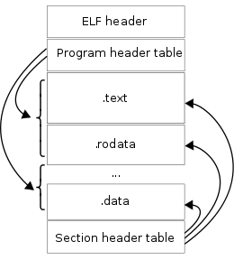

## 调试命令：`disass` 反汇编

6.1~6.4 节讲的是怎么把调试器"架起来"：启动、attach、编译并调试目标，以及进入调试会话。截至 6.4 节，会话里还没有一条真正去看目标程序的命令。从本节开始，我们逐个实现调试会话内的调试命令，第一个是反汇编 `disass`。

反汇编是指令级调试的基础：指令级调试不看源码，看的就是一条条机器指令以及它们在内存里的地址。另外，只有先能看到指令及其地址，后面才能在指定地址处添加断点，所以我们先介绍反汇编。

本节配套代码在 [hitzhangjie/godbgv2](https://github.com/hitzhangjie/godbgv2) 的 tag `ch6.5`，`git diff ch6.4 ch6.5` 可以看到这一节改了什么。

### 实现目标：`godbg> disass [address]` 反汇编机器指令

本节实现 `disass [address]`，address 是可选参数：

- 不带 address：从当前停止位置（PC）开始反汇编；
- 带上 address：从指定地址开始反汇编，地址支持十六进制写法（如 `0x478120`），也支持十进制和 `0` 开头的八进制（后面 `parseAddress` 会介绍）；
- 两种用法都是先解析出一个起始地址，再走**同一套**反汇编处理逻辑，不存在两条分叉的实现路径。

用法如下：

```bash
godbg> disass                          # 从当前停止位置开始，默认 10 条
godbg> disass 0x478120                 # 从 0x478120 开始，默认 10 条
godbg> disass -n 5                     # 只反汇编 5 条
godbg> disass 0x478120 -n 3 -s intel   # 从指定地址开始、3 条、intel 语法
```

反汇编条数由 `-n/--max` 控制，默认 10；汇编语法由 `-s/--syntax` 控制，支持 `go`、`gnu`、`intel` 三种，默认 `gnu`。每条指令输出为三列：

```text
0x478120:	e9 bb c8 ff ff	jmpq 0xffffffffffffc8c4
```

第一列是指令地址，第二列是这条指令的机器码，第三列是反汇编得到的汇编文本。

为了让"不带 address"这种用法成立，本节还要前移一个最小的基础能力：读取被调试进程当前的 PC。命令层得先知道"当前停在哪儿"，才能把它当作反汇编起点。按前面的分层，这个能力要一路补到 `api.Client`、`debugger` 门面和 `pkg/target`。完整的寄存器读取命令（`pregs`）到 6.14 节才实现，这里只补一个 `CurrentPC()`，够本节使用即可。

还要提前说明一点：本节只做反汇编，不涉及断点。断点命令在 6.6 节才实现，所以本节的代码里没有"断点落在反汇编起点上，需要回退 PC 或还原 0xCC"这类处理。断点位置反汇编的原理我们照常讲清楚，但会把"本节代码没有做"的地方标出来。

### 基础知识

#### 反汇编：变长指令的逐条解码

汇编指令和硬件强相关，本质上是一组助记符和操作数，一条汇编指令的操作码、操作数按指令集规定的编码方式编码后，就得到了机器指令。不同指令的操作码、操作数占用字节数可能相同也可能不同，x86 就是典型的变长编码。

变长编码意味着反汇编不能按固定步长往后数，必须一条一条解码：先解出当前这条指令，拿到它占用的字节数，再移动到下一条指令的位置继续解。x86asm 的 `Decode` 返回的 `Inst.Len` 就是当前指令的长度，这是 decode 循环里推进偏移量的依据；一旦遇到解不出来的字节，还要决定是跳过继续还是直接报错。

自己从头实现一套 x86 解码器显然不现实。现成的反汇编方案主要有：

- [Capstone](http://www.capstone-engine.org/)：支持多平台、多指令集的反汇编框架，C 实现；Go 里可以通过 [Gapstone](https://github.com/bnagy/gapstone) 绑定调用；
- Go 官方提供的 [golang.org/x/arch/x86/x86asm](https://pkg.go.dev/golang.org/x/arch/x86/x86asm)：纯 Go 的 x86/x86-64 解码器。流行的 Go 调试器 dlv 也是用它做反汇编的。

godbgv2 选择 x86asm：纯 Go 实现，不用引入 CGO 和额外的动态库，调试器本身的构建和分发都简单；我们只需要解码和格式化，x86asm 的 `Decode`、`GNUSyntax`、`GoSyntax`、`IntelSyntax` 就够用了。

#### 指令数据从哪里来

反汇编的对象是机器指令，指令数据可以从两个地方来：可执行文件，或者目标进程的内存。

**做法一：从可执行文件里读。** 先根据 pid 找到可执行程序。Linux 下虚拟文件系统路径 `/proc/<pid>/exe` 是一个符号链接，指向进程 `<pid>` 对应的可执行程序的绝对路径，Go 程序读取该链接就能拿到路径。Linux 下的可执行文件是 ELF（Executable and Linkable Format）格式，接下来要按 ELF 格式解析这个文件，从 `.text` 里读出机器指令，再逐条 decode。

ELF 文件的大致结构如下所示。要读取、解析 ELF 文件数据，可以借助标准库 `debug/elf`。



一个 ELF 文件由 ELF Header、段头表（Program Header Table）、节头表（Section Header Table）以及一系列的 Section 组成。段头表描述的是加载器眼中的"执行时视图"，节头表描述的是链接器眼中的"链接时视图"，这两种视图的设计细节在 7.2 节《理解ELF文件》中有专门介绍，这里不展开。对反汇编来说，只需要关心一件事：机器指令集中在 `.text` section 里，按 ELF 格式找到它、把数据读出来即可。

这种做法适合离线全量分析，`objdump -d` 这类工具走的就是这条路径；本节要实现的调试器则采用下面的做法二。

**做法二：用 ptrace 直接读目标进程内存。** 这是 godbgv2 采用的做法。tracee 处于停止状态时，调试器可以通过 `ptrace(PTRACE_PEEKTEXT, pid, addr, ...)` 读取目标地址处的数据。Linux 不区分 text 和 data 地址空间，PEEKTEXT 和 PEEKDATA 效果相同，都是读 tracee 的内存。

这个做法简单直接，读到的是进程运行时真实的指令数据，不需要做"文件偏移 → 进程地址"的换算，也不用管 PIE 程序每次运行加载地址不同的问题。它的限制是只能读已经映射的页：调试器平时只关心当前停止位置附近的一小段指令，这段内存一定在（CPU 正停在这里），所以完全够用；如果要全量反汇编整个程序，才需要回到做法一。

> ps：这里说的"PIE 程序每次运行加载地址不同"，背后就是 ASLR（地址空间布局随机化）。对非 PIE 构建的 Go 程序，代码段地址是固定的（本书示例里的 `0x478120` 每次运行都一样），但栈、堆、共享库的地址每次启动都会变化；调试脚本里如果写死了栈变量这类地址，重启后就会失效。ASLR 的原理及其对调试的完整影响，见 [12.8 认识ASLR](../12-appendix/8-aslr.md)。

本节的目标层从起始地址读 1024 字节的窗口，再在这个窗口上逐条解码。为什么是 1024？x86 单条指令最长 15 字节，默认反汇编 10 条指令最多也就 150 字节，1024 字节的窗口绰绰有余；`-n` 数值再大，也只是在这个窗口里多解几条，不会为了反汇编去读更大范围的内存。

#### 断点位置的反汇编（原理，本节尚未实现）

> 这一小节讲的是断点存在时反汇编要额外处理什么。本节代码还没有断点（6.6 节实现），所以这些处理目前都没有做，这里先把原理和后面的实现计划讲清楚。

动态断点往往是通过指令 patch 来实现的，即将任意完整机器指令的第一字节数据保存，然后将其替换成 `0xCC (int 3)` 指令，处理器执行完 0xCC 之后自身就会停下来，这就是断点的效果。

断点通过指令 patch 来实现必须覆盖指令的第一字节，不能覆盖其他字节，原因很简单：指令为了提高解码效率、支持更多操作类型，往往都是采用的变长编码。如果写的不是第一字节，那么处理器执行时可能会产生错误。比如一条指令操作码有多个字节，结果因为覆盖的原因导致变成了一个错误的操作码，执行时就会有异常。再比如一条指令只有一个字节，我们非要写到第二个字节存起来，那就起不到断点的作用，因为执行到这个断点时，前面本不应该执行的一字节指令却执行了。

对于断点指令，我们在《4.2.3 断点与执行控制》进行过介绍；对于指令 patch，不光是调试器中会用到，对于 gomonkey mock 测试框架、软件逆向及破解领域，也是会使用的。

回到反汇编。假定反汇编的起始地址是 `addr`，我们首先需要关注的是 `addr` 处是不是一个指令断点，这决定了接下来两种不同的处理方式：

- **`addr` 处不是断点**：可以直接从 `addr` 开始读取指令数据、逐条 decode；
- **`addr` 处是断点**：`addr` 开始的那条完整指令已经被 patch 过了，从 `addr` 开始反汇编，必须先恢复为原来的指令数据，再做 decode。

```bash
断点添加之前：
addr:  0x?? 0x1 0x2 0x3 0x4

断点添加之后：
addr:  0xcc 0x1 0x2 0x3 0x4   | orig: <addr, 0x??>
```

这里要特别注意，反汇编操作并不是控制程序执行，它只需要把读出来的指令数据缓冲区中的 0xCC 恢复成原来的指令字节即可，不需要通过指令 patch 把 0xCC 写回原数据。等后续 next、continue、step 这些真正影响执行的操作，才需要把内存里的 0xCC 替换回原指令。

那么"当前停止位置"和断点地址又是什么关系？软件断点命中时，CPU 执行的是 `0xCC`，这是一条完整的一字节指令，执行完之后 PC 指向下一条指令，也就是：

```bash
当前停止在断点处：
addr:  0xcc 0x1 0x2 0x3 0x4   | orig: <addr, 0x??>
PC = addr + 1
```

所以对无参的 `disass` 来说，真正要反汇编的起点往往不是 PC，而是 `PC-1`：

- `PC-1` 处是我们下的断点：从 `PC-1` 开始反汇编，并把该处读到的 0xCC 恢复成原始字节；
- `PC-1` 处不是断点：那 PC 本身就是下一条待执行指令的地址，直接从 PC 开始反汇编即可。exec 启动后停在入口、attach 后停在目标线程这些情况，都属于这一类。

这套处理在 godbgv2 里要等 6.6 节实现断点之后才补齐。godbg 的完整实现里，`disass` 提供了 `--clearall` 选项，配合目标层的 `DisassembleWithBreakpointCleared` 扫描反汇编窗口内的所有断点、把缓冲区里的 0xCC 还原成原始字节再反汇编；godbgv2 目前还没有这部分，本节的目标层 `disassembleData` 拿到什么字节就解什么字节。等断点实现之后，我们再回来把 `disass` 的断点处理补上，这与"本节只做反汇编"的范围划分是一致的。

### 在 godbgv2 中实现

前面几节搭好的分层这次不用动：命令层新增 `disass` 子命令，`api.Client` 补两个方法（`CurrentPC`、`Disassemble`），`debugger` 门面转发，`pkg/target` 真正去读寄存器和读内存。相对 ch6.4，这一节的调用链是：

```text
godbg> disass [address]
    cmd/debug/disass.go            RunE：校验 0 或 1 个参数；disassStartAddress 得到起始地址；
                                   调 Client.Disassemble，按三列格式打印结果
    pkg/service/api                Client 接口：新增 CurrentPC；Disassemble 返回 []AsmInstruction
    pkg/service/debugger           门面，把请求转给目标层
    pkg/target                     pc.go：PTRACE_GETREGS 读 RIP
                                   disassemble.go：PTRACE_PEEKTEXT 读内存 + x86asm.Decode
```

命令层后面仍然是 `Client`，`main` 里把它装配成 `debugger.New()`，这个约定没有变。下面按命令层、服务层、目标层分别看。

#### 命令层

`cmd/debug/disass.go` 的完整代码如下：

```go
package debug

import (
	"errors"
	"fmt"

	"github.com/hitzhangjie/godbgv2/pkg/service/api"
	"github.com/spf13/cobra"
)

var disassCmd = &cobra.Command{
	Use:     "disass [address]",
	Short:   "反汇编机器指令（缺省从当前停止位置开始）",
	Aliases: []string{"dis", "disassemble"},
	Annotations: map[string]string{
		cmdGroupAnnotation: cmdGroupSource,
	},
	RunE: func(cmd *cobra.Command, args []string) error {
		if len(args) > 1 {
			return errors.New("usage: disass [address]")
		}

		// 未指定地址时从当前停止位置开始反汇编，指定地址时从该地址开始；
		// 两种情况都是先解析出起始地址，再走同一套反汇编处理逻辑。
		addr, err := disassStartAddress(args)
		if err != nil {
			return err
		}

		max, _ := cmd.Flags().GetUint64("max")
		syntax, _ := cmd.Flags().GetString("syntax")

		var insts []api.AsmInstruction
		insts, err = Client.Disassemble(addr, max, syntax)
		if err != nil {
			return err
		}

		for _, inst := range insts {
			fmt.Printf("%#x:\t% x\t%s\n", inst.Addr, inst.Bytes, inst.Text)
		}
		return nil
	},
}

// disassStartAddress 解析反汇编起始地址：未指定地址时取当前停止位置（PC），
// 指定地址时按参数解析。两种情况得到相同的起始地址语义。
func disassStartAddress(args []string) (uint64, error) {
	if len(args) == 0 {
		pc, err := Client.CurrentPC()
		if err != nil {
			return 0, fmt.Errorf("read current pc err: %v", err)
		}
		return pc, nil
	}

	addr, err := parseAddress(args[0])
	if err != nil {
		return 0, fmt.Errorf("parse address err: %v", err)
	}
	return addr, nil
}

func init() {
	debugRootCmd.AddCommand(disassCmd)

	disassCmd.Flags().Uint64P("max", "n", 10, "反汇编指令数量")
	disassCmd.Flags().StringP("syntax", "s", "gnu", "反汇编指令语法，支持：go, gnu, intel")
}
```

几个要点：

- `Use` 是 `disass [address]`，方括号表示 address 可选；`len(args) > 1` 时返回 usage 错误，也就是只接受 0 个或 1 个参数；
- 起始地址的解析集中在 `disassStartAddress`：没有参数时调 `Client.CurrentPC()` 取当前停止位置，有参数时交给 `parseAddress`。两种来源最终都变成一个 `uint64` 起始地址，后面就只剩一条路径——`Client.Disassemble(addr, max, syntax)`。这正是"无参=当前停止位置、有参=指定地址，两者同一套处理逻辑"在代码上的落点；
- `-n/--max`、`-s/--syntax` 在 `init` 里注册，`RunE` 只负责读取；默认值 10 和 gnu 就是 `help disass` 里显示的值；
- 反汇编本身不在命令层做：命令层拿到的是 `[]api.AsmInstruction` 快照，只负责把每条指令按 `0xADDR:\tBYTES\tTEXT` 三列打印出来。后端不打印、前端只展示，这是贯穿本书的约定；
- 命令还注册了 `dis`、`disassemble` 两个别名，就是 `Use` 下面的 `Aliases`，敲短一点也一样能用。

地址字符串的解析放在 `cmd/debug/address.go`：

```go
package debug

import (
	"fmt"
	"strconv"
)

// parseAddress 将字符串解析为地址值。
//
// 支持 0x 前缀的十六进制（如 0x478120）与十进制（如 4686112），
// 以及 0 前缀的八进制（Go 的 strconv.ParseUint base=0 约定）。
func parseAddress(locStr string) (uint64, error) {
	v, err := strconv.ParseUint(locStr, 0, 64)
	if err != nil {
		return 0, fmt.Errorf("invalid address: %v", err)
	}
	return v, nil
}
```

`strconv.ParseUint(locStr, 0, 64)` 的 base 传 0，表示按字符串前缀推断进制：`0x` 开头按十六进制，`0` 开头按八进制，其余按十进制。所以 `disass 0x478120`、`disass 4686112` 都是合法的；解析失败会返回 `invalid address` 错误。

#### 服务层

`api.Client` 新增了两个方法：`CurrentPC` 给无参 disass 取起点，`Disassemble` 做反汇编并返回指令快照（这里省略了接口文件头部的注释和 `Kind`、`State` 的定义）：

```go
type Client interface {
	// Launch 启动并跟踪一个进程，返回被调试进程 pid
	Launch(kind Kind, cmd string, args ...string) (int, error)
	// State 返回当前调试会话状态
	State() (*State, error)
	// CurrentPC 返回被调试进程当前停止位置的 PC（指令指针）。
	//
	// tracee 处于停止状态时，它就是"当前停下位置"：无参 disass 等
	// 以当前位置为起点的命令据此确定起点。
	CurrentPC() (uint64, error)
	// Kill 终止被调试进程
	Kill() error
	// Attach 跟踪一个正在运行的进程
	Attach(pid int) error
	// Detach 结束调试，分离被调试进程
	Detach() error
	// Disassemble 反汇编地址 addr 处的指令，返回 max 条
	Disassemble(addr, max uint64, syntax string) ([]AsmInstruction, error)
}
```

`CurrentPC` 插在 `State` 之后，注释里写明了它的定位：tracee 处于停止状态时，它返回的就是"当前停下位置"。完整的寄存器读取能力要到 6.14 节 `pregs` 才实现，这里只把"读 PC"这一项最小能力前移，因为无参 disass 现在就需要它。

反汇编结果用 `api.AsmInstruction` 表示，定义在 `pkg/service/api/types.go`：

```go
// AsmInstruction 一条反汇编指令
type AsmInstruction struct {
	Addr  uint64 // 指令地址
	Bytes []byte // 指令机器码
	Text  string // 指令汇编文本
}
```

这里体现了服务层的两条约定：接口只传值、只返回快照（`[]api.AsmInstruction` 一次性返回，不做流式或回调）；后端不打印任何内容，输出格式由命令层决定。

`pkg/service/debugger` 门面只做转发和空指针检查（同一个文件里还有 Launch、Attach、Detach 等方法，本节不涉及，这里省略）：

```go
// CurrentPC 返回被调试进程当前停止位置的 PC（指令指针）
func (d *Debugger) CurrentPC() (uint64, error) {
	if d.dbp == nil {
		return 0, fmt.Errorf("no debugged process")
	}
	return d.dbp.CurrentPC()
}

// Disassemble 反汇编地址 addr 处的指令，返回 max 条
func (d *Debugger) Disassemble(addr, max uint64, syntax string) ([]api.AsmInstruction, error) {
	if d.dbp == nil {
		return nil, fmt.Errorf("no debugged process")
	}
	return d.dbp.Disassemble(addr, max, syntax)
}
```

装配没有变化，`main` 里仍然是 `cmd.Client = debugger.New()`；命令层不需要知道后端换了谁，第 9 章切到 headless RPC 时这一层同样不用改。

#### 目标层：读取当前 PC

`pkg/target/pc.go` 是本节新增的文件，逻辑很短：

```go
package target

import "syscall"

// CurrentPC 返回被调试进程当前停止位置的 PC（指令指针）。
//
// 调试器只会在 tracee 处于停止状态时执行调试命令，此时直接通过
// PTRACE_GETREGS 读取 RIP 即可；ptrace 请求统一经 ExecPtrace 串行执行。
func (p *DebuggedProcess) CurrentPC() (uint64, error) {
	var regs syscall.PtraceRegs
	err := p.ExecPtrace(func() error {
		return syscall.PtraceGetRegs(p.Process.Pid, &regs)
	})
	if err != nil {
		return 0, err
	}
	return regs.PC(), nil
}
```

- 调试器只会在 tracee 处于停止状态时执行调试命令，所以直接 `PTRACE_GETREGS` 读寄存器，拿到的 RIP 就是"当前停止位置"；
- ptrace 请求没有直接裸调 `syscall.PtraceGetRegs`，而是包在 `ExecPtrace` 里。6.1 节讲过 ptrace limit：跟踪关系建立后，所有 ptrace 请求必须来自同一个 tracer 线程，`ExecPtrace` 就是用来保证这一点的；`CurrentPC` 和后面的 `peekMemory` 都走这条路，串行执行，不会互相插队；
- 这里读的是主线程（`p.Process.Pid`）的 RIP。本节示例 `loop` 停在入口时还是单线程，所以够用；多线程程序里"当前停止位置"还要考虑选哪个线程，那是 6.17 节"调试多线程程序"的内容。

#### 目标层：读取指令并反汇编

`pkg/target/disassemble.go` 负责真正干活，核心代码如下（省略了文件头部的 import 和前面的 `DisassembleSingleInstruction`，见下面 ps）：

```go
// Disassemble 反汇编地址addr处的指令，返回max条
func (p *DebuggedProcess) Disassemble(addr, max uint64, syntax string) ([]api.AsmInstruction, error) {
	// 指令数据
	dat := make([]byte, 1024)
	n, err := p.peekMemory(uintptr(addr), dat)
	if err != nil || n == 0 {
		return nil, fmt.Errorf("peek text error: %v, bytes: %d", err, n)
	}

	return p.disassembleData(addr, dat[:n], max, syntax)
}

// disassembleData 在给定的数据上进行反汇编
func (p *DebuggedProcess) disassembleData(addr uint64, data []byte, max uint64, syntax string) ([]api.AsmInstruction, error) {
	insts := []api.AsmInstruction{}

	// 反汇编这里的指令数据
	offset := uint64(0)
	count := uint64(0)

	for count < max && int(offset) < len(data) {
		inst, err := x86asm.Decode(data[offset:], 64)
		if err != nil {
			if err == x86asm.ErrUnrecognized {
				offset++
				continue
			}
			return nil, fmt.Errorf("x86asm decode error: %v", err)
		}

		asm, err := instSyntax(inst, syntax)
		if err != nil {
			return nil, fmt.Errorf("x86asm syntax error: %v", err)
		}

		end := offset + uint64(inst.Len)
		insts = append(insts, api.AsmInstruction{
			Addr:  addr + offset,
			Bytes: data[offset:end],
			Text:  asm,
		})
		offset = end
		count++
	}
	return insts, nil
}

// instSyntax 按指定语法风格格式化一条指令
func instSyntax(inst x86asm.Inst, syntax string) (string, error) {
	asm := ""
	switch syntax {
	case "go":
		asm = x86asm.GoSyntax(inst, uint64(inst.PCRel), nil)
	case "gnu":
		asm = x86asm.GNUSyntax(inst, uint64(inst.PCRel), nil)
	case "intel":
		asm = x86asm.IntelSyntax(inst, uint64(inst.PCRel), nil)
	default:
		return "", fmt.Errorf("invalid asm syntax error")
	}
	return asm, nil
}

// peekMemory 读取内存地址addr处的数据到buf中，返回实际读取的字节数。
// TODO(ch6.13): 将 peekMemory 抽出为 DebuggedProcess.ReadMemory 方法
func (p *DebuggedProcess) peekMemory(addr uintptr, buf []byte) (int, error) {
	var (
		dat int
		err error
	)
	err = p.ExecPtrace(func() error {
		// PtracePeekText 与 PtracePeekData 效果相同
		n, err := syscall.PtracePeekText(p.Process.Pid, addr, buf)
		if err != nil {
			return err
		}
		dat = n
		return nil
	})
	return dat, err
}
```

逐段说明：

- `Disassemble` 只做两件事：从 `addr` 读一段固定 1024 字节的窗口，然后把窗口交给 `disassembleData`。窗口读取失败或一个字节都读不到时，返回 `peek text error`；
- `disassembleData` 是 decode 循环：`count < max && offset < len(data)` 两个条件同时满足才继续；每次 `x86asm.Decode(data[offset:], 64)` 按 64 位模式解码，成功后用 `instSyntax` 转成指定语法，`Bytes` 取 `data[offset:offset+inst.Len]`，`Addr` 是 `addr+offset`，然后 `offset += inst.Len`、`count++`；
- 解码失败分两种：`x86asm.ErrUnrecognized` 表示这段字节不是可识别的指令，跳过一个字节继续（相当于重新同步）；其他错误（比如指令被截断）直接返回。因为默认只解 10 条、窗口有 1024 字节，正常情况下走不到窗口末尾，这个错误分支不容易碰到；
- `instSyntax` 按 `-s` 的取值选择 `GoSyntax`、`GNUSyntax`、`IntelSyntax`，未知取值返回 `invalid asm syntax error`；
- `peekMemory` 把 PEEKTEXT 包进 `ExecPtrace` 执行。注释里的 `TODO(ch6.13)` 说明它后面会抽成正式的 `ReadMemory` 方法，到 6.13 节实现 `pmem` 时补上。

> ps: 目标层还有一个 `DisassembleSingleInstruction`，读 16 字节、decode 一条指令就返回，留给后面需要"单条指令信息"的调试命令使用，本节的反汇编窗口不走它。

### 运行效果

在 godbgv2 仓库里切到这一节，把调试器和 fixture 都构建出来：

```bash
git checkout ch6.5
make build
make fixtures
```

`make build` 产出 `./godbg`，`make fixtures` 把 `examples/debuggee` 下的示例程序编到 `_fixtures/`，编译时带 `-gcflags "all=-N -l"`，不做优化、不做内联，方便调试。本节用 `_fixtures/loop` 做目标程序。

然后 `godbg exec` 启动它，进程会停在 exec 产生的 SIGTRAP 上，接着就可以用 `disass` 反汇编：

```bash
$ ./godbg exec _fixtures/loop
process 1668541 launched, stopped by SIGTRAP
godbg> disass
0x478120:	e9 bb c8 ff ff	jmpq 0xffffffffffffc8c4
0x478125:	cc	int3
0x478126:	cc	int3
0x478127:	cc	int3
0x478128:	cc	int3
0x478129:	cc	int3
0x47812a:	cc	int3
0x47812b:	cc	int3
0x47812c:	cc	int3
0x47812d:	cc	int3
godbg> disass -n 5
0x478120:	e9 bb c8 ff ff	jmpq 0xffffffffffffc8c4
0x478125:	cc	int3
0x478126:	cc	int3
0x478127:	cc	int3
0x478128:	cc	int3
godbg> disass 0x478120 -n 3
0x478120:	e9 bb c8 ff ff	jmpq 0xffffffffffffc8c4
0x478125:	cc	int3
0x478126:	cc	int3
godbg> disass 0x478120 -n 3 -s intel
0x478120:	e9 bb c8 ff ff	jmp 0xffffffffffffc8c4
0x478125:	cc	int3
0x478126:	cc	int3
godbg> disass
0x478120:	e9 bb c8 ff ff	jmpq 0xffffffffffffc8c4
0x478125:	cc	int3
...（共 10 条，语法回到默认的 gnu）
godbg> help disass
反汇编机器指令（缺省从当前停止位置开始）

disass [address]
  -h, --help            help for disass
  -n, --max uint        反汇编指令数量 (default 10)
  -s, --syntax string   反汇编指令语法，支持：go, gnu, intel (default "gnu")
```

观察一下这段输出：

- `_fixtures/loop` 的 ELF 入口地址是 `0x478120`（`readelf -h _fixtures/loop` 里的 Entry point address），exec 启动后初始停止位置就是入口，所以无参 `disass` 和 `disass 0x478120` 的起点一致；入口处是一条 jmp，后面跟着一串 int3 填充；
- `disass` 默认反汇编 10 条，这里就是 1 条 jmp 加 9 条 int3；`disass -n 5` 只输出 5 条；`disass 0x478120 -n 3` 从指定地址开始、输出 3 条。每行三列分别是地址、机器码、汇编文本，用 tab 分隔；
- `-s intel` 切换语法之后，同一条 jmp 从 `jmpq` 变成 `jmp`（gnu/AT&T 风格带操作码后缀）。指令和地址都没有变，变的只是文本呈现；
- `-s intel` 之后再执行一次不带选项的 `disass`，输出回到默认的 10 条、gnu 语法，没有沿用上一条的 `-n 3 -s intel`：6.4 节的 `DebugSession.execute` 会在每条命令执行后复位 flag，选项不会跨命令残留；
- `help disass` 的第一行就是命令的 `Short`；usage 里 `[address]` 的方括号表示地址可选；`-n`、`-s` 的默认值也在这里列出来。

> ps: 细心的读者会注意到 `jmpq` 的目标 `0xffffffffffffc8c4` 不像一个正常地址。这是因为 `x86asm.GNUSyntax(inst, pc, nil)` 要拿到指令自身的地址，才能把 PC 相对跳转的偏移换算成绝对目标；`instSyntax` 里传进去的是 `inst.PCRel`，而 `Inst.PCRel` 表示 PC 相对字段的**长度**（rel32 时是 4），不是偏移量，于是算出来的目标值没有实际意义。这不影响我们查看指令本身和指令地址；真要展示绝对跳转目标，把指令地址传给 `GNUSyntax` 即可。

本节的冒烟脚本 `testdata/script/ch6.5.txt` 内容如下：

```text
# ch6.5 smoke: 反汇编机器指令（address 可选，缺省从当前停止位置开始）
# 地址 0x478120 取自 _fixtures/loop 的 ELF 入口（readelf -h），
# fixture 由固定工具链 go1.24.13 构建，非 PIE 程序地址固定；
# exec 初始停止位置即 ELF 入口，故无参 disass 与 disass 0x478120 结果一致。
disass -n 2
=0x478120:
disass 0x478120 -n 2
=0x478120:
```

`=` 开头的行是冒烟测试的断言，核对紧挨着的上一条 godbg 命令的输出（约定见 6.4 节）。两条命令一条不带 address、一条显式指定入口地址，都断言输出里出现 `0x478120:`，正好把"无参时从当前停止位置开始"这个行为和显式指定地址对齐验证了。运行：

```bash
$ make smoke S=ch6.5
smoke: running testdata/script/ch6.5.txt
smoke: all passed
```

（`make smoke` 会先构建 godbg 和 fixtures，这里的输出省略了构建日志。）

会话退出时会走 6.4 节注册的清理逻辑，exec 启动的 tracee 被 kill，终端上会看到 `tracee is run by tracer, kill it`。

### 更多相关内容

汇编指令有 go、gnu、intel 三种常见风格，gnu 风格的俗称 AT&T 风格。三者只是同一条指令的三种文本写法，语义完全一致；各有各的习惯，比如 gnu 风格寄存器带 `%` 前缀、操作数顺序与 intel 相反。为了方便不同习惯的开发者阅读反汇编结果，disass 用 `-s/--syntax` 来切换，默认 gnu；实现上就是 `instSyntax` 里对 `x86asm.GoSyntax`、`GNUSyntax`、`IntelSyntax` 的选择，语法字符串传错时会返回 `invalid asm syntax error`。

> 换语法只影响"文本怎么写"，不影响指令本身和指令地址，所以 `-n`、`-s` 可以任意组合。

除了调试会话内的即时反汇编，还有一种常见需求是把磁盘上的二进制整体反汇编出来做离线分析：通过 `/proc/<pid>/exe` 找到程序、按 ELF 读出 `.text` 的全部指令再逐条 decode，并且对不认识的指令做跳过处理。它和 godbgv2 的 `disass` 分别代表了前面"指令数据从哪里来"的两种做法——一个面向离线全量分析，一个面向调试会话里即时查看当前指令。godbgv2 只保留后者，离线全量反汇编这里不再展开实现。

完整的实现可以在 godbgv2 仓库的 tag `ch6.5` 下查看，涉及 `cmd/debug/disass.go`、`cmd/debug/address.go`、`pkg/service/api/client.go`、`pkg/service/api/types.go`、`pkg/service/debugger/debugger.go`、`pkg/target/pc.go`、`pkg/target/disassemble.go`。

### 本节小结

本节实现了指令级调试的第一个调试命令 `disass`：

- 支持 `disass [address]`：address 可选，不带地址时从当前停止位置（PC）开始，带地址时从指定地址开始；两种来源都经 `disassStartAddress` 解析成同一个起始地址，再走同一条 `Client.Disassemble(addr, max, syntax)` 处理路径；
- 支持了读取PC寄存器的最小基础能力 `CurrentPC`：`api.Client` 增加接口，`debugger` 门面转发，`pkg/target` 通过 `PTRACE_GETREGS` 读 RIP；完整的寄存器读取留到 6.14 节 `pregs`；
- 反汇编选用 x86asm：变长指令逐条 decode，`Inst.Len` 用来推进偏移量；支持 `-n/--max`（默认 10 条）和 `-s/--syntax`（go/gnu/intel，默认 gnu），输出为 `0xADDR:\tBYTES\tTEXT` 三列；
- 指令数据用 ptrace PEEKTEXT 直接从目标进程内存读（1024 字节窗口），看到的是运行时真实的指令；从 ELF 的 `.text` 全量反汇编则是独立反汇编工具的做法，本节作为背景对照介绍；
- 讲清了断点位置反汇编的原理：0xCC patch 只覆盖指令第一字节，命中断点时 PC 已经指向下一条指令，所以无参 disass 要关注 PC-1、并恢复缓冲区里的原始字节；本节代码还没有断点，这部分留到 6.6 节实现断点之后再补齐（godbg 的完整实现用 `--clearall` 和 `DisassembleWithBreakpointCleared` 兑现该能力）。

下一节我们就在这个基础上实现动态断点：用 `break <address>` 在指定的指令地址处 patch 一个 0xCC，并记录该地址处的原始指令。

### 参考文献

1. What You Need To Know About ELF, https://student.cs.uwaterloo.ca/~cs452/W18/elf/elf.html
2. dissecting go binaries, https://www.grant.pizza/blog/dissecting-go-binaries/
3. how many x86-64 instructions are there anyway, https://stefanheule.com/blog/how-many-x86-64-instructions-are-there-anyway/
4. golang.org/x/arch/x86/x86asm, https://pkg.go.dev/golang.org/x/arch/x86/x86asm
5. Capstone disassembly framework, http://www.capstone-engine.org/
