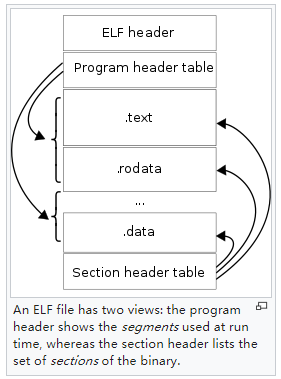

## 认识ELF文件

上一节跟着 `go build` 把编译、汇编、打包、链接走了一遍。链接器生成的可执行程序就是 ELF 文件；调试器后面要用的符号表、DWARF、`.note.go.buildid`，都在这个文件里。本节先从文件结构看起。

ELF ([Executable and Linkable Format](https://en.wikipedia.org/wiki/Executable_and_Linkable_Format))，可执行可链接格式，是Unix、Linux环境下一种十分常见的文件格式，它可用于可执行程序、目标文件、共享库、core文件等。

### ELF文件结构

ELF文件结构如下图所示，包括ELF文件头 (ELF Header)、段头表 (Program Header Table)、节头表 (Section Header Table)、Sections。Sections位于段头表和节头表之间，并被段头表和节头表引用。



* **文件头**：ELF文件头 (ELF FIle Header)，其描述了当前ELF文件的类型（可执行程序、可重定位文件、动态链接文件、core文件等）、32位/64位寻址、ABI、ISA、程序入口地址、Program Header Table起始地址及元素大小、Section Header Table起始地址及元素大小，等等。
* **段头表**：段头表定义了程序的“**执行时视图**”，描述了如何创建程序的进程映像。每个表项定义了一个“段 (segment)” ，每个段引用了0、1或多个sections。段有类型，如PT_LOAD表示该段引用的sections需要在运行时被加载到内存。段头表主要是为了指导加载器进行加载。
  举个例子，.text section隶属于一个Type=PT_LOAD的段，意味着会被加载到内存；并且该段的权限为RE（Read+Execute），意味着指令部分加载到内存后，进程对这部分区域的访问权限为“读+可执行”。加载器 (loader /lib64/ld-linux-x86-64.so) 应按照段定义好的虚拟地址范围、权限，将引用的sections加载到进程地址空间中指定位置，并设置好对应的读、写、执行权限（vm_area_struct.vm_flags)。
* **节头表**：节头表定义了程序的“**链接时视图**”，描述了二进制可执行文件中包含的每个section的位置、大小、类型、链接顺序，等等，主要目的是为了指导链接器进行链接。
  举个例子，项目包含多个源文件，每个源文件是一个编译单元，每个编译单元最终会生成一个目标文件(*.o)，每个目标文件都是一个ELF文件，都包含自己的sections。链接器是将依赖的目标文件和库文件的相同section进行合并（如所有*.o文件的.text合并到一起），然后将符号引用解析成正确的偏移量或者地址。
* **Sections**：ELF文件中的sections数据，夹在段头表、节头表之间，由段头表、节头表引用。不同程序中包含的sections数量是不固定的：有些编程语言会有特殊的sections来支持对应的语言运行时层面的功能，如go .gopclntab, gosymtab；程序采用静态链接、动态链接生成的sections也会不同，如动态链接往往会生成.got, .plt, .rel.text。

下面，我们我们对每个部分进行详细介绍。

### 文件头（ELF File Header）

#### 类型定义

每个解析成功的ELF文件，对应着go标准库类型 debug/elf.File，包含了文件头 FileHeader、Sections、Progs：

```go
// A File represents an open ELF file.
type File struct {
	FileHeader
	Sections    []*Section
	Progs       []*Prog
	...
}

// A FileHeader represents an ELF file header.
type FileHeader struct {
	Class      Class
	Data       Data
	Version    Version
	OSABI      OSABI
	ABIVersion uint8
	ByteOrder  binary.ByteOrder
	Type       Type
	Machine    Machine
	Entry      uint64
}
```

注意，go标准库FileHeader比man手册中ELF file header少了几个解析期间有用的字段，为了更全面理解文件头各字段的作用，来看下man 手册中的定义：

```c
#define EI_NIDENT 16

typedef struct {
    unsigned char e_ident[EI_NIDENT];
    uint16_t      e_type;
    uint16_t      e_machine;
    uint32_t      e_version;
    ElfN_Addr     e_entry;
    ElfN_Off      e_phoff;
    ElfN_Off      e_shoff;
    uint32_t      e_flags;
    uint16_t      e_ehsize;
    uint16_t      e_phentsize;
    uint16_t      e_phnum;
    uint16_t      e_shentsize;
    uint16_t      e_shnum;
    uint16_t      e_shstrndx;
} ElfN_Ehdr;
```

- e_ident[EI_NIDENT]
  - EI_MAG0: 0x7f
  - EI_MAG1: E
  - EI_MAG2: L
  - EI_MAG3: F
  - EI_Class: 寻址类型（32位寻址 or 64位寻址）；
  - EI_Data: 处理器特定的数据在文件中的编码方式（小端还是大端）；
  - EI_VERSION: ELF规范的版本；
  - EI_OSABI: 该二进制面向的OS以及ABI（sysv，hpux，netbsd，linux，solaris，irix，freebsd，tru64 unix，arm，stand-alone（embeded）；
  - EI_ABIVERSION: 该二进制面向的ABI版本（相同OSABI可能有不兼容的多个ABI版本）；
  - EI_PAD: 这个位置开始到最后EI_NIDENT填充0，读取时要忽略；
  - EI_NIDENT: e_ident数组长度；
- e_type: 文件类型（可重定位文件、可执行程序、动态链接文件、core文件等）；
- e_machine: 机器类型（386，spark，ppc，etc）；
- e_version: 文件版本；
- e_entry: 程序入口地址（如果当前文件没有入口地址，就填0）；
- e_phoff: 段头表相对当前文件开头的偏移量；
- e_shoff: 节头表相对当前文件开头的偏移量；
- e_flags: 处理器特定的flags；
- e_ehsize: ELF文件头部结构体大小；
- e_phentsize: 段头表中每个条目占用的空间大小；
- e_phnum: 段头表中的条目数量；
- e_shentsize: 节头表中每个条目占用的空间大小；
- e_shnum: 节头表中的条目数量；
- e_shstrndx: 存储了节名字的节在节头表中的索引 (可能是.strtab或者.shstrtab)；

> ps：ELF文件头其他字段都比较容易懂，关于.shstrtab，它的数据存储与.strtab雷同，只是它用来存section名 (man手册显示.strtab除了可以存储符号名，也可以存储Section名)。
>
> **String Table (.strtab section)**
>
> | Index        | +0     | +1     | +2    | +3    | +4     | +5     | +6     | +7    | +8    | +9    |
> | ------------ | ------ | ------ | ----- | ----- | ------ | ------ | ------ | ----- | ----- | ----- |
> | **0**  | `\0` | `n`  | `a` | `m` | `e`  | `.`  | `\0` | `V` | `a` | `r` |
> | **10** | `i`  | `a`  | `b` | `l` | `e`  | `\0` | `a`  | `b` | `l` | `e` |
> | **20** | `\0` | `\0` | `x` | `x` | `\0` | ` ` |        |       |       |       |
>
> 假定有上述.strtab，那么idx=0对应的字符串为none，idx=1的对应着字符串为“name.”，idx=7的对应的字符串为“Variable”。对于.shstrtab，它的存储方式与.strtab相同，但是存储的是所有节的名字，而节的名字在.shstrtab中的索引由Elf32/Elf64_Shdr.s_name来指定。

### 段头表 (Program Header Table)

段头表 (Program Header Table)，可以理解为程序的执行时视图（executable point of view），主要用来指导loader如何加载。从可执行程序角度来看，进程运行时需要了解如何将程序中不同部分，加载到进程虚拟内存地址空间中的不同区域。Linux下进程地址空间的内存布局，大家并不陌生，如data段、text段，每个段包含的信息其实是由段头表预先定义好的，包括在虚拟内存空间中的位置，以及段中应该包含哪些sections数据，以及它们的读写执行权限。

#### 类型定义

段头表当然就是一个数组了，我们看看其中每个“段”的定义：

```c
typedef struct {
    uint32_t   p_type;
    Elf32_Off  p_offset;
    Elf32_Addr p_vaddr;
    Elf32_Addr p_paddr;
    uint32_t   p_filesz;
    uint32_t   p_memsz;
    uint32_t   p_flags;
    uint32_t   p_align;
} Elf32_Phdr;

typedef struct {
    uint32_t   p_type;
    uint32_t   p_flags;
    Elf64_Off  p_offset;
    Elf64_Addr p_vaddr;
    Elf64_Addr p_paddr;
    uint64_t   p_filesz;
    uint64_t   p_memsz;
    uint64_t   p_align;
} Elf64_Phdr;
```

下面详细解释下，上面两个结构分别是面向32位、64位系统下的结构体，其字段含义如下：

- p_type: 段类型
  - PT_NULL: 该表想描述了一个undefined的段，可以忽略；
  - PT_LOAD: 该表项描述了一个可加载的段；
  - PT_DYNAMIC: 该表项描述了一个动态链接信息；
  - PT_INTERP: 该表项指定了一个interpreter的路径；
  - PT_NOTE: 该表项指定了notes的位置；
  - PT_SHLIB: 该类型被保留，但语义未指定。包含这个类型的段表项的程序不符合ABI规范；
  - PT_PHDR: 该表项指定了段头表本身的位置和size；
  - PT_LOPROC, PT_HIPROC: 该表项指定了一个范围[PT_LOPROC, PTHIPROC]，这个范围内数据用来保存处理特定机制信息；
  - PT_GNU_STACK: GNU扩展，Linux内核使用该字段来p_flags中设置的Stack的状态；TODO
- p_offset: 表示该段相对于文件开头的偏移量；
- p_vaddr: 表示该段数据加载到内存后的虚拟地址；
- p_paddr: 表示该段在内存中加载的物理地址；
- p_filesz: 表示该段在文件中占用的大小；
- p_memsz: 表示该段在内存中占用的大小；
- p_flags: 表示该段的属性，以位掩码的形式：
  - PF_X: 可执行；
  - PF_W: 可写；
  - PF_R: 可读；
- p_align: 表示该段对齐方式；

> 注意，又是一些术语使用不够严谨可能导致理解偏差的地方：
>
> - 内存地址空间中的内存布局，代码所在区域我们常称为代码段（code segment, CS寄存器来寻址）or 文本段（text segment），数据段我们也常称为数据段（data segment，DS寄存器来寻址）。
> - 内存布局中的上述术语text segment、data segment，不是ELF文件中的.text section和.data section，注意区分。
>
> 下面的段头表定义给出了一个这样的示例，text segment其实包含了.text section以及其他sections，data segment其实也包含了.data section以外的其他sections。
>
> ```bash
> // text segment，段索引02，可以看到包含了.text等其他sections
> LOAD        0x0000000000000000 0x0000000000400000 0x0000000000400000
>             0x0000000000000a70 0x0000000000000a70  R E    0x200000
>
> // data segment，段索引03，可以看到包含了.data等其他sections
> LOAD        0x0000000000000df0 0x0000000000600df0 0x0000000000600df0
>             0x000000000000025c 0x0000000000000260  RW     0x200000
>
> 02     .interp .note.ABI-tag .note.gnu.build-id .gnu.hash .dynsym .dynstr .gnu.version .gnu.version_r .rela.dyn .rela.plt .init .plt .text .fini .rodata
> 03     .init_array .fini_array .dynamic .got .got.plt .data .bss
> ```

#### 工具演示

下面这个程序用来看完整段头表。`loop2.go`：

```go
package main

import "fmt"
import "os"
import "time"

func init() {
	go func() {
		for {
			fmt.Println("main.func1 pid:", os.Getpid())
			time.Sleep(time.Second)
		}
	}()
}
func main() {
	pid := os.Getpid()
	for {
		fmt.Println("main.main pid:", pid)
		time.Sleep(time.Second * 3)
	}
}
```

`go.mod` 写成 `module loop2`、`go 1.24`。构建：

```bash
$ CGO_ENABLED=0 GOOS=linux GOARCH=amd64 go build -trimpath -gcflags='all=-N -l' -o loop2 loop2.go
```

运行 `readelf -l loop2` 查看其段头表，共有6个表项，每个段定义包含了类型、在虚拟内存中的地址、读写执行权限，以及引用的sections。通过 `Section to Segment mapping: Segment Sections...`部分可以看到：

- 编号00是 PHDR，编号05是 GNU_STACK，这两项没有引用 section；
- text segment（编号02的segment其Flags为R+E，表示可读可执行，这就是text segment）包含了如下sections `.text .note.gnu.build-id .note.go.buildid`；
- rodata segment (编号03的segment其Flags为R，表示只读，就是rodata segment) 包含了 `.rodata .typelink .itablink .gosymtab .gopclntab` 这些go运行时需要的数据；
- data segment (编号04的segment其Flags为RW，表示可读可写，就是data segment) 包含了 `.go.buildinfo .go.fipsinfo .noptrdata .data .bss .noptrbss`；

> ps：下面的 `readelf -l` 和 `readelf -W -S` 是同一次构建的输出。go1.24.13，linux/amd64。不加 `-W` 时，超过 16 个字符的节名会被截断。

```bash
$ readelf -l loop2

Elf file type is EXEC (Executable file)
Entry point 0x478120
There are 6 program headers, starting at offset 64

Program Headers:
  Type           Offset             VirtAddr           PhysAddr
                 FileSiz            MemSiz              Flags  Align
  PHDR           0x0000000000000040 0x0000000000400040 0x0000000000400040
                 0x0000000000000150 0x0000000000000150  R      0x1000
  NOTE           0x0000000000000f78 0x0000000000400f78 0x0000000000400f78
                 0x0000000000000064 0x0000000000000064  R      0x4
  LOAD           0x0000000000000000 0x0000000000400000 0x0000000000400000
                 0x00000000000b1fd1 0x00000000000b1fd1  R E    0x1000
  LOAD           0x00000000000b2000 0x00000000004b2000 0x00000000004b2000
                 0x00000000000aed10 0x00000000000aed10  R      0x1000
  LOAD           0x0000000000161000 0x0000000000561000 0x0000000000561000
                 0x0000000000009f80 0x000000000002dca0  RW     0x1000
  GNU_STACK      0x0000000000000000 0x0000000000000000 0x0000000000000000
                 0x0000000000000000 0x0000000000000000  RW     0x8

 Section to Segment mapping:
  Segment Sections...
   00     
   01     .note.go.buildid 
   02     .text .note.gnu.build-id .note.go.buildid 
   03     .rodata .typelink .itablink .gosymtab .gopclntab 
   04     .go.buildinfo .go.fipsinfo .noptrdata .data .bss .noptrbss 
   05     
```

一个section中数据最终会不会被加载到内存，也是由引用它的段的类型决定：PT_LOAD类型会被加载到内存，反之不会。

以上面的go程序demo为例：

1）.gosymtab、.gopclntab所属的段（段索引值 03）类型是PT_LOAD，表示其数据会被加载到内存，这是因为go runtime依赖这些信息来计算stacktrace，比如 `runtime.Caller(skip)` 或者panic时 `runtime.Stack(buf)`。

2）而.note.go.buildid所属的段（段索引 01）为NOTE类型，只看这个段的话，section .note.go.buildid不会被加载到内存，但是

3）注意到.note.go.buildid还被下面这个段索引为02、PT_TYPE=LOAD的段引用，那这个section最终就会被加载到内存中。

> ps: 一般情况下，.note.* 这种sections就是给一些外部工具读取使用的，一般不会被加载到内存中，除非go设计者希望能从进程内存中直接读取到这部分信息，或者希望core转储时能包含这些信息以供后续提取使用。

本章稍后的章节，会继续介绍ELF段头表信息如何指导loader加载程序数据到内存，以构建进程映像。

### 节头表 (Section Header Table)

每个编译单元生成的目标文件（ELF格式），将代码和数据划分成不同sections，如指令在.text、只读数据在.rodata、可读写数据在.data、其他vendor自定义sections，等等，实现了对不同数据的合理组织。

在此基础上，节头表 (Section Header Table)，定义了程序的链接视图（the linkable point of view），用来指导linker如何对多个编译单元中的sections进行链接（合并相同sections、符号解析、重定位）。

这里就不得不提共享库类型：静态共享库（俗称静态链接库）、动态共享库（俗称动态链接库）。静态共享库，可以理解成包含了多个*.o文件；动态共享库，相当于把相同sections合并，merging not including \*.o 文件。链接生成最终的可执行程序的时候也是要将相同sections进行合并。至于更多的一些细节，此处先不展开。

#### 类型定义

节头表其实就是一系列section表项的数组，我们来看看其中每个描述表项的定义，section数据可根据其中地址、size来读取。

```c
typedef struct {
    uint32_t   sh_name;
    uint32_t   sh_type;
    uint32_t   sh_flags;
    Elf32_Addr sh_addr;
    Elf32_Off  sh_offset;
    uint32_t   sh_size;
    uint32_t   sh_link;
    uint32_t   sh_info;
    uint32_t   sh_addralign;
    uint32_t   sh_entsize;
} Elf32_Shdr;

typedef struct {
    uint32_t   sh_name;
    uint32_t   sh_type;
    uint64_t   sh_flags;
    Elf64_Addr sh_addr;
    Elf64_Off  sh_offset;
    uint64_t   sh_size;
    uint32_t   sh_link;
    uint32_t   sh_info;
    uint64_t   sh_addralign;
    uint64_t   sh_entsize;
} Elf64_Shdr;
```

上面分别是32位、64位的定义，下面详细解释下每个字段的含义:

- sh_name: section name的偏移量，即section的名字在.strtab中的偏移量；
- sh_type: section类型
  - SHT_NULL: 空section，不包含任何数据；
  - SHT_PROGBITS: 代码段、数据段；
  - SHT_SYMTAB: 符号表；
  - SHT_STRTAB: 字符串表；
  - SHT_RELAG: 重定位表；
  - SHT_HASH: 符号hash表；
  - SHT_DYNAMIC: 动态链接表；
  - SHT_NOTE: 符号注释；
  - SHT_NOBITS: 空section，不包含任何数据；
  - SHT_REL: 重定位表；
  - SHT_SHLIB: 预留但是缺少明确定义；
  - SHT_DYNSYM: 动态符号表；
  - SHT_LOPROC, SHT_HIPROC: 定义了一个范围[SHT_LOPROC, SHT_HIPROC]用于处理器特定机制；
  - SHT_LOUSER, SHT_HIUSER: 定义了一个范围[SHT_LOUSER, SHT_HIPROC]预留给给应用程序；
- sh_flags: section标志位
  - SHF_WRITE: 进程执行期间可写；
  - SHF_ALLOC: 进程执行期间需要分配并占据内存；
  - SHF_EXECINSTR: 包含进程执行期间的指令数据；
  - SHF_MASKPROC: 预留给处理器相关的机制；
- sh_addr: 如果当前section需要被加载到内存中，表示在内存中的虚拟地址；
- sh_offset: 表示当前section相对文件开头的偏移量；
- sh_size: section大小；
- sh_link: 表示要链接的下一个节头表的索引，用于section链接顺序；
- sh_info: section额外信息，具体解释依赖于sh_type；
- sh_addralign: 对齐方式；
- sh_entsize: 表示每个section的大小；

#### 工具演示

OK，还是这个 loop2，我们来看下其链接器角度的视图，可以看到其包含了25个sections，每个section都有类型、偏移量、大小、链接顺序、对齐等信息，用以指导链接器完成链接操作。

```bash
$ readelf -W -S loop2
There are 25 section headers, starting at offset 0x190:

Section Headers:
  [Nr] Name              Type            Address          Off    Size   ES Flg Lk Inf Al
  [ 0]                   NULL            0000000000000000 000000 000000 00      0   0  0
  [ 1] .text             PROGBITS        0000000000401000 001000 0b0fd1 00  AX  0   0 32
  [ 2] .rodata           PROGBITS        00000000004b2000 0b2000 036456 00   A  0   0 32
  [ 3] .typelink         PROGBITS        00000000004e8460 0e8460 0007a0 00   A  0   0 32
  [ 4] .itablink         PROGBITS        00000000004e8c00 0e8c00 000070 00   A  0   0 32
  [ 5] .gosymtab         PROGBITS        00000000004e8c70 0e8c70 000000 00   A  0   0  1
  [ 6] .gopclntab        PROGBITS        00000000004e8c80 0e8c80 078090 00   A  0   0 32
  [ 7] .go.buildinfo     PROGBITS        0000000000561000 161000 000110 00  WA  0   0 16
  [ 8] .go.fipsinfo      PROGBITS        0000000000561120 161120 000078 00  WA  0   0 32
  [ 9] .noptrdata        PROGBITS        00000000005611a0 1611a0 004e22 00  WA  0   0 32
  [10] .data             PROGBITS        0000000000565fe0 165fe0 004f92 00  WA  0   0 32
  [11] .bss              NOBITS          000000000056af80 16af80 020290 00  WA  0   0 32
  [12] .noptrbss         NOBITS          000000000058b220 18b220 003a80 00  WA  0   0 32
  [13] .debug_abbrev     PROGBITS        0000000000000000 16b000 000157 00   C  0   0  1
  [14] .debug_line       PROGBITS        0000000000000000 16b157 01a116 00   C  0   0  1
  [15] .debug_frame      PROGBITS        0000000000000000 18526d 009a12 00   C  0   0  1
  [16] .debug_gdb_scripts PROGBITS        0000000000000000 18ec7f 000018 00      0   0  1
  [17] .debug_info       PROGBITS        0000000000000000 18ec97 036768 00   C  0   0  1
  [18] .debug_loc        PROGBITS        0000000000000000 1c53ff 019c77 00   C  0   0  1
  [19] .debug_ranges     PROGBITS        0000000000000000 1df076 003e0f 00   C  0   0  1
  [20] .note.gnu.build-id NOTE            0000000000400fdc 000fdc 000024 00   A  0   0  4
  [21] .note.go.buildid  NOTE            0000000000400f78 000f78 000064 00   A  0   0  4
  [22] .shstrtab         STRTAB          0000000000000000 20bf55 000127 00      0   0  1
  [23] .symtab           SYMTAB          0000000000000000 1e2e88 013698 18     24 102  8
  [24] .strtab           STRTAB          0000000000000000 1f6520 015a35 00      0   0  1
Key to Flags:
  W (write), A (alloc), X (execute), M (merge), S (strings), I (info),
  L (link order), O (extra OS processing required), G (group), T (TLS),
  C (compressed), x (unknown), o (OS specific), E (exclude),
  D (mbind), l (large), p (processor specific)
```

### 节 (Sections)

#### 类型定义

这里的section指的就是ELF section里面的数据了，就是一堆bytes，它由节头表、段头表来引用。比如节头表表项中有地址、size指向对应的某块section数据。

#### 常见的节

ELF文件会包含很多的sections，前面给出的测试实例中就包含了25个sections。先了解些常见的sections的作用，为后续加深对linker、loader、debgguer工作原理的认识提前做点准备。

- .text: 编译好的程序指令；
- .rodata: 只读数据，如程序中的常量字符串；
- .data：已经初始化的全局变量；
- .bss：未经初始化的全局变量，在ELF文件中只是个占位符，不占用实际空间；
- .symtab：符号表，每个可重定位文件都有一个符号表，存放程序中定义的全局函数和全局变量的信息，注意它不包含局部变量信息，局部非静态变量由栈来管理，它们对链接器符号解析、重定位没有帮助。
- .debug_*: 调试信息，调试器读取该信息以支持符号级调试（如gcc -g生成，go build默认生成）；
- .strtab：字符串表，包括.symtab和.[z]debug_*节引用的字符串值、section名；
- .rel.text：一个.text section中引用的位置及符号列表，当链接器尝试把这个目标文件和其他文件链接时，需要对其中符号进行解析、重定位成正确的地址；
- .rel.data：引用的一些全局变量的位置及符号列表，和.rel.text有些类似，也需要符号解析、重定位成正确的地址；

如果您想了解更多支持的sections及其作用，可以查看man手册：`man 5 elf`，这里我们就不一一列举了。

#### 自定义节

ELF也支持自定义sections，如go语言添加了.gosymtab、.gopclntab、.note.build.id来支持go运行时、go工具链的一些操作。

#### 工具演示

这里我们来简单介绍下如何查看sections中的内容：

- 以字符串形式打印：`readelf --string-dump=<section> <prog>`；
- 以十六进制数打印：`readelf --hex-dump=<section> <prog>`；
- 打印前先完成重定位，再以十六进制打印：`readelf --relocated-dump=<section> <prog>`；
- 打印DWARF调试信息：`readelf --debug-dump=<section> <prog>`；

以go语言为例，首先 `go tool buildid <prog>`提取buildid信息，这个其实就是存储在.note.go.buildid section中的。来验证下，首先通过 `go tool buildid`来提取buildid信息：

```bash
$ go tool buildid testdata/loop
_Iq-Pc8WKArkKz99o-e6/6mQTe-5rece47rT9tQco/8IOigl4fPBb3ZSKYst1T/QZmo-_A8O3Ec6NVYEn_1
```

接下来通过 `readelf --string-dump=.note.go.buildid <prog>`直接读取ELF文件中的数据：

```bash
$ readelf --string-dump=.note.go.buildid testdata/loop
String dump of section '.note.go.buildid':
  [     4]  S
  [     c]  Go
  [    10]  _Iq-Pc8WKArkKz99o-e6/6mQTe-5rece47rT9tQco/8IOigl4fPBb3ZSKYst1T/QZmo-_A8O3Ec6NVYEn_1
```

结果发现buildid数据是一致的，证实了我们上述判断。

本节ELF内容就先介绍到这里，在此基础上，接下来我们将循序渐进地介绍linker、loader、debugger的工作原理。

### 本节小结

本文较为详细地介绍了ELF文件结构，介绍了ELF文件头、段头表、节头表的定义，以及通过实例演示了段头表、节头表对节的引用，以及如何通过readelf命令进行查看。我们还介绍了一些常见的节的作用，go语言中为了支持高级特性自主扩展的一些节。读完本节内容后相信读者已经对ELF文件结构有了一个初步的认识。

接下来，我们将介绍符号表、符号的内容，这里先简单提一下。说起符号，ELF .symtab、DWARF .debug_* sections都提供了“符号”信息，编译过程中会记录下来有哪些符号，链接器连接过程中会决定将上述哪些符号生成到.symtab，以及哪些调试类型的符号需要生成信息到.debug_* sections。现在来看.debug_* sections是专门为调试准备的，是链接器严格按照DWARF标准、语言设计、和调试器约定来生成的，.symtab则主要包含链接器符号解析、重定位需要用到的符号。.symtab中其实也可以包含用于支持调试的符号信息，主要看链接器是个什么策略。

比如，gdb作为一款诞生年代很久的调试器，就非常依赖.symtab中的符号信息来进行调试。DWARF是后起之秀，尽管gdb现在也逐渐往DWARF上去靠，但是为了兼容性（如支持老的二进制调试、工具链）还是会保留利用符号表调试的实现方式。如果想让gdb也能调试go程序，就得了解gdb的工作机制，在.symtab, .debug_\* sections中生成其需要的信息，see：[GDB为什么同时使用.symtab和DWARF](./92-why-gdb-uses-symtab.md)。

### 参考文献

1. Executable and Linkable Format, https://en.wikipedia.org/wiki/Executable_and_Linkable_Format
2. How to Fool Analysis Tools, https://tuanlinh.gitbook.io/ctf/golang-function-name-obfuscation-how-to-fool-analysis-tools
3. Go 1.2 Runtime Symbol Information, Russ Cox, https://docs.google.com/document/d/1lyPIbmsYbXnpNj57a261hgOYVpNRcgydurVQIyZOz_o/pub
4. Some notes on the structure of Go Binaries, https://utcc.utoronto.ca/~cks/space/blog/programming/GoBinaryStructureNotes
5. Buiding a better Go Linker, Austin Clements, https://docs.google.com/document/d/1D13QhciikbdLtaI67U6Ble5d_1nsI4befEd6_k1z91U/view
6. Time for Some Function Recovery, https://www.mdeditor.tw/pl/2DRS/zh-hk
7. Computer System: A Programmer's Perspective, Randal E.Bryant, David R. O'Hallaron, p450-p479
8. 深入理解计算机系统, 龚奕利 雷迎春 译, p450-p479
9. Learning Linux Binary Analysis, Ryan O'Neill, p14-15, p18-19
10. Linux二进制分析, 棣琦 译, p14-15, p18-19
11. 字符串表示例, https://refspecs.linuxbase.org/elf/gabi4+/ch4.strtab.html
12. Introduction of Shared Libraries, https://medium.com/@hitzhangjie/introduction-of-shared-libraries-df0f2299784f
