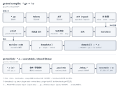

## 符号表和符号

在 "认识ELF文件" 一节中，我们有介绍过ELF文件中常见的一些section及其作用，本节我们重点讲述符号表及符号。

### 生成过程

尽管这部分知识是非常有价值的，但是仍然难免感觉有些枯燥。OK，那我们换个讲解思路，我们先不介绍那些枯燥的符号表格式、符号类型定义，先看看Go编译工具链中符号表是如何生成的吧。

为了方便大家理解，我画了下面这张流程图，包括了 `go tool compile` 的工作过程，以及与生成符号信息相关的 `go tool link` 的关键步骤。大家如果想查看源码，可以参考此流程来阅读。



**go编译器的具体工作：**

- 会接受go源文件作为输入，
- 然后读取源文件进行词法分析得到一系列tokens，
- 进而进行语法分析（基于grammar进行规约）得到AST，
- 然后基于AST进行类型检查，
- 类型检查无误后开始执行函数编译（buildssa、代码优化、生成plist、转换为平台特定机器码），
- 最后将结果输出到目标文件中（*.o 文件）。

这里的*.o文件实际上是一个ar文件（通过 `file *.o` 可以求证），并不是大家熟悉的gcc生成的ELF *.o 文件。这种实现思路是go团队借鉴plan9项目的目标文件格式。每个编译单元对应的 *.o 文件包括了两部分数据：一部分是compiler object file，一部分是linker object file。`go tool compile` 默认把这两部分写进同一个 ar，`ar -t` 看到的成员是 `__.PKGDEF` 和 `_go_.o`。只指定编译选项 `-o` 只写 compiler object file，指定了选项 `-linkobj` 后才会拆成两个文件，它指定了 linker object file 要写到的文件。

> ps: 分布式构建（比如 bazel）会这样拆开，后续编译只拿 compiler object file，链接时才用 linker object file。

跟符号处理相关的一部分任务，编译器compiler还会在输出的目标文件 *.o 中记录一些将来由链接器linker处理的符号信息，这些信息就是一份LSym列表。内存里的LSym列表，经 `WriteObjFile` 写成goobj格式的符号表（从单独一行`!`之后开始，魔数是`\x00go120ld`）。最终落盘的是这张符号表。`go tool nm` 读的就是这份goobj格式的符号表。而ar文件中的 `__.PKGDEF` 是包导出数据，给后面编译别的包用。

```go
// An LSym is the sort of symbol that is written to an object file.
// It represents Go symbols in a flat pkg+"."+name namespace.
type LSym struct {
	Name string
	Type objabi.SymKind
	Attribute

	Size   int64
	Gotype *LSym
	P      []byte
	R      []Reloc

	Extra *interface{} // *FuncInfo, *VarInfo, *FileInfo, or *TypeInfo, if present

	Pkg    string
	PkgIdx int32      // <<<=== look，这里还需要记录包名信息
	SymIdx int32
}
```

这些LSym符号信息，从源码视角来看，其实就是编译器处理过程中识别到的各类pkg.name（如变量、常量、类型、别名、函数等等），这里的符号如果类型为 `LSym.Type=SDWARF*`（如 `SDWARFVAR`、`SDWARFRANGE` 等），表示这是一个调试符号，链接器linker要识别并处理。

**go链接器的具体工作：**

- 除了合并来自多个目标文件中的同名 section（如 .text、.rodata、.data、.bss）之外，
- 还需要完成符号解析、重定位（输入可能还包含其他共享库，这里暂时不做发散），
- 在内部逐渐建立起一个全局符号表，并基于它完成本次链接的符号解析与重定位，以及死代码消除（dead code elimination，见 [Dead Code Elimination: A Linker&#39;s Perspective](https://medium.com/p/d098f4b8c6dc)）这类全局优化，
- 把符号名和地址写入可执行程序（ET_EXEC，`-buildmode=pie` 构建时是 ET_DYN）或共享库的 .symtab，并把动态链接要用的符号筛选出来写入 .dynsym，
- 生成 .gopclntab 等运行时需要的元数据，以及 DWARF 调试信息，
- 生成最终的可执行程序或者共享库，

OK，这里我们就先不发散太多……前面编译器将LSym列表写入到目标文件之后，Linker就需要读取出来，利用它完成符号解析、重定位相关的工作。跨编译单元的符号引用（函数、全局变量、类型、itab 等）由这次链接建立的全局符号表完成解析。另外，对那些调试类符号（`LSym.Type` 为 `SDWARF*`，在 goobj 里通常表现为 `go:info.*`、`go:cuinfo.*` 这类名字），编译器先写入目标文件的只是中间形式，linker 需要按 DWARF 标准合并各编译单元的内容、补全类型描述并完成重定位，最终落到 .debug_info、.debug_line、.debug_frame 等 section 中，方便后续调试器读取。

OK，前面介绍了编译器、链接器之间的协作，最终在可执行程序或者共享库中生成符号表、DWARF调试信息的过程。这里以go编译工具链为例，也是为了让大家多认识下go的方方面面。其他语言编译工具链的处理流程、目标文件的格式等等存在不同之处，但是整体来看是相近的，我们就不再继续发散了。感兴趣的读者可以带着这些框架去搜索下对应的资料。OK，接下来我们再来介绍下符号表、符号的相关内容，读者认识就更全面了。

> go团队设计实现的时候为了更好地进行优化，并没有直接使用ELF格式作为目标文件的格式，而是采用了一种借鉴自plan9目标文件格式的自定义格式。因此go tool compile生成的目标文件，是没法像gcc编译生成的目标文件一样被readelf、nm、objdump等之类的工具直接读取的。尽管go团队并没有公开详细的文档来描述这种目标文件格式，但是go编译工具链提供了go tool nm, go tool objdump等工具来查看这些目标文件中的数据。

### 认识符号表

上一节我们跟着编译、链接的流程走了一遍，知道最终产物里有符号表。这一节把镜头拉近：先看清一个符号是什么，再看哪些名字会成为符号，最后看这些符号分别存在哪张表里、不同文件类型里又是怎么分布的。

#### 符号与字符串表

符号表存储的是一系列符号，每个表项描述一个符号，通常是程序中的函数、全局变量等对象。表项记录了符号的名字、值（地址或节内偏移）、大小、类型、绑定属性（binding）和可见性（visibility）等信息。各字段的确切含义，留到后面“符号定义”再展开。

符号表项里并不直接存名字，名字集中放在字符串表中，表项只记录一个偏移，指向名字在字符串表中的位置。.symtab 的符号名放在 .strtab，.dynsym 的符号名放在 .dynstr，符号表通过所在 section header 的 `sh_link` 字段指向对应的字符串表。除此之外，.shstrtab 存放各 section 的名字。这几张字符串表第 0 字节固定是 NUL（空名字），其余是 NUL 结尾的字符串，因此整个表也以 NUL 结束。

#### 哪些名字会成为符号

至于哪些名字会进这张表，可以借 C 语言来对照：自动变量（栈上的局部变量）通常不进 .symtab；函数内的 static 局部变量虽然是块作用域、无链接（no linkage），但它有独立的存储，编译器会改名后把它作为局部符号（如 `x.1`）写进 .symtab，绑定为 STB_LOCAL——同一编译单元内靠这个局部符号就够了；文件级 static 才是文件作用域。Go 没有 C 那种函数内 static：局部变量只出现在 DWARF 调试信息里，包级名字才会进 .symtab/goobj。

ELF 符号表主要记录的是具有外部作用范围的对象，包括：

- 全局函数和全局变量
- 静态函数和静态变量（仅对当前源文件或编译单元可见）
- 以及其他需要跨文件或模块访问的符号

需要强调，我们这里所说的符号，是指 .symtab 中的表项，它与 DWARF 调试信息是两回事：前者主要服务于链接，后者才服务于调试。但 .symtab 也确实会被某些调试器使用：dlv 的符号级调试主路径是靠 DWARF，但是读取 `runtime.tlsg` 或 `runtime.tls_g` 计算 g 指针相对于线程 TLS 的偏移时依然要靠读取 .symtab。

> 至于为什么这个偏移必须从 .symtab 取、DWARF 为什么给不出来，见附录 [12.18 dlv为什么从.symtab读取TLS符号](../12-appendix/95-why-dlv-reads-tls-symbols-from-symtab.md)。gdb 对 .symtab 的使用，见 [GDB为什么同时使用.symtab和DWARF](../12-appendix/92-why-gdb-uses-symtab.md)。

#### .symtab 与 .dynsym

ELF 中存储符号表的 section 常见的有 .symtab 和 .dynsym，二者分工不同：

- .symtab 用于静态链接时的符号解析、重定位，记录了链接器需要的全部符号，范围较广；它并非运行时必需，未 strip 时保留下来，供 nm、readelf 和调试器查看符号名与地址，可以用 strip 去掉。
- .dynsym 供动态链接使用，由链接器在最终链接阶段生成，目标文件里没有。加载时的动态链接器（ld-linux 之类）读的就是它，动态段中的 DT_SYMTAB 指向这张表。其中只放动态链接要用的导出符号和未定义符号，0 号是空符号。

纯 Go 程序默认 `-buildmode=exe` 不生成 .dynsym，用 `-buildmode=pie` 构建时才会出现。

> 需要说明的是，这里有两个容易混淆的点：
>
> - 一是“静态链接”并不等于“一定是 ET_EXEC”，PIE 可执行程序的 `e_type` 是 ET_DYN，加载基址由 ld.so 随机选择，即使它一个共享库都不依赖（`ldd` 显示 statically linked），也要在加载阶段补上基址完成重定位，所以照样会带 .interp、.dynamic、.dynsym 和重定位表 .rela（GNU ld 产物里通常是 .rela.dyn；static-pie 自带自举代码，可以不带 .interp）；
> - 二是这种 PIE 的 .dynsym 里往往只有 0 号空符号，没有需要跨模块解析的符号，它存在只是为了满足动态 ELF 的结构要求，真正驱动重定位的是 .rela。详见后文和附录 [12.17 PIE可执行文件为什么有.interp/.dynsym/.dynamic](../12-appendix/94-why-pie-has-dyn-sections.md)。

分清了谁在用哪张表，删表的后果也就不难推出来：

- 从共享库中删掉 .symtab：依赖方链接和加载都不看它，构建和运行不会失败，主要影响 nm 和部分调试器；gdb 会受影响，dlv 的符号级调试主路径是 DWARF，核心调试能力不受影响（读取 TLS 符号计算 g 偏移、反汇编时的符号名除外，见上文）。
- 从共享库中删掉 .dynsym：依赖方链接和加载时的动态链接都要用它，通常直接导致链接失败或加载时动态链接失败，比删掉 .symtab 更致命。

#### 不同文件类型中的符号表

概括来说，未 strip 时共享库和动态链接的可执行文件通常两张都有；.o、.a 以及普通的静态链接可执行文件一般只有 .symtab。下面逐类来看：

- ELF 可重定位目标文件（`e_type` 为 ET_REL）有符号表 .symtab，常见的 ELF \*.o 就是这种文件；
- Go 默认的 \*.o 与 ELF \*.o 只是后缀相同，文件格式完全不同：它是 ar 包着的 goobj（细节见上文“生成过程”），符号不在 ELF 的 .symtab 里，只能用 `go tool nm` 这类工具查看；
- \*.a 是静态库，也就是 archive。每个成员各自带一张符号表，静态链接时链接器抽出被引用的成员参与链接，再合并这些符号表；
- \*.so 是共享库，`e_type` 为 ET_DYN。\*.so 里不再像静态库那样保留独立的 \*.o：链接器把多个 \*.o 合成 \*.so 时合并的是 section，而不是把 \*.o 本身留在里面，即 Merging, not Inclusion；
- 其他不常见的文件类型，不继续展开；

#### 符号定义

下面是 `man 5 elf` 中列出的32位和64位版本符号对应的类型定义，它们成员相同，仅仅是字段列表定义顺序有所不同。

```c
typedef struct {
    uint32_t      st_name;
    Elf32_Addr    st_value;
    uint32_t      st_size;
    unsigned char st_info;
    unsigned char st_other;
    uint16_t      st_shndx;
} Elf32_Sym;

typedef struct {
    uint32_t      st_name;
    unsigned char st_info;
    unsigned char st_other;
    uint16_t      st_shndx;
    Elf64_Addr    st_value;
    uint64_t      st_size;
} Elf64_Sym;
```

下面来详细了解下各个字段的作用：

- st_name: 符号的名称，是符号表节头sh_link指向的字符串表中的偏移。.symtab对应.strtab，.dynsym对应.dynstr。非0表示该偏移处的名字；为0则表示该符号没有名字（字符串表首字节为'\0'）
- st_value: 符号的值。在可重定位目标文件（e_type 为 ET_REL）中，符号已定义且 st_shndx 指向普通节时，st_value 是节内偏移。st_shndx 为 SHN_ABS 时，st_value 是绝对值。st_shndx 为 SHN_COMMON 时，st_value 是对齐约束。st_shndx 为 SHN_UNDEF 时，符号没有定义位置。在可执行文件与共享目标文件（e_type 为 ET_EXEC 或 ET_DYN）中，普通已定义符号的 st_value 是虚拟地址。符号类型为 STT_TLS 时，st_value 是相对 TLS 模板或线程指针的偏移。
- st_size: 符号指向的对象大小，如果大小未知或者无需指定大小就为0。如符号对应的int变量的字节数；
- st_info: 符号的类型和绑定属性(binding attributes)

  - 类型(type, STT_*)
    - STT_NOTYPE: 未指定类型
    - STT_OBJECT: 该符号关联的是一个数据对象
    - STT_FUNC: 该符号关联的是一个函数
    - STT_SECTION: 该符号关联的是一个section
    - STT_FILE: 该符号关联的是一个目标文件对应的原文件名
    - STT_TLS: 该符号关联的是TLS变量
    - STT_LOPROC, STT_HIPROC： 范围[STT_LOPROC, STT_HIPROC]预留给处理器相关的机制
  - 绑定(binding, STB_*)
    - STB_LOCAL：局部绑定(local binding)，链接作用域限于当前编译单元（目标文件）。多个编译单元中可以存在同名的 STB_LOCAL 符号，互不干扰
    - STB_GLOBAL：全局绑定(global binding)，链接作用域覆盖参与链接的各编译单元（目标文件）。一个编译单元中的定义，可以在另一个编译单元中引用
    - STB_WEAK: 弱绑定(weak binding)，链接作用域与全局符号相同，但其定义的优先级更低
    - STB_LOPROC, STB_HIPROC：范围[STB_LOPROC, STB_HIPROC]预留给处理器相关的机制
- st_other: 定义了符号的可见性 (visibility)

  - STV_DEFAULT: 默认可见性规则；全局符号和弱符号对其他模块可见；本地模块中的引用，可以解析为其他模块中的定义；
  - STV_INTERNAL: 处理器特定的隐藏类型；
  - STV_HIDDEN: 符号对其他模块不可见；本地模块中的引用，只能解析为当前模块中的符号；
  - STV_PROTECTED: 符号对其他模块可见，但本模块内的引用必须绑定到本模块中的定义，不可被预占；
- st_shndx: 符号所关联的 section header 在节头表中的索引。变量名、函数名等若定义在某个 section 中，这里是该节在节头表中的下标，readelf -s 的 Ndx 列直接显示这个数字。并非每个符号都定义在某个 section 中。不指向节头表的特殊值有：

  - SHN_UNDEF：未定义。符号表第 0 项固定取此值；本模块未定义、留待链接器解析的符号也取此值。readelf 显示为 UND，即下文示例第 0 项；
  - SHN_ABS：绝对值，不随重定位改变。readelf 显示为 ABS，下文示例中的文件名符号 go.go 即是；
  - SHN_COMMON：公共符号，如尚未分配存储的未初始化外部变量，链接时才归入某个 section。readelf 显示为 COM。

  实际节索引大到无法放进该字段时，记为 SHN_XINDEX，真正的索引在 SHT_SYMTAB_SHNDX 节中。

到这里，符号表的“表”和“符号”都认识过了。还记得我们的初衷吗，“让大家认识到那些高屋建瓴的设计是如何协调compiler、linker、loader、debugger工作的”，读者不妨大胆多问几个为什么？没多少人能不做一番调研就说他精通这些。

- 多个目标文件中出现同名符号，链接器如何取舍？这是符号解析要处理的问题，留到“符号解析 & 重定位”一节展开；
- gdb 早期实现可以借助 .symtab 实现，为什么还需要 DWARF？DWARF 标准更胜一筹，但是成为业界标准较晚；
- gdb 现在为什么不弃用 .symtab 而完全借助 DWARF？兼容老的二进制和工具链。

我们的学习过程不应该是快餐式的，而应该是脚踏实地的。正视自己内心疑问的每个瞬间，无疑都是一剂帮助我们自我突破、走向更远方的强心剂。

### 读取符号表

go标准库中对ELF32 Symbol的定义 `debug/elf.Sym32/64` 如下。go没有位字段，`Info`、`Other` 仍各是一个 `uint8`：`Info` 高 4 位为 binding、低 4 位为 type（`ELF32_ST_BIND` 为 `info>>4`，`ST_TYPE` 为 `info&0xf`），`Other` 的低 2 位为 visibility。

```go
// ELF32 Symbol.
type Sym32 struct {
	Name  uint32
	Value uint32
	Size  uint32
    	Info  uint8	// binding:4+type:4
	Other uint8	// low 2 bits: visibility
	Shndx uint16	// section
}
```

关于如何读取符号表，可以参考go源码 `src/debug/elf/file.go`：https://sourcegraph.com/github.com/golang/go/-/blob/src/debug/elf/file.go。

现在go工具链已经支持读取符号表，推荐大家优先使用go工具链。Linux binutils也提供了一些类似工具，但是对于go程序而言，有点特殊之处：

- 如果是编译链接完成的可执行程序，通过readelf -s、nm、objdump都可以；
- 但是如果是go目标文件，由于go是自定义的目标文件格式，则只能借助go tool nm、go tool objdump来查看。

可能使用这个类型 `debug/elf.Symbol`会更方便，而且还支持读取动态符号表.dynsym。

```go
// A Symbol represents an entry in an ELF symbol table section.
type Symbol struct {
	Name        string
	Info, Other byte

	// HasVersion reports whether the symbol has any version information.
	// This will only be true for the dynamic symbol table.
	HasVersion bool
	// VersionIndex is the symbol's version index.
	// Use the methods of the [VersionIndex] type to access it.
	// This field is only meaningful if HasVersion is true.
	VersionIndex VersionIndex

	Section     SectionIndex
	Value, Size uint64

	// These fields are present only for the dynamic symbol table.
	Version string
	Library string
}
```

接下来我们来展开了解下如何使用此类工具，以及掌握理解输出的信息。

### 工具演示

大家看完了符号的类型定义后，肯定产生了很多联想，“变量名对应的symbol应该是什么样”，“函数名对应的symbol应该是什么样”，“常量名呢……”，OK，我们接下来就会结合具体示例，给大家展示下程序中的不同程序构造对应的符号是什么样子的。

代码示例如下，**file: main.go**

```go
package main

import "fmt"

func main() {
	fmt.Println("vim-go")
}
```

#### 列出所有的符号

`readelf -s <prog>`，可以显示出程序prog中的所有符号列表。下面是 go1.24.6、linux/amd64 下 `go build`（默认 `-buildmode=exe`）得到的一份示例，本机条目数与地址可能不同，以本机 `readelf -s` 为准。

```bash
$ readelf -s main

Symbol table '.symtab' contains 2298 entries:
   Num:    Value          Size Type    Bind   Vis      Ndx Name
     0: 0000000000000000     0 NOTYPE  LOCAL  DEFAULT  UND 
     1: 0000000000000000     0 FILE    LOCAL  DEFAULT  ABS go.go
     2: 0000000000401000     0 FUNC    LOCAL  DEFAULT    1 runtime.text
     3: 0000000000402d00   557 FUNC    LOCAL  DEFAULT    1 cmpbody
     4: 0000000000402f50   339 FUNC    LOCAL  DEFAULT    1 memeqbody
     5: 0000000000403100   297 FUNC    LOCAL  DEFAULT    1 indexbytebody
     6: 000000000046ae80    64 FUNC    LOCAL  DEFAULT    1 gogo
     7: 000000000046aec0    43 FUNC    LOCAL  DEFAULT    1 callRet
     8: 000000000046af00    47 FUNC    LOCAL  DEFAULT    1 gosave_systemstack_switch
     9: 000000000046af40    13 FUNC    LOCAL  DEFAULT    1 setg_gcc
    10: 000000000046af50  1380 FUNC    LOCAL  DEFAULT    1 aeshashbody
    11: 000000000046b4c0   205 FUNC    LOCAL  DEFAULT    1 gcWriteBarrier
        ...
```

#### 查看符号的依赖图

示例中的包名main、函数名main.main、导入的外部包名fmt、引用的外部函数fmt.Println，这些都属于符号的范畴。

“vim-go”算不算符号？其本身是一个只读数据，存储在.rodata section中，其本身算不上符号，但可以被符号引用，比如定义一个全局变量 `var s = "vim-go"` 则变量s有对应的符号，其符号名称为s，变量值引用自.rodata中的vim-go。

我们可以通过 `readelf --hex-dump .rodata main | grep vim-go`来验证：

```bash
$ readelf --hex-dump .rodata main | grep vim-go
  0x004b3e40 73737365 3376696d 2d676f53 7472696e ssse3vim-goStrin
```

上述示例中其实会生成一个临时变量，该临时变量的值为"vim-go"，要想查看符号依赖图，可以借助 `go build -ldflags "--dumpdep"`，它会把链接器看到的符号依赖边打印到 stderr：

> ```bash
> $ go build -ldflags "--dumpdep" main.go 2>&1 | grep -E 'main\.main ->|main_main·f ->|main\.\.stmp_0 ->'
>
> runtime.main_main·f -> main.main
> main.main -> main..stmp_0
> main.main -> os.Stdout
> main.main -> go:itab.*os.File,io.Writer
> main.main -> fmt.Fprintln
> main..stmp_0 -> go:string."vim-go"
> ```

可以看到生成了一个临时变量main..stmp_0，它引用了go:string."vim-go"，并作为fmt.Println的参数。

#### 查看符号表&符号

示例代码不变，来介绍下如何快速查看符号&符号表信息：

`go build -o main main.go` 编译成完整程序，然后可通过readelf、nm、objdump等分析程序main包含的符号列表，虽然我们的示例代码很简单，但是由于go运行时非常庞大，会引入非常多的符号。

我们可以考虑只编译 main.go 这一个编译单元。Go 1.20 起标准库不再预编译到 `$GOROOT/pkg`，`go tool compile` 不能直接解析 `import "fmt"`，需要先提供 importcfg，可以先用 `go list -export -deps` 生成：

```bash
$ go list -export -deps -f '{{if .Export}}packagefile {{.ImportPath}}={{.Export}}{{end}}' main.go > importcfg
$ go tool compile -p main -trimpath "$PWD=>." -importcfg importcfg -o main.o main.go
```

得到的 main.o 是一个可重定位目标文件，但是其文件格式却不能被readelf、nm分析，因为它是go自己设计的一种对象文件格式，在 [proposal: build a better linker](https://docs.google.com/document/d/1D13QhciikbdLtaI67U6Ble5d_1nsI4befEd6_k1z91U/view) 中有提及，要分析main.o只能通过go官方提供的工具。

> ps: `-p main` 用来指定包路径，这样符号名是 `main.` 开头的写法；`-trimpath "$PWD=>."` 把源文件绝对路径替换为 `./`，使不同目录下编译得到的符号值一致，便于对照本文输出。

可以通过 `go tool nm`来查看main.o中定义的符号信息：

```bash
$ go tool nm main.o

         U 
         U 
         U 
         U 
         U 
         U 
         U $GOROOT/src/fmt/print.go
         U ./main.go
         U <autogenerated>
         U fmt..inittask
         U fmt.Fprintln
    3a32 R gclocals·FzY36IO2mY0y4dZ1+Izd/w==
    3a65 R gclocals·ISb46fRPFoZ9pIfykFK/kQ==
    3a5b R gclocals·rJbr+btbFJy3NLIRCgNSZQ==
    3a3a R gclocals·ynuM6ptGWxUYldU3ztZ9GQ==
    3a82 ? go:cuinfo.packagename.main
    3a7c ? go:cuinfo.producer.main
         U go:info.*sync/atomic.Pointer[os.dirInfo]
         U go:info.[]interface {}
         U go:info.bool
         U go:info.error
    3a86 ? go:info.fmt.Println$abstract
         U go:info.int
    382c R go:itab.*os.File,io.Writer
    37d7 R go:string."vim-go"
    35f1 D main..inittask
    3a10 r main..stmp_0<1>
    359e T main.main
    3a43 r main.main.stkobj<1>
         U os.(*File).Write
         U os.Stdout
	....
```

`go tool nm`和Linux下binutils提供的nm，虽然支持的对象文件格式不同，但是其输出格式还是相同的，查看man手册，我们了解到：

- 第一列，symbol value，符号值。.o 里多半是节内偏移，已链接的可执行文件里是虚拟地址；
- 第二列，symbol type，用小写字母表示局部符号，大写则为全局符号（uvw例外）；

  运行命令 `man nm`查看nm输出信息：

  ```bash
  "A" The symbol's value is absolute, and will not be changed by further linking.

  "B"
  "b" The symbol is in the uninitialized data section (known as BSS).

  "C" The symbol is common.  Common symbols are uninitialized data.  When linking, multiple common symbols may appear with the same name.  If the symbol is defined anywhere, the common symbols are treated as undefined references.

  "D"
  "d" The symbol is in the initialized data section.

  "G"
  "g" The symbol is in an initialized data section for small objects.  Some object file formats permit more efficient access to small data objects, such as a global int variable as opposed to a large global array.

  "i" For PE format files this indicates that the symbol is in a section specific to the implementation of DLLs.  For ELF format files this indicates that the symbol is an indirect function.  This is a GNU extension to the standard set of ELF symbol types.  It indicates a symbol which if referenced by a relocation does not evaluate to its address, but instead must be invoked at runtime.  The runtime execution will then return the value to be used in the relocation.

  "I" The symbol is an indirect reference to another symbol.

  "N" The symbol is a debugging symbol.

  "p" The symbols is in a stack unwind section.

  "R"
  "r" The symbol is in a read only data section.

  "S"
  "s" The symbol is in an uninitialized data section for small objects.

  "T"
  "t" The symbol is in the text (code) section.

  "U" The symbol is undefined.

  "u" The symbol is a unique global symbol.  This is a GNU extension to the standard set of ELF symbol bindings.  For such a symbol the dynamic linker will make sure that in the entire process there is just one symbol with this name and type in use.

  "V"
  "v" The symbol is a weak object.  When a weak defined symbol is linked with a normal defined symbol, the normal defined symbol is used with no error.  When a weak undefined symbol is linked and the symbol is not defined, the value of the weak symbol becomes zero with no error.  On some systems, uppercase indicates that a default value has been specified.

  "W"
  "w" The symbol is a weak symbol that has not been specifically tagged as a weak object symbol.  When a weak defined symbol is linked with a normal defined symbol, the normal defined symbol is used with no error.  When a weak undefined symbol is linked and the symbol is not defined, the value of the symbol is determined in a system-specific manner without error.  On some systems, uppercase indicates that a default value has been specified.

  "-" The symbol is a stabs symbol in an a.out object file.  In this case, the next values printed are the stabs other field, the stabs desc field, and the stab type.  Stabs symbols are used to hold debugging information.

  "?" The symbol type is unknown, or object file format specific.
  ```
- 第三列，symbol name，已经解码出来的符号名字符串。ELF 符号表项里的 `st_name` 才是符号名在字符串表中的索引，`nm` 输出时已经把它解成了这一列的名字；
- 补充：`go tool nm` 读 goobj 时，会把编译器静态生成的符号（如 `main..stmp_0`、`main.main.stkobj`）的第二列显示为小写，并在名字后加 `<1>`，例如 `main..stmp_0<1>`；`<1>` 是 goobj 的 static 标记，不是符号名的一部分；
- 另外，Go 1.24 的符号命名与更早版本不同，这里是 `main.main`、`go:string`、`go:itab`、`go:cuinfo`、`go:info`、`type:string`，更早版本可能写作 `"".main`、`go.string`、`go.itab`、`go.cuinfo`、`go.info`、`type.string`；

我们回头再看下我们的示例来加深下理解，OK，让我们关注下main函数本身，我们注意到nm输出显示符号 `main.main` 的符号值是 `0x359e`，这是 .text 的节内偏移，并且表示它是一个 .text section 中定义的符号，也就是 func main.main。

```bash
$ go tool nm main.o | grep -E 'main\.\.|main\.main|go:string|go:itab'
    382c R go:itab.*os.File,io.Writer
    37d7 R go:string."vim-go"
    35f1 D main..inittask
    3a10 r main..stmp_0<1>
    359e T main.main
    3a43 r main.main.stkobj<1>
```

我们可以通过 `go tool objdump -S main.o`反汇编main.o来对照这一符号值，`0x359e`处恰为func main.main的入口。

```bash
$ go tool objdump -S main.o
TEXT main.main(SB) ./main.go
func main() {
  0x359e		493b6610		CMPQ SP, 0x10(R14)	[2:2]R_USEIFACE:type:string [2:2]R_USEIFACE:type:*os.File
  0x35a2		7646			JBE 0x35ea
  0x35a4		55			PUSHQ BP
  0x35a5		4889e5			MOVQ SP, BP
  0x35a8		4883ec38		SUBQ $0x38, SP
	fmt.Println("vim-go")
  0x35ac		488d1500000000		LEAQ 0(IP), DX		[3:7]R_PCREL:type:string
  0x35b3		4889542428		MOVQ DX, 0x28(SP)
  0x35b8		488d1500000000		LEAQ 0(IP), DX		[3:7]R_PCREL:main..stmp_0<1>
  0x35bf		4889542430		MOVQ DX, 0x30(SP)
	return Fprintln(os.Stdout, a...)
  0x35c4		488b1d00000000		MOVQ 0(IP), BX		[3:7]R_PCREL:os.Stdout
  ......
```

另外我们也注意到示例中有很多符号类型是 `U`，这些符号都是在当前模块main.o中未定义的符号，这些符号是定义在其他模块中的，将来需要链接器来解析这些符号并完成重定位。

> 在[how-go-build-works](./1-how-go-build-works.md)小节中我们介绍过importcfg.link，还记得吧？go程序构建时依赖了标准库、运行时，需要和这些一起链接才可以。

之前我们提到，可重定位文件中，存在一些.rel.text、.rel.data sections来实现重定位，但我们也提到了，go目标文件是自定义的，它参考了plan9目标文件格式（`-go115newobj` 是 Go 1.15 的过渡选项，现在的链接器已经不再提供），Linux binutils提供的readelf工具是无法读取的，go提供了工具objdump来查看。

```bash
$ go tool objdump main.o | grep R_
  main.go:5		0x359e			493b6610		CMPQ SP, 0x10(R14)	[2:2]R_USEIFACE:type:string [2:2]R_USEIFACE:type:*os.File
  main.go:6		0x35ac			488d1500000000		LEAQ 0(IP), DX		[3:7]R_PCREL:type:string
  main.go:6		0x35b8			488d1500000000		LEAQ 0(IP), DX		[3:7]R_PCREL:main..stmp_0<1>
  print.go:314		0x35c4			488b1d00000000		MOVQ 0(IP), BX		[3:7]R_PCREL:os.Stdout
  print.go:314		0x35cb			488d0500000000		LEAQ 0(IP), AX		[3:7]R_PCREL:go:itab.*os.File,io.Writer
  print.go:314		0x35df			e800000000		CALL 0x35e4		[1:5]R_CALL:fmt.Fprintln
  main.go:5		0x35ea			e800000000		CALL 0x35ef		[1:5]R_CALL:runtime.morestack_noctxt
```

我们使用 `grep R_`来过滤objdump的输出，现在我们看到的这些操作指令，其中都涉及了一些需要进行重定位的符号，比如类型定义type:string，比如全局变量os.Stdout，比如全局函数fmt.Fprintln。

> ps: 这里的 R_USEIFACE、R_PCREL、R_CALL 是 Go 目标文件中的重定位类型（objabi.RelocType），表示这里需要进行重定位，后面会介绍。

这些符号将在后续 `go tool link` 时进行解析并完成重定位。链接时同样需要 importcfg，否则 link 会因为找不到标准库的目标文件而报错（`cannot open file .../pkg/linux_amd64/fmt.o`），可以运行：

```bash
$ go tool link -importcfg importcfg -o a.out main.o
$ ls
a.out  importcfg  main  main.go  main.o
$ ./a.out
vim-go
```

这里生成的 a.out 就是链接完全的可执行程序了。

最后需要注意的是，在 linux/amd64、go1.24.6 上，纯go程序走内部链接且使用默认 `-buildmode=exe` 时，最终构建出的可执行程序大体仍是静态链接的 ET_EXEC，其中不存在需要动态符号解析的symbol或section。使用 `-buildmode=pie` 时会出现 `.interp`、`.dynsym`、`.dynamic`，这是因为 PIE 需要动态加载器完成自举重定位，并不代表依赖共享库，所以 `ldd` 有时仍显示 `statically linked`；外部链接、cgo、`-linkshared` 则属于真正的动态链接，同样会带上这些section。关于这些section的来龙去脉、`ldd` 输出的含义以及几种构建方式的对比，见附录 [12.17 PIE可执行文件为什么有.interp/.dynsym/.dynamic](../12-appendix/94-why-pie-has-dyn-sections.md)。

```
$ ldd -r test1 // 这是一个简单的纯go程序，默认 -buildmode=exe 构建
        not a dynamic executable

$ ldd -r test1-pie // 同一程序的 -buildmode=pie 构建
        statically linked

$ ldd -r test2 // 这是一个 cgo 构建、链接了 libc 等共享库的 go 程序
        linux-vdso.so.1 (0x00007ffd6c7fc000)
        libpthread.so.0 => /lib64/libpthread.so.0 (0x00007f9664a00000)
        libc.so.6 => /lib64/libc.so.6 (0x00007f9664600000)
        /lib64/ld-linux-x86-64.so.2 (0x00007f9664e00000)
```

不同机器、不同次运行时动态库地址可能不同，test2 具体依赖哪些共享库也取决于程序本身和系统环境。

而对c程序且使用了共享库的，构建出的可执行程序中存在一些这样的符号或section，在后续loader加载程序时会调用动态链接器（如ld-linux）来完成动态符号解析。

### 本节小结

前面我们结合go测试程序详细介绍了：

- 什么是符号&符号表；
- 符号表&符号是如何生成的？
- 如何读取符号&符号表；
- 如何快速查看目标文件中的符号列表&符号依赖关系；
- 如何完成链接生成可执行程序；

至此，相信大家已经对符号&符号表有了比较清晰的认识，我们可以继续后续内容了。

### 参考内容

1. Go: Package objabi, https://golang.org/pkg/cmd/internal/objabi/
2. Go: Object File & Relocations, Vincent Blanchon, https://medium.com/a-journey-with-go/go-object-file-relocations-804438ec379b
3. Golang Internals, Part 3: The Linker, Object Files, and Relocations, https://www.altoros.com/blog/golang-internals-part-3-the-linker-object-files-and-relocations/
4. Computer System: A Programmer's Perspective, Randal E.Bryant, David R. O'Hallaron, p450-p479

   深入理解计算机系统, 龚奕利 雷迎春 译, p450-p479
5. Linker and Libraries Guide, Object File Format, File Format, Symbol Table, https://docs.oracle.com/cd/E19683-01/816-1386/chapter6-79797/index.html
6. Linking, https://slideplayer.com/slide/9505663/
7. proposal: build a better linker, https://docs.google.com/document/d/1D13QhciikbdLtaI67U6Ble5d_1nsI4befEd6_k1z91U/view
