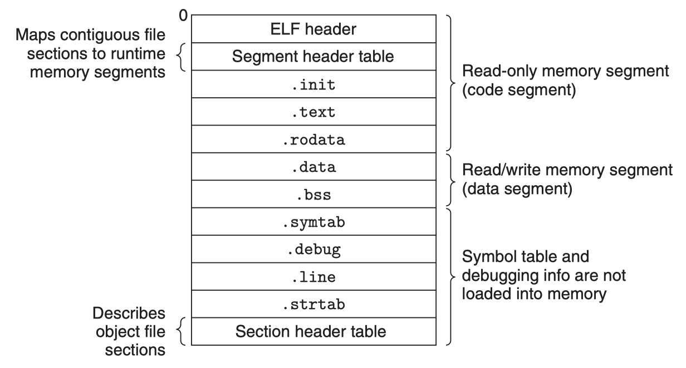
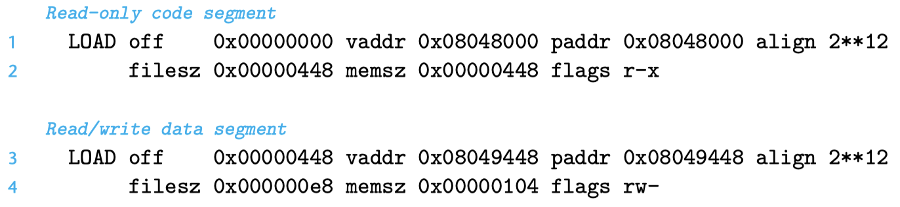
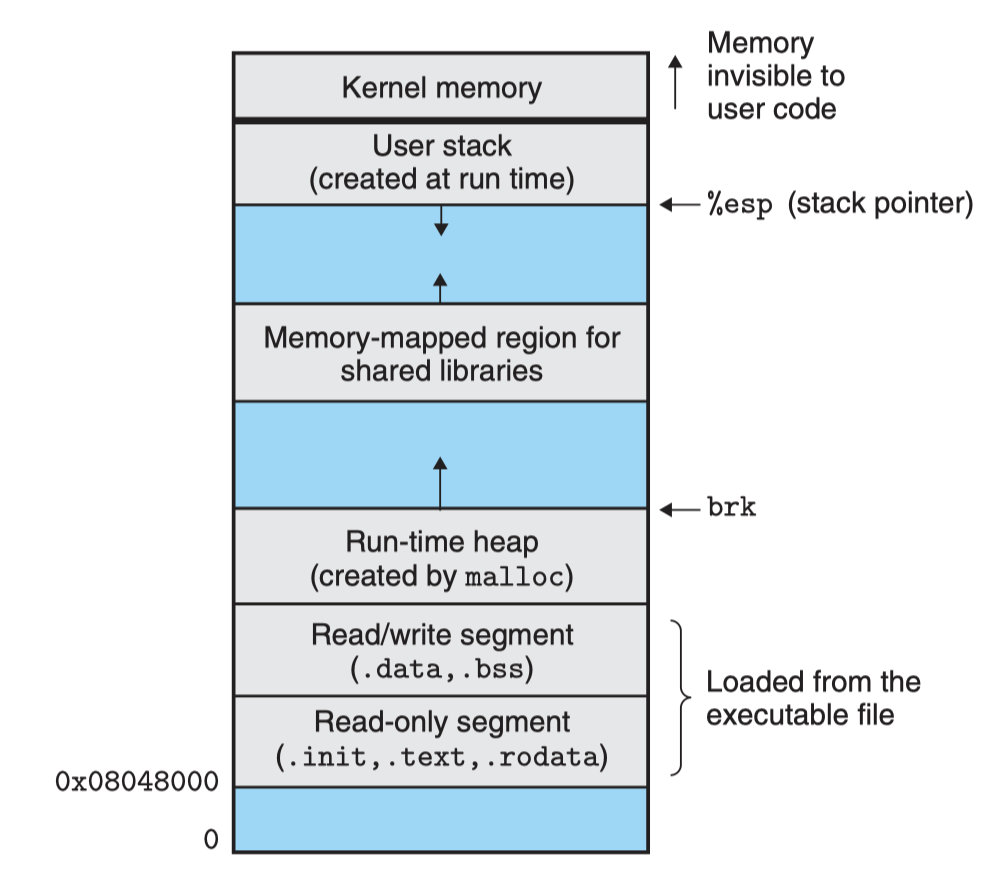
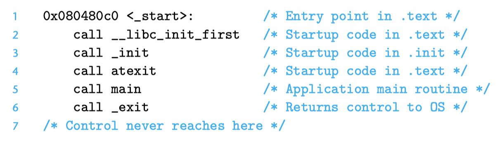
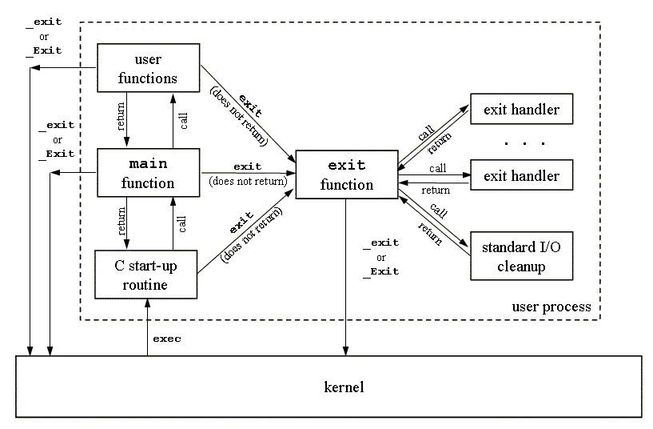

## 程序加载

从我们最初编写的源程序，经过编译工具链处理后，源文件（ASCII or UTF-8编码文件）现在已经被转换为一个可执行的二进制文件，这个二进制文件包含了加载程序到内存运行所需的必要信息。前面我们提及过有些引用了动态共享库的情景，需要在程序加载器加载程序时，调用动态链接器继续处理符号解析和重定位：数据重定位在加载时完成，函数的延迟绑定留到第一次调用，启用立即绑定（`-z now`，动态段 `DT_FLAGS` 含 `DF_BIND_NOW`）时这些函数也在加载时绑定。然后，动态链接器才会将控制转入 ELF 头里的程序入口。

下面我们来展开详细看看。

### 可执行程序

我们已经了解了，静态链接阶段是如何将多个目标模块合并成一个可执行目标文件的，下图是个典型的ELF可执行文件结构：



ELF Header中还包括了可执行程序的入口点（entry point）。没有 PT_INTERP 时，内核从这里开始执行用户态的第一条指令；有 PT_INTERP 时，内核先进入解释器，解释器完成加载时的重定位后再转入这个入口。.text、.rodata、.data section和可重定位目标文件中的对应section是相似的。非 PIE 的可执行文件里，这些 section 的链接期虚拟地址就是运行时地址。PIE 还要加上内核选定的装载基址，才是运行时地址。.init section定义了一个小函数，叫做_init，程序的初始化代码会调用它。如果可执行程序是完全链接的，这种情况下就不再需要.rel.data、.rel.text section（x86-64 上是 .rela.data、.rela.text）。用 REL 还是 RELA 由处理器 ABI 决定，IA32 用 REL，x86-64 用 RELA。如果涉及到动态共享库符号引用，加载时处理的数据重定位记在 .rel.dyn 或 .rela.dyn（x86-64 上是 .rela.dyn）；函数的延迟绑定（lazy binding）记在 .rel.plt 或 .rela.plt（x86-64 上是 .rela.plt），配合 PLT/GOT，第一次调用该函数时再解析。链接时若启用立即绑定（`-z now`，动态段 `DT_FLAGS` 含 `DF_BIND_NOW`），.rel.plt 或 .rela.plt 中的条目也在加载时处理。

ELF可执行文件被设计得很容易加载到内存中，可执行文件的连续的片（chunk）被映射到连续的内存段。段头表（program header table）描述了这种映射关系。下图展示了某个可执行文件的段头表，是由objdump输出的。



> 解释下上述输出的部分字段：
>
> - offset：文件偏移量；
> - vaddr/paddr：虚拟/物理地址；
> - align：段对齐；
> - filesz：目标文件中的段大小；
> - memsz：内存中的段大小；
> - flags：权限；

从段头表中，我们看到可执行文件段头表初始化了两个内存段。

**第1行和第2行告诉我们第1个段（代码段）：**

- align，值为 4KB；按页把文件映射到内存时，虚拟地址和文件偏移在页内的位置必须相同，虚拟地址本身不必落在 4KB 边界上；
- flags，有读权限和执行权限；
- vaddr+memsz，起始地址位于内存0x08048000处，共占用内存0x448字节；
- off+filesz，并且被初始化为可执行程序的前0x448字节；

这个segment很明显是存了代码，通常会包含.text section中的数据。

**第3行和第4行告诉我们第2个段（数据段）：**

- align，值为 4KB；按页把文件映射到内存时，虚拟地址和文件偏移在页内的位置必须相同。本段起始虚拟地址 0x08049448 并不在 4KB 边界上，它和文件偏移 0x448 的页内位置相同；
- flags，有读权限和写权限，没有执行权限；
- vaddr+memsz，开始于内存地址0x08049448处，总的内存大小为0x104字节；
- off+filesz，并用从文件偏移0x448处开始的0xe8个字节对内存段进行初始化；

这个segment在这个示例中，偏移0x448处正是.data开始的位置。另外，该段中剩下的字节对应于运行时将被初始化为零的.bss数据。

### 加载器原理

要运行一个可执行目标文件p，可以在Linux shell里面键入它的名字，如：

```bash
$ /path-to/p
```

因为p不是一个内置的shell命令，所以shell会认为p是一个可执行目标文件，通过调用某个驻留在内存中的称为**加载器（loader）**的操作系统代码来运行它。任何Linux程序都可以通过调用**execve族函数**来调用加载器。加载器按程序头把可执行文件的 PT_LOAD 段映射到地址空间，页面在缺页时再从文件读入。没有 PT_INTERP 时，内核转入 ELF 头里的入口；有 PT_INTERP 时，内核转入解释器。这个把程序映射进内存并运行的过程叫做“**加载（loading）**”。

每个Linux程序（进程）都有一个运行时存储器映像，类似于下图所示的那样：

- 在 32 位 Linux 上，非 PIE、并且链接时未拆开只读段和代码段时，GNU ld 默认的可执行段从 0x08048000 开始；PIE 的装载地址不固定。GNU ld 默认带 `-z separate-code` 时，0x08048000 是只读段，可执行段从后面一页开始；
- 数据段排在代码段之后，起始虚拟地址不必落在 4KB 边界上，它和文件偏移在页内的位置相同；上例中，0x08049448 与文件偏移 0x448 的页内位置相同；
- 运行时堆在读写段（.data、.bss）之后接下来的第一个4KB对齐的地址处，并通过malloc库（实际上是brk系统调用）从低地址向高地址增长；
- 用户栈总是从最大的合法用户地址开始，从高地址向低地址方向增长；
- 在用户栈更上部的段是为操作系统内核代码和数据准备的，用户程序无权访问；
- 介于用户栈、运行时堆之间，是为共享库保留的；



当加载器运行时，它将创建如上图所示的存储器映像。内核按段头表把 PT_LOAD 段映射到代码段和数据段所在的地址，不在 execve 里把这些页整段拷贝进来。没有 PT_INTERP 时，内核随后转入程序入口；有 PT_INTERP 时，先转入解释器。

以 Linux/glibc 下的 C 程序为例，程序入口通常是符号 \_start 的地址。\_start 处的启动代码（startup code）定义在运行时提供的启动目标文件中（如 crt1.o），具体使用哪个启动目标文件取决于构建方式。下图展示了启动代码中的关键函数调用序列。

在从 .text、.init 和 .init_array 中调用了初始化例程之后，启动代码调用 atexit 例程，登记应用程序正常终止时应该调用的函数。这些初始化例程负责在进入 main 之前完成运行时和程序自身的初始化；编译器和链接器会把不同来源的初始化代码分别放到这些 section 中，因此启动时需要从多个 section 里调用它们。接着，启动代码将调用应用程序的 main 函数，它会开始执行我们的 C 代码。在应用程序返回之后，启动代码调用 exit；exit 会先执行 atexit 注册的函数，再将控制权返回给操作系统。



上述过程可以用下图简单概括：



**这个过程中加载器是如何工作的呢？**

首先，考虑到加载时是否需要动态链接，加载器的工作方式是不同的，我们先笼统的介绍一下。

Unix系统中的每个程序都运行在一个进程上下文中，都有自己的进程地址空间。当shell运行一个程序时，父shell进程会生成一个子shell进程，它是父进程的一个复制品。子进程通过调用**execve系统调用来启动加载器**。

加载器会剔除子进程中现有的存储器段，并映射一组新的代码段和数据段。内核把程序断点放在 bss 结束处按页对齐的位置，不预先划出一整段清零的堆。初始栈上放着 argc、argv、环境变量和辅助向量（auxiliary vector），栈往后新扩的页才在缺页时清零。通过将虚拟地址空间中的页映射到新的可执行文件的页，新的代码和数据段被初始化为了新的可执行文件的内容。没有 PT_INTERP 时，内核转入 ELF 头中的 e_entry；C 程序里这个符号通常是 _start，再由启动代码调用 main。有 PT_INTERP 时，内核转入解释器，解释器做完加载时的重定位后再转入 e_entry。除了一些头部信息，在加载过程中没有任何从磁盘到存储器的数据拷贝动作，直到CPU引用一个被映射的虚拟内存页面时会引起缺页异常（page fault）才会触发实际的拷贝动作，此时操作系统利用页面调度机制自动将页面从磁盘传送到存储器，OK之后，进程继续执行。

上述过程只是笼统的介绍，实际的加载过程要考虑的问题更多。

### 链接与加载

链接，指的是，链接器将多个可重定位文件（目标文件、库文件）进行符号解析、重定位、将多个文件结合成一个可执行程序的过程。

加载，指的是，加载器将可执行程序、共享库等从磁盘加载到内存，组织好内存布局为程序执行做好准备的过程。

可以肯定的是，**链接器（尤其是动态链接器）和加载器之间不是完全孤立的，它们之间也是一种协作关系。**

从编译工具链生成可执行文件，到加载器将程序装入运行，链接和加载发生在不同阶段。下面按照这一先后过程，先考察生成可执行文件时采用的链接方式，再考察相应代码的加载方式，由此讨论静态链接、动态链接与静态加载、动态加载的四种组合。这里，组合中的链接方式描述的是生成可执行文件时的处理方式；程序启动和运行期间，还可能继续进行动态链接。

1. **静态链接与静态加载**：编译工具链在链接时，将所需目标代码及从静态库中选取的目标模块合并到可执行文件中。对于完全静态链接的程序，启动时由内核中的 ELF 加载器映射可执行文件，再将控制交给程序入口，不需要通过 ld-linux.so 加载启动依赖库。
2. **静态链接与动态加载**：可执行文件先由编译工具链完成静态链接，并在启动时加载运行。程序运行期间，还可以通过 `dlopen` 加载共享库。此时新装入的共享库仍需要符号解析和重定位，因此这一过程也包含动态链接。这里的“静态链接”描述可执行文件的生成方式，并不表示后续运行过程完全没有动态链接。
3. **动态链接与静态加载**：编译工具链生成可执行文件时，记录共享库依赖及动态链接所需的信息，不将相应共享库的代码合并到可执行文件中。启动时，内核映射可执行文件，并根据 PT_INTERP 将控制交给用户态动态链接器；动态链接器随后映射依赖库，完成启动所需的重定位，再转入程序入口。采用延迟绑定的函数符号留到第一次调用时绑定。
4. **动态链接与动态加载**：程序按动态链接方式生成，并经过启动时的加载和动态链接过程进入运行。此后，程序还可以通过 `dlopen` 加载新的共享库，由动态链接器完成新库所需的符号解析和重定位，再通过 `dlsym` 获取需要使用的符号。

先看生成可执行文件时的链接方式。静态链接在这一步把目标代码合并进文件；动态链接在这一步只留下依赖和重定位所需的信息，符号解析和重定位留到后面的加载阶段与运行阶段。

**静态链接**是指在编译时将所需目标代码，以及从静态库（后缀为 `.a`）中选取的目标模块，合并到可执行文件中。链接器 `/usr/bin/ld` 负责将这些目标模块链接到最终的可执行文件中。静态链接说的是生成这个可执行文件时，库代码如何进入文件。只把一部分 `.a` 链入、其余依赖仍是共享库时，可执行文件的程序头里仍有 PT_INTERP。没有 PT_INTERP 的，是整份都静态链接的可执行文件。这种 glibc 程序在运行中仍可以 `dlopen` 一个 `.so`，不能把 `.a` 交给 `dlopen`。运行时要能用到链接时那一套 glibc 共享库。对新装入的 `.so` 还要做符号解析和重定位，这一步是动态链接。

**动态链接**是指将对动态库（后缀为 `.so`）的引用进行符号解析、重定位，而不是将库的代码直接包含在可执行文件中。数据引用在加载时处理；函数的延迟绑定留到第一次调用，启用立即绑定（`-z now`，动态段 `DT_FLAGS` 含 `DF_BIND_NOW`）时也在加载时处理。用 `execve` 启动普通可执行文件时，若它的程序头中有 PT_INTERP，动态链接器就是用户态的 ld-linux.so，路径记在 PT_INTERP 里。内核把控制交给它，再由它映射依赖的共享库。

再看加载方式。静态加载是程序启动时的加载，动态加载是程序进入运行以后的加载。启动和运行期间的动态链接，就发生在这两步里。

**静态加载**是指启动时加载：进程启动时由内核映射可执行文件。文件带有 PT_INTERP 时，再由用户态的 ld-linux.so 按 DT_NEEDED 映射列出的共享库，完成加载时的数据重定位，然后转入程序入口。运行中另行 `dlopen` 的库不属于启动这一步。未启用立即绑定时，函数地址留到第一次调用再写入 .got.plt；启用立即绑定（`-z now`，动态段 `DT_FLAGS` 含 `DF_BIND_NOW`）时，这些函数在加载时绑定。整份静态链接、没有 PT_INTERP 的可执行文件，由内核中的 ELF 加载器在 execve 里映射并转入入口，启动时不进入 ld-linux.so。文件中的页面在缺页时读入。

**动态加载**是指运行时加载，接在程序进入运行之后：程序运行起来以后再装入共享库，用 `dlopen` 打开库，用 `dlsym` 取出符号。glibc 2.34 起这两个函数由 libc 提供，链接时仍可以使用兼容库 `libdl`。

>ps: 动态链接与动态加载的这种方式提供了更大的灵活性，使得程序可以根据需要加载和使用库。

可执行程序从启动到执行的过程分成三个阶段：

- 初始loading阶段就是将对应的segments mmap映射到进程虚地址空间，
- 然后动态链接期间会将数据重定位确定下来的地址写入 .got 或条目指定的位置；函数的延迟绑定留到第一次调用，把地址写入 .got.plt，启用立即绑定（`-z now`，动态段 `DT_FLAGS` 含 `DF_BIND_NOW`）时这一步也在加载期间完成，
- 后加载阶段（就是动态加载）可以通过dlopen等函数进行运行时加载、解析、重定位。

### 总结

本文介绍了程序被加载运行时的执行细节，考虑到链接（静态链接、动态链接）和加载（静态加载、动态加载）的多种方式，本文分别介绍了这几种链接、加载方式及适用场景。我们也特别描述了下，使用了动态共享库的情景下，loader加载程序、完成动态链接，以及可能后续的动态加载库、动态解析符号的这几个不同的阶段。

现在我们从源代码到编译、到链接、到加载执行的过程细节都介绍到了。接下来我们会在第6小节快速浏览下相关的go标准库go/src/debug的使用，这其中包含了ELF相关、符号表相关、DWARF相关的支持代码。然后第7小节我们会简单总结下go标准库go/src/debug/dwarf相关的实现，了解这些还是不够的，第8章我们会深入介绍下DWARF是如何对高级语言源程序构造进行描述的，比如如何描述一个函数、一个类型等。

OK，我们离目标又进了一步，让我们继续吧。

### 参考内容

1. Computer System: A Programmer's Perspective, Randal E.Bryant, David R. O'Hallaron, p450-p479
2. 深入理解计算机系统, 龚奕利 雷迎春 译, p450-p479
3. What are the executable ELF files respectively for static linker, dynamic linker, loader and dynamic loader, Roel Van de Paar, https://www.youtube.com/watch?v=yzI-78zy4HQ
4. Advanced Programming in Unix Environment
