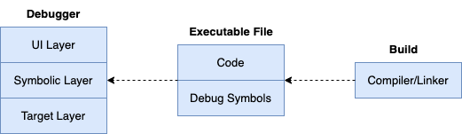

## 符号级调试基础

### 内容回顾

前面我们介绍了指令级调试过程中对tracee的各种控制，线程跟踪、执行到断点、单步执行、读写内存、读写寄存器等等，这些也是符号级调试必备的控制能力。前面提过一个设计良好的符号级调试器至少要做到3层架构，包括UI层、符号层、目标层，这样软件结构组织上清晰、扩展性也更好：

一起来回顾下调试器的三层架构：

- **UI层 (UI layer)**，主要负责与用户交互。执行调试动作，如添加断点、单步执行等。展示调试信息，如变量值、堆栈信息等。分离出UI层便于将交互和展示逻辑与核心调试逻辑分离开，便于更改或支持不同的用户界面。
- **符号层 (Symbolic Layer)**，主要负责解析调试符号信息，如理解变量、函数、源码位置与内存指令和数据地址的转换、调用栈等，它是连接用户UI操作与对目标程序执行控制的桥梁，比如我们打印一个变量值时通过变量名来打印，添加断点时断点位置使用源码file:lineno来添加。分离出符号层，可以更容易地支持不同的调试信息格式。
- **目标层 (Target Layer)**，目标层直接与被调试程序交互，负责执行调试命令对进程进行控制、数据读写，如设置断点、单步执行、读取内存和寄存器数据等。分离出目标层，可以更方便地支持不同的平台，如支持不同的操作系统、硬件架构。第六章实现的指令级调试中的进程控制能力，在第9章构建符号级调试器时，会下沉一部分到目标层。

### 面临挑战

符号级调试，依赖于多种多样的调试符号信息，比如DWARF调试信息描述的数据类型、变量、函数、行号表、调用栈信息表、符号表、字符串表等等。其实历史上出现过多种调试信息标准，用于指导编译器、链接器在编译构建二进制产物过程中生成对应的描述信息，其中DWARF（Debugging With Attributed Record Formats）应该说是目前最成功、最被广泛应用的一种。包括我们熟悉的go编译器、知名调试器gdb、delve也都支持DWARF。

当然除了DWARF调试信息，编译工具链也会在二进制产物中生成一些其他信息，用于给第三方工具、调试工具使用，比如符号表、字符串表。这些信息也可以被调试器读取、用于调试目的。当然了，DWARF生成的信息足够全的话，一般也是没这个必要的。

> ps：关于“符号”这个术语，其在不同阶段扮演着不同的角色，携带的信息也各有侧重：
>
> - **.symtab 中的符号信息**：链接器在链接时使用各目标文件（.o）中的.symtab进行符号解析和重定位，据此将不同的代码段和数据段组合成可执行文件；链接器在最终产物中合并生成的.symtab通常包含函数地址、全局变量地址等，主要供nm、readelf等工具使用（被strip移除也不影响程序运行）。加载时若涉及动态链接，则由动态链接器基于.dynsym（动态符号表）完成符号解析，与.symtab无关。
> - **.debug_info (或 .debug_*) 中的信息** 主要面向调试器，用于提供源码级别的调试信息，例如类型名、变量名、函数名等，这些信息以 DWARF (Debugging With Attributed Record Formats) 的 DIE (Debugging Information Entry) 形式存储。调试器利用这些信息进行符号显示、断点设置、单步调试等操作。
> - **编译器在词法分析、语法分析和语义分析阶段** 会对源码中的类型名、变量名、函数名等符号进行分析，并生成包含更详细信息的内部符号表（不是.symtab）。这些信息不仅用于类型安全检查等分析过程，也为后续的优化和代码生成提供依据。
>
> 注意不同情景下提到“符号”这个术语，读者不要混淆相关的含义和技术细节。

在详细介绍DWARF对不同编程语言的强大描述能力之前，先假设读者没有系统性了解过这部分知识，所以会先介绍些必要的基础知识，帮助不同掌握程度的读者都能在学习后顺利过渡到后续更有挑战的DWARF章节。然后，我们再一起进入符号级调试器的开发部分。如果读者对这方面很熟，也可以加速阅读或者跳过。

那不禁要问，除了前面已经介绍过的指令级调试的知识，实现符号级调试器的话我们还需要掌握什么？其实，我认为最主要的就是，对go语言设计实现具备一定的认识，并且能够自如地借助go编译工具链生成描述go类型、变量、函数等等的各类DWARF数据（便于实验分析），同时又能在调试器中消费解析这些数据，建立起内存数据、DWARF数据、源码数据的高层映射。然后基于前面指令级调试部分掌握的对进程内存、寄存器数据的读写以及控制能力，实现通过符号就能设置断点、读写变量、控制执行等面向高级语言层面的一些调试动作。

如果您现在听不懂也没关系，随着后续章节深入，理解也会逐渐越来越清晰。

### DWARF调试信息可描述的对象

以Linux下的ELF文件格式为例，编译器、链接器负责生成DWARF调试信息，并将其存储在ELF文件的 `.(z)debug_` sections中。从DWARF标准来看，根据描述对象的不同，DWARF调试信息可以细分为下面这些大类：

- 描述数据类型（.debug_info）；
- 描述变量（.debug_info）；
- 描述函数定义（.debug_info）；
- 描述行号表（.debug_line）；
- 描述调用栈信息表（.debug_frame）；
- 描述字符串表（.debug_str）；
- 等等。

> ps: 注意区分，符号表、字符串表在ELF层面也有同名概念（如.symtab、.strtab），但ELF的.symtab、.strtab不属于DWARF描述的对象；这里说的字符串表指DWARF自带的.debug_str，用于存储名称类数据。

### Go编译构建时生成了哪些信息

编译工具链除了生成DWARF调试信息，也会考虑语言运行时本身的一些特性支持，这会添加一些语言独有的sections。还需要考虑生成一些常见的sections来兼容现有的二进制分析工具。比如：
- go语言编译器、链接器会生成DWARF调试信息（.[z]debug_* sections）供调试器使用；
- 它还额外生成.gosymtab、.gopclntab用于go runtime来跟踪调用栈信息（注：.gosymtab自go1.25起已被移除，运行时仅依赖.gopclntab）；
- 生成.note.go.buildid来保留go buildid信息；
- 也会生成.symtab供readelf等通用的二进制分析工具使用。

### 符号级调试需要用到哪些信息

符号级调试的实现，一般会依赖DWARF调试信息，但并不是100%依赖DWARF，还是要看具体实现，这要看编译器、链接器有没有生成足够完备的调试信息，以及调试器本身自己的设计取舍。有些语言的编译工具链生成的DWARF信息不全面、或者旧版本规范指导下生成的DWARF信息存储解析成本高，这种情况下调试器实现可能会用一些其他方法，比如去读取ELF中符号表、字符串表来完成部分功能。go-delve/delve就是完全借助DWARF，而gdb还是用了部分符号表中的信息。

理论上来说只要DWARF调试信息生成的描述数据足够充分、读写成本低，调试器是可以借助DWARF来实现的。但是，DWARF在标准化过程中演进了很多年，工程上落地也有很长的过程，有很多现实中要考虑的适配问题。总之，实现一个强大高效的符号级调试器，如何建立起源程序和二进制产物、进程映像之间的联系，以前可能是个挑战，但是现在DWARF日渐成熟，不用担心这个问题了。

符号到地址的解析有多种数据来源（`.symtab`、`.gosymtab`、`.gopclntab`、DWARF），在 DWARF sections 被 strip 而其他 sections 仍在的情况下，一些调试器会退而求其次地利用它们做符号解析的兜底。本书实现的调试器 godbgv2 假定二进制保留了 DWARF sections，符号解析统一走 DWARF，不依赖 `.gosymtab`/`.gopclntab`（其原理介绍见 7.6.2 节）。

### 要不要直接介绍DWARF调试信息

本章作为符号级调试的前置基础知识，我们需要介绍下符号级调试所依赖的各类描述信息到底有哪些，它们存储在哪里，如何生成的，如何消费的，读写这类信息的规范是什么。所以，我们还会介绍Linux ELF文件格式（ELF sections和segments），以及编译器、链接器、加载器是如何协同工作的。这样，我们也逐渐理解了源代码如何变成可执行程序、如何被加载到内存、如何被操作系统调度的。

当我们对这些已经有了相对全面的认识，实现调试器的任务，就可以被描述的更加具体。我们就是利用这些信息，利用这些不同数据之间的转换，来建立起一层跨越源代码、可执行程序（指令+DWARF等）、进程的高层视图，并且利用操作系统提供的调试能力对进程执行进行跟踪、读写、控制。可以说，这就是符号级调试器要干的事情。

本章介绍的内容，相当基础且晦涩。这个过程中，我们会介绍编译器、链接器为什么要生成某些sections、segments，以及segments如何被loader加载到进程地址空间，如何完成符号解析、重定位。在本章之后，读者会对编译工具链、ELF文件有个更清晰的认识，会充分认识到这是一个经过了多么精妙设计的协作过程。

**所以，要不要跳过这一章直接介绍DWARF调试信息呢？**

**作者从写作的角度来讲**，是不能直接跳过这一章，需要确保读者读完本书之后能够真的有一个非常系统的认知。如果选择跳过这一章的话，可能导致如下问题：
1. 读者可能不熟悉ELF、编译器、链接器的工作原理，短时间内也难以理顺，很可能在这里碰壁后失去继续下去的信心。
2. 调试器设计实现也确实离不开这部分知识，还不如系统性地把这个浑水给趟完，免得读者还要自己去搜索各种资料来补齐。
3. 我们会经常提到一些术语，比如符号在多个场景下有使用但是实则是不同的东西，读者不了解本章内容很可能会搞混很多技术细节。

**但是从读者的角度来讲**，也许只想了解实现调试器最最最需要了解的内容，而对于一些更加基础、更加硬核的知识暂时不想深入的话，那也可以尝试直接阅读 **《第8章 调试信息标准: DWARF》**，等遇到不明白的问题时回头看看本章内容也许会有新的收获。

本章先介绍一些ELF基础知识，编译器、链接器的工作过程，DWARF调试信息是如何生成的，如何查看，它们能描述什么。然后第8章我们可以介绍下DWARF调试信息是如何描述程序的，我们将在第9章进入符号级调试开发。

