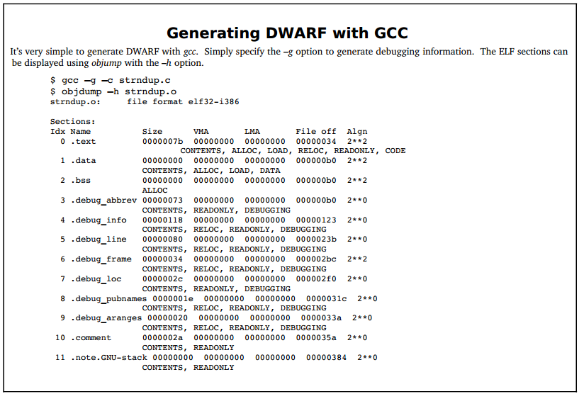
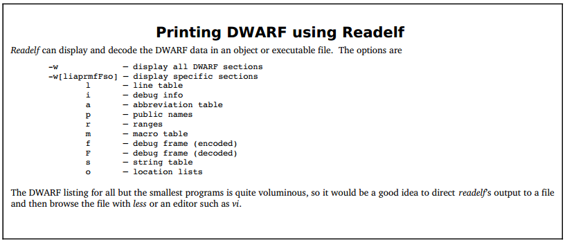

## 本章总结

DWARF 的基本概念非常简单：

- 程序被描述为“**DIE 节点构成的树**”，以紧凑的语言和与机器无关的方式表示源码中的各种函数、数据和类型；
- “**行号表**”提供了可执行指令地址和生成它们的源码之间的映射关系；
- “**CFI（调用帧信息表）**”描述了如何虚拟地展开调用栈；
- 考虑到 DWARF 需要针对**多种编程语言**和**不同的机器架构**表达许多不同的细微差别，因此 DWARF 中也有很多微妙之处。

以 gcc 为例，通过选项 `-g`（`gcc -g -c filename.c`）能够生成 DWARF 调试信息并将其存储到目标文件 `filename.o` 的调试信息相关 section 中；Go 程序构建时则会默认生成调试信息。通过 `readelf -w` 能够读取、显示所有生成的 DWARF 调试信息，也可以指定特定的 section，如 `readelf -wl` 只加载 `.debug_line` 行号表信息。

本章沿着“标准 → 生成 → 读取 → 应用”的顺序展开：

- 8.1–8.5 讲 DWARF 的数据模型：DIE、Tag/Attribute、类型、位置、代码、行号表、CFI、加速访问、宏、压缩；
- 8.6 讲 Go 工具链怎么生成这些数据：编译器产出 `SDWARF*` 符号，链接器合并、重定位、压缩，最终写入 `.debug_*`；
- 8.7 用标准库 `debug/dwarf` 读一遍，看看它能做什么、不能做什么；
- 8.8 解释为什么最终选择 delve 的 `pkg/dwarf`，以及它多做了哪些事；
- 8.9 用 delve 的包做实验，读取类型、变量、函数、行号表、CFI。

尽管我们提供了一些 go-delve/delve 中 DWARF 相关的测试用例，但和实现一个真正的符号级调试器相比，这也只能算是 DWARF 应用的一点皮毛。真正实现的时候，我们需要更加复杂的 DWARF 操作，甚至要对 Go 的设计实现非常精通，才能实现一个真正可用的符号级调试器。

让我们带着储备的基础知识以及实现一个符号级调试器的“野心”，一起进入下一章吧。
