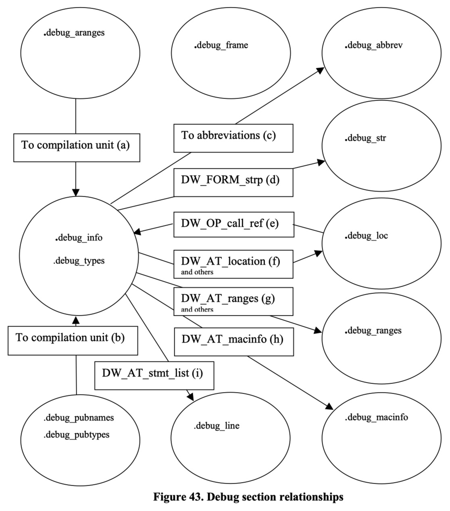

## ELF Sections

虽然DWARF设计上可以与任何目标文件格式一起使用，但最经常与ELF一起使用，作者提供的示例也主要是基于Linux的。

DWARF调试信息根据描述对象的不同，在最终存储的时候也进行了归类、存储到不同的section。section名称均以前缀 `.debug_`开头。为了提升效率，对DWARF数据的大多数引用都是通过相对于当前编译单元的偏移量来引用的，而不是重复存储或者遍历之类的低效操作。

常见的ELF sections及其存储的内容如下:

1. .debug_abbrev, 存储.debug_info中使用的缩写信息；
2. .debug_aranges, 存储一个加速访问的查询表，通过内存地址查询对应编译单元信息；
3. .debug_frame, 存储调用栈帧信息；
4. .debug_info, 存储核心DWARF数据，包含了描述变量、代码等的DIEs；
5. .debug_line, 存储行号表程序 (程序指令由行号表状态机执行，执行后构建出完整的行号表)
6. .debug_loc, 存储location描述信息；
7. .debug_macinfo, 存储宏相关描述信息；
8. .debug_pubnames, 存储一个加速访问的查询表，通过名称查询全局对象和函数；
9. .debug_pubtypes, 存储一个加速访问的查询表，通过名称查询全局类型；
10. .debug_ranges, 存储DIEs中引用的address ranges；
11. .debug_str, 存储.debug_info中引用的字符串表，也是通过偏移量来引用；
12. .debug_types, 存储描述数据类型相关的DIEs；

这些信息都存储在.debug_前缀的sections中，它们之间的引用关系入下图 (DWARFv4 Appendix B) 所示，大家先有个直观的认识。注意DWARF v5有些变化，比如.debug_types废弃，.debug_pubnames, .debug_pubtypes 使用 .debug_names代替等，但是Go从1.12开始主要使用的是DWARF v4，所以从v4到v5的变化，我们了解即可。

DWARF 数据的压缩、`.zdebug_*` 与 `SHF_COMPRESSED` 的区别，见 8.5.6 和 7.2，这里不再展开。需要关闭压缩时，可以给链接器传 `-ldflags=-compressdwarf=false`。

为了更好地学习掌握DWARF（或者ELF），掌握一些常用的工具是必不可少的，如 `readelf --debug-dump=<section>`、`objdump --dwarf=<section>`、dwarfdump、nm。另外，我亲手写了一个可视化工具：[hitzhangjie/dwarfviewer](https://github.com/hitzhangjie/dwarfviewer)，目前支持导航式浏览DIE信息，也支持查看编译单元的行号信息表等，推荐作者使用该工具来辅助学习。

> ps：Github也找到一些个人开发者、小团队维护的专门针对DWARF的可视化工具，如dwex、dwarftree, dwarfexplorer、dwarfview等，但是使用后体验都不是很好，比如长期缺乏更新、依赖管理混乱难以安装使用、功能单一无法满足功能需求，最后没有一个顺利跑起来的。所以最后我才自己编写的dwarfviewer这个工具。
