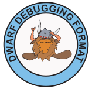

## 调试信息标准：DWARF

上一章我们把程序从源码送到了进程：编译、链接、加载、地址换算，调试器终于知道“代码在哪儿、数据在哪儿”。但知道地址还不够，用户说的是 `main.go:19`、`pid`、`main.main`，调试器要在源码和机器之间来回翻译。完成这层翻译的，就是调试信息。

### 重建源码视角之难

将人类可读的代码编译成处理器能够执行的二进制形式，是一个相当复杂的过程。它本质上是将源代码逐步转换成越来越简单的形式，在每一步都丢弃信息，最终得到处理器能够理解的一系列简单指令、寄存器、内存地址和二进制值。处理器并不关心你使用了面向对象编程、模板还是智能指针，它只理解对有限数量的寄存器和内存位置执行的非常基础的操作。

编译器在读取和解析源代码时，会收集关于程序的信息，例如变量或函数声明和使用的行号。语义分析则在此基础上，补充变量类型和函数参数等细节。优化阶段可能会重新排列代码结构、合并相似的代码片段、展开内联函数，或者删除冗余的部分。最后，代码生成器将程序的内部表示转换成实际的机器指令。为了进一步提升效率，通常还会对机器代码进行“窥孔”优化。

编译器越能实现创建紧凑且快速代码的目标，结果就越可能难以理解。在转换过程中，编译器会收集关于程序的信息，这些信息在后续调试时会非常有用。这里存在两个挑战：一是编译器可能难以将它所做的更改与程序员最初编写的源代码联系起来；二是如何在足够详细地描述可执行程序及其与原始源代码的关系的同时，保持描述的简洁性，避免占用过多空间或消耗过多处理器时间。

DWARF 调试格式应运而生。它以一种相对高效的方式表示可执行程序与源代码之间的联系，方便调试器进行处理。

### 调试器要从 DWARF 里拿到什么

当开发人员对程序进行调试时，常常需要执行一些常见的操作：在源代码的特定位置设置断点；查看局部变量、全局变量或函数参数；查看调用堆栈，了解程序是如何到达断点的；逐行跟踪程序的执行，进入或跳过调用的函数；显示变量的类型；以不同格式显示变量的值，等等。

这些操作对应到 DWARF，是几类不同的数据：

- **DIE（Debugging Information Entry）**：用 Tag + Attribute 描述类型、变量、函数、编译单元，构成一棵树；
- **行号表（`.debug_line`）**：建立指令地址与源码 `file:line:col` 之间的映射；
- **调用帧信息（`.debug_frame`）**：根据指令地址计算栈帧、CFA 和返回地址，支撑调用栈展开；
- **加速访问、宏信息、位置列表等**：为查询和特殊场景服务。

本书不打算把 DWARF v4 的 325 页标准逐条翻译一遍，而是围绕“写一个 Go 符号级调试器需要用到的部分”展开：先建立数据模型，再看 Go 工具链怎么生成，最后看怎么用标准库和 delve 读出来。

### 本章结构

| 小节 | 内容 | 读法 |
| --- | --- | --- |
| 8.1 | DWARF 发展历史 | 了解版本演进，快速过 |
| 8.2 | DWARF 内容概览 | 建立整体印象 |
| 8.3 | DWARF 数据分类 | DIE、行号表、CFI 的分工 |
| 8.4 | DIE 详细介绍 | 本章核心，重点读 |
| 8.5 | 其他调试数据：行号表、CFI、加速访问、宏、压缩等 | 8.5.2、8.5.3 重点读，其余可当手册 |
| 8.6 | 用 Go 标准库读取 DWARF | 动手，验证前面的理解 |
| 8.7 | 从标准库到 delve：Go DWARF 实现选型 | 理解为什么最终用 delve |
| 8.8 | DWARF 解析与应用 | 用 delve 的包做实验 |
| 8.9 | 本章总结 | 回收本章 |

### 怎么读

- **第一遍**：8.1 → 8.2 → 8.3 → 8.4 → 8.5.2 → 8.5.3 → 8.6 → 8.8。读到 8.4 的 Tag/Attribute 表时不要试图背下来，知道“有这些种类、用的时候查标准”就够了。
- **想先跑通调试器**：8.3 → 8.4.1/8.4.2/8.4.3 → 8.5.2 → 8.5.3 → 8.6 → 8.8，然后进入第9章；8.1、8.5.1、8.5.4–8.5.7 可以以后回来看。
- **想理解工具链**：先读 7.8，再读 8.1–8.5、8.7；7.8 的代码走读不必逐行抠，抓“编译器产出符号、链接器合并输出”的主干即可。

第8章结束时，你应该能回答：DIE 怎么描述一个变量、行号表怎么把 `file:line` 变成 `PC`、CFI 怎么把 `PC` 展开成调用栈，以及 `debug/dwarf` 能读什么、不能读什么。第9章我们就用这些能力，把符号级调试器真正写出来。

### 参考文献

1. DWARF, https://en.wikipedia.org/wiki/DWARF
2. DWARFv1, https://dwarfstd.org/doc/dwarf_1_1_0.pdf
3. DWARFv2, https://dwarfstd.org/doc/dwarf-2.0.0.pdf
4. DWARFv3, https://dwarfstd.org/doc/Dwarf3.pdf
5. DWARFv4, https://dwarfstd.org/doc/DWARF4.pdf
6. DWARFv5, https://dwarfstd.org/doc/DWARF5.pdf
7. DWARFv6 draft, https://dwarfstd.org/languages-v6.html
8. Introduction to the DWARF Debugging Format, https://dwarfstd.org/doc/Debugging-using-DWARF-2012.pdf
