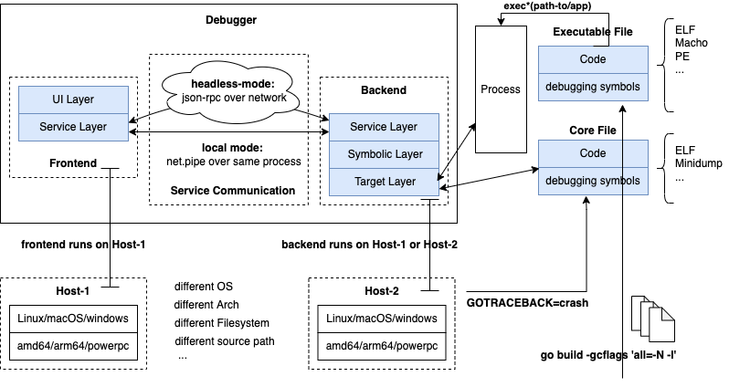

## 软件调试的挑战与现代调试器架构设计

### 软件调试在真实环境中的挑战

在现代软件开发与运维过程中，调试器作为定位和解决问题的核心工具，面临着诸多挑战：

- **多平台兼容性**：应用程序需要在不同操作系统（如Linux、macOS、Windows）和多种硬件架构（如amd64、arm64）上运行，调试器需具备良好的跨平台能力。
- **远程与分布式调试**：随着云原生、微服务架构的普及，调试目标进程往往运行在远程主机、容器或沙箱环境中，传统本地调试方式难以胜任。
- **安全与隔离性**：生产环境对调试操作有严格的安全隔离要求，调试器需支持最小权限原则，避免对业务系统造成影响。
- **高性能与低侵入性**：调试器需尽量减少对被调试进程（tracee）的性能影响，尤其是在高并发、低延迟场景下。
- **丰富的调试功能**：包括断点、单步、变量查看、内存检查、线程/协程切换、调用栈分析等，且可能需要支持多语言和多运行时（如gdb就支持多种语言的调试能力）。
- **制品及源码管理**：线上程序表现出症状需要调试时，如何快速确定源码版本、检出源码远程调试又如何解决检出源码路径与制品构建时源码路径不一致问题。
- **偶现及确定性调试**：如果问题可以稳定复现，离力解并解决也就不远了，现实中存在非常多难以复现的问题，如何进行复现并实现确定性调试是一大挑战。
- **其他挑战**：也许读者朋友们也有自己的痛点，而作者并没有一一列出，这才是真实的、复杂的计算机世界。

为了更好地应对上述挑战，调试器的架构也在迭代、升级，一起来学习下现代调试器gdb、dlv等的整体架构。

注：本章的配套实现是 **godbgv2**（仓库 `hitzhangjie/godbgv2`，二进制名 `godbg`），它是在第 6 章指令级调试器的基础上继续手写的符号级调试器，不包含 go-delve/delve 的派生代码。第 9 章早期版本曾以 **tinydbg** 为参考实现——tinydbg 是作者为教学从 `go-delve/delve@v1.24.1` 裁剪出的符号级调试器；godbgv2 在分层、命令形态、goroutine 逻辑切换等**做法层面**参考了 delve/tinydbg（归因见 godbgv2 的 `docs/CLEANROOM.md`），但代码是净室重写。阅读本章时，凡涉及源码走读均以 godbgv2 为准，tinydbg 只作为历史对照出现。

### 现代调试器架构设计

为了更好地解决现实中软件调试面临的各种挑战，现代调试器一般采用前后端分离式架构，并且在 UI 层、服务层、符号层、目标层支持可扩展，如下图所示：

> 图注：图中 "json-rpc over network" 是早期设计示意；godbgv2 实际使用 Go 标准库 `net/rpc`（gob 编码），本地模式通过 `net.Pipe` 承载同一套 RPC。详见 9.1.3 与 9.2.16。

- **前后端解耦**：将UI/交互层（frontend）与核心调试逻辑（backend）分离，二者通过标准协议通信。这样可以灵活适配不同的前端（CLI、GUI、Web、IDE插件等），也便于后端独立演进和扩展。
- **多种通信模式**：支持本地模式（如 `net.Pipe` 实现的进程内通信）和远程模式（如基于 `net/rpc`、`DAP` 的网络通信），满足本地和远程调试需求。
- **跨平台支持**：后端核心调试能力通过接口抽象和条件编译，适配多种操作系统（Windows/Linux/macOS）、硬件架构（amd64/arm64/powerpc）、文件格式（ELF/Mach-O/PE）和调试信息格式（DWARF/Stabs/COFF）。
- **安全与隔离**：远程调试时可通过权限控制、认证机制，保障生产环境安全。如只允许backend拥有部分PTRACE操作权限，而不是root权限，再比如可以对frontend调试进行用户认证、鉴权。
- **高性能优化**：精简核心功能，减少依赖，降低对被调试进程的侵入性。如线上环境可以限制只允许ebpf-based tracing操作来跟踪函数的耗时统计，而不允许断点等操作。

> 在PCG内容中台进行内容处理调度系统的设计实现时，我已经被前人们设计的系统折腾的要吐血了，那一刻我深刻地理解了这句话："软件架构设计的核心目标之一，就是让不可见的东西变得可见"，合理的架构设计，将子系统的职能边界清晰地划分开来，彼此之间通过约定好的协议进行通信，整个系统的能力就体现在子系统划分、子系统协议中。而不是傻大黑粗揉成一团，谁知道一个芝麻团里面有几个芝麻？

现代调试器基本都已经演进到上述架构，如gdb、dlv等，得益于这样的架构设计，使得现代调试器具备非常好的灵活性、适应性，基本可以解决我们前面提及的各种困难。

### 前后端分离式架构

调试器的功能，主要包括UI层与用户的交互、符号层的解析、目标层对被调试进程的控制这3大部分组成。大家可能对本地调试都比较熟悉，如通过gdb、lldb、dlv或者IDE自带调试器对本地程序进行调试，本地调试场景下，UI交互、符号解析、进程控制都在同一个调试器进程中完成就可以了。什么情况下，我们不得不将其拆分成前端、后端两个调试器实例呢？

#### 安全策略限制开发者登录机器

在一些企业中，由于安全策略的要求，开发人员可能无法直接登录到测试环境或生产环境的服务器上。这种情况下，如果需要调试运行在这些环境中的程序，传统的本地调试方式就无法满足需求。主要存在以下几个问题：

- **访问限制**：开发人员没有服务器的登录权限，无法直接在服务器上启动调试器
- **权限隔离**：即使通过跳板机等方式获得了有限访问权限，也可能缺乏必要的调试权限（如ptrace权限）
- **安全审计**：企业需要对调试操作进行严格的审计，记录谁在什么时间对哪些进程进行了调试

前后端分离的调试器架构为解决这些问题提供了可能：

1. 后端调试器可以由运维人员或自动化系统在目标服务器上启动，仅开放必要的调试端口
2. 前端调试器运行在开发人员的本地机器上，通过网络协议与后端通信
3. 在通信层面可以增加认证、授权、审计等安全机制
4. 调试操作可以通过统一的运维平台进行管理和控制

这种架构既保证了企业的安全要求，又为开发人员提供了远程调试的能力。

#### 被调试进程所在主机没有源码

真实场景下，其实有很大概率存在这样的调试问题。当然跟企业、项目有关：

1. 有的在开发者个人的开发环境即可进行测试，不存在没有源码的问题；
2. 有的需要在统一的测试环境测试，**测试环境没有源码**，但是测试环境管理往往比较松，开发可以 `rz` 上传源码；
3. 线上环境的管理往往是比较规范严格的，**线上环境没有源码**，开发人员通过运维系统更新服务、配置，在隔离流量、保留现场后是可以用来进行调试的，但是不允许 `rz` 上传源码；
4. 即使测试环境、线上环境可以上传源码，**源码版本要一致**、**上传需要时间**，再者上传的**源码路径与构建时的源码路径可能不一致**，且**没有root权限时可能无法解决**；
5. **开放root权限则安全性无从谈起**。
6. 如果不能上传源码，`sz` 下载二进制到本地调试总可以吧？可以下载，但是目标程序可能时linux/amd64，或者linux/arm64，who knows? 而你本地可能是windows、macOS。
7. 即使下载下来，本地机器与服务器也一致（或者手动找一台这样的机器），现场也丢了，对于一些flaky tests问题，没了现场很难以定位。

最终，就会造成这样的窘境，给调试带来了挑战：

* 待调试的进程，它运行在另一台机器Host-2上，而我现在的机器是Host-1；
* 但是Host-2上没有源代码；
* Host-2上有现场，下载会本地Host-1程序不一定兼容，且丢失现场；

在调试器前后端分离架构下，这个问题就比较好解决。利用调试器前端所在主机上的源码进行调试，无需上传源码到被调试进程所在主机，只需在前端询问用户源码路径的映射关系即可，如将 `/path-to/main.go` 映射为构建时的路径 `/devops/workspace/p-{pipelineid}/src/main.go`。see: [https://github.com/go-delve/delve/discussions/3017](https://github.com/go-delve/delve/discussions/3017)。

#### CLI/GUI调试萝卜青菜各有所爱

有的开发人员调试倾向于使用跨平台一致的CLI调试界面，而有的开发人员倾向于使用VSCode进行调试，还有的开发人员倾向于使用Goland进行调试。可能不只是一种倾向的问题，而是不同开发人员开发习惯不同，使用的开发工具链也不同，如果我们的调试只支持CLI调试界面，或者只支持GUI调试界面，那就很不友好，会降低开发人员的调试效率。

前后端分离式架构下，这个问题就比较容易解决，以对go程序进行调试为例：

- CLI调试界面，如dlv frontend可以通过JSON-RPC与dlv backend进行通信，完成对目标进程调试；
- VSCode调试功能，如可以通过DAP（Debugger Adapter Protocol）与dlv backend进行通信，完成对目标进程调试；

由于是前后端分离式架构，我们可以独立开发新的调试器UI来更方便地调试：

- 比如dlv是CLI调试界面，我们可以开发一个[aarzilli/gdlv](https://github.com/aarzilli/gdlv)。

#### 当前机器与目标机器os/arch不同

前面我们提到了远程机器上没有源码的问题，同时也提到了一个相关的问题 - 当前机器与目标机器的操作系统或硬件架构不同的情况。这种情况在实际开发和调试中非常常见:

- 开发人员使用MacOS或Windows进行开发，但需要调试运行在Linux服务器上的程序
- 开发机器是x86_64架构，但需要调试运行在ARM架构服务器上的程序
- 在容器化环境中，容器内外的操作系统和架构可能不同

这些差异会带来以下挑战：

1. 本地编译的调试器可能无法在目标机器上运行
2. 调试器需要理解不同平台的可执行文件格式(如ELF、PE、Mach-O)
3. 调试相关的系统调用在不同平台上可能完全不同
4. 寄存器、内存布局等底层细节存在差异

前后端分离架构为解决这些问题提供了优雅的方案：

- 后端调试器可以针对目标平台单独编译和部署
- 前端调试器只需关注用户交互，不需要关心平台差异
- 通过标准化的通信协议屏蔽平台细节
- 可以在同一个前端界面下调试不同平台的程序

#### 总结

前面讨论的几个问题 - 安全合规、源码访问、UI偏好差异、平台差异 - 正是促使我们采用前后端分离架构的主要原因。这种架构设计可以优雅地将调试器的用户界面逻辑与底层平台实现解耦，从而更好地应对这些挑战。

结合架构设计，我们将调试器(Debugger)拆分为Frontend和Backend两个核心组件：

- Frontend负责所有与用户交互相关的功能，包括接收用户调试命令、展示调试结果、管理调试会话等。它专注于提供流畅的用户体验，而不需要关心底层实现细节；
- Backend则负责在不同平台上实现具体的调试功能。以Linux/amd64平台为例，它需要解析ELF文件中的DWARF调试信息，通过系统调用控制被调试进程，并收集必要的运行时信息；
- Frontend和Backend之间通过标准化的通信协议进行交互。Frontend将用户的调试指令转换为Backend可以理解的命令，Backend执行这些命令并返回结果，Frontend再将这些结果格式化后呈现给用户。

这种分离式架构不仅解决了前述问题，还为未来的扩展和改进提供了良好的基础。我们可以独立地改进前端界面或增加新的后端平台支持，而不会相互影响。

### 通信模式

调试器的前后端分离式架构离不开前、后端之间的通讯，那这里的通讯应该考虑些什么呢？

#### 不同进程：net/rpc over network（gob）

如果前后端运行在不同的机器，那么没什么可选择的，只能通过网络通信。Go 标准库提供了 `net/rpc`，godbgv2 用它来实现前后端通信：`api.Client` 的方法对应 RPC 服务端的方法，请求/响应都是 Go 结构体，由 `gob` 负责编解码，不需要手写 JSON 消息。

一旦实现了 `net/rpc` 通信，前后端运行在相同主机上的问题也可以解决，只不过这个时候的网络地址变成了本地回环地址 `localhost/lo` 而已。后文会看到，godbgv2 在本地模式下也保留同一套 RPC，只是把底层连接换成了 `net.Pipe`，这样本地和远程只有传输介质的差别。

针对运行在相同主机这种情况，我们还需要考虑地更细致些，对使用方更友好一些，设计上更优雅一些。

ps: 当然在同一台机器上，如果是调试器前后端两个进程实例通信，除了TCP通信，也可以选择Unix通信。

#### IDE集成：DAP over network

调试器要集成到IDE中，就需要遵循IDE的调试适配器协议(Debug Adapter Protocol, DAP)。DAP是一个标准化的协议，定义了IDE和调试器之间的通信格式和流程。

DAP采用基于JSON的消息格式，通过TCP网络传输数据。虽然消息格式类似JSON-RPC，但DAP定义了自己的消息结构，包含了sequence、type等专用字段。它定义了一系列标准的请求和响应消息，包括:

- 启动/附加调试会话
- 设置/删除断点
- 单步执行/继续运行
- 查看变量/调用栈
- 表达式求值

调试器实现了DAP协议，我们的调试器就可以无缝集成到支持DAP的IDE中，如VS Code、GoLand等。这样用户就可以在熟悉的IDE环境中使用我们的调试器，而不需要切换到专门的调试器界面。
另外，如果IDE中一个插件实现了对某个编程语言的基于DAP的调试，也意味着它可以在不同的调试器backend之间切换，如go语言调试时，VSCode可以从调试器实现dlv切换到gdb等。

#### 同进程内：listenerPipe

如果前后端都运行在本机，那似乎直接UI层、符号层、目标层就足够了，这种形式下用户调试动作转换为目标层进程控制就是简单的上层调用下层封装的函数。但是我们已经拆分成前后端分离式架构了，且明确了前、后端之间要借助service通讯来完成交互。如果仅仅是因为本机，就直接绕过service层对target层进行函数调用，会让各层之间的边界不清不楚、不优雅、徒增复杂性。

那我们是不是可以选择 net/rpc，完全通过网络方式来进行呢？我们可以和操作系统申请一个端口并用这个端口来完成通信，以避免固定一个端口与其他调试器实例或者其他本机进程出现端口占用冲突。

这个方案是一个可行的方案，但是我们再仔细斟酌下：

- 在同一台机器上运行两个前端、后端两个调试器实例，它们之间通过 net/rpc 通信，但是这种多进程架构、本机却还通过网络通信，这种不够优雅。以Linux为例，为什么父子进程不借助pipe、fifo、共享内存等高效率的通信方式呢？
- 假设仍采用前后端两个调试器实例，首次启动的调试器实例为父进程，它应该作为前端进程，它还需要启动一个子进程，然后在二者之间建立一个pipe用来完成进程间通信？这种多进程+pipe的方式多出现在c/c++单进程单线程程序中，而go本身是协程并发，直接一个进程+pipe就可以搞定类似的功能？而且标准库确实也提供了net.Pipe来返回这样的pipe供goroutines间进行通信。
- 搞明白这些，现在要考虑下如何对service层的通信进行设计。service层涉及到的无非是网络通信，前端涉及到的是net.Dial(...)建立连接net.Conn，而后端涉及到的是net.Listen(...)获取listener并通过listener.Accept(...)获取新建立的连接net.Conn，然后frontend、backend通过各自建立的net.Conn进行通信。
  对于 net/rpc 而言本身就是走的 Go 网络库，这些操作自然是没问题的。但是如果我们想在同一个进程里面让前后端的service层通过net.Pipe通信，还要向网络通信接口看齐，那我们可以自定义实现net.Listener，如 godbgv2 的 `listenerPipe`（`pkg/service/listenerpipe.go`），它内部包括了一个 `net.Pipe`：后端通过 `listenerPipe.Accept()` 返回一个 `net.Conn`（本质是 `net.Pipe` 的一端），而前端也可以拿到与之关联的 `net.Conn`（本质也是 `net.Pipe` 的一端）与后端进行通信。

#### 总结

这样我们就实现了调试器在相同主机、跨不同主机下运行的 service 层通信问题：跨不同主机时用 `net/rpc` 通信；相同主机时既可以用 `net/rpc`，也可以用单进程 + `listenerPipe`。godbgv2 选择把本地模式也接到同一套 RPC 上，具体装配见 9.2.16。与 IDE 集成则需要实现 DAP 协议，godbgv2 目前没有做，只在 9.3 作为扩展方向介绍。

后面我们会讲述调试器运行时如何决定自己运行在前后端单一进程模式下，还是前后端分离模式下。

### 平台可扩展性

讲述前后端分离式架构时，我们提到了前端、后端可能运行在不同类型的主机上，这些主机的操作系统、硬件架构可能都有明显的差异。这些差异性可能会导致我们的调试器在一种操作系统、硬件平台组合下运行良好，但是在另一种组合下可能会直接crash或者根本无法运行。

调试动作相对来说是可枚举的，如设置断点、读写内存、读写寄存器、单步执行等，我们需要将其转换为目标层的操作集合，而在不同操作系统、硬件平台实现这些目标层的操作时，就需要考虑不同平台的差异性。

这里就需要对目标层的操作集合进行必要的抽象，如提炼出一个 `Target` interface，它包含了对目标进程所有的操作，然后不同的操作系统、硬件平台提供对应的实现。

> 说明：godbgv2 当前用具体类型 `target.DebuggedProcess` 与 `proc.Target` 组合实现目标层，尚未抽出 `Target`/`Process` 接口；本节讨论的是设计上的扩展点，具体代码见 9.1.5。

### 调试对象扩展性

我们要调试的可能是一个运行中的进程，也可能是一个已经消亡的进程生成的core文件（也习惯称coredump文件）。

运行中的进程，只要它还在运行期间，你几乎可以通过操作系统拿到它所有的状态信息，但是一旦它挂掉了仅仅通过其挂掉前生成的core文件是不可能还原出进程运行时所有的状态信息的。core文件中通常只记录了进程挂掉之前的调用栈信息，以方便开发人员了解程序最终在这里出现了致命的、不可恢复的错误。

我们前面提到 `Target` interface 是对目标进程进行控制，这里当然也就少不了对进程状态的读写，这里就需要考虑对真实进程和 core 文件状态读写的差异性，就需要考虑提炼出一个 `Process` interface，而进程、core 文件提供对应的实现。

### 文件可扩展性

不同操作系统上生成的可执行文件、core文件的格式是有差异的，如 Linux 多采用 ELF，Darwin 多采用 Mach-O，Windows 采用 PE；core 文件方面，Linux 采用 ELF，Windows 采用 PE，Darwin 的 core 文件通常也是 Mach-O 格式。

这些文件格式的差异，注定了我们在读取文件时、读取调试信息时会存在一定的差异性，比如：

它们的文件头都不一样的；

- 调试信息存储的section名可能也不一样，如有的开启了zlib压缩放在了.zdebug_ sections下，有的没压缩放在了.debug_ sections下；
- 甚至它们都不将调试信息数据放在二进制程序文件中，如Darwin可能将调试信息放在与二进制程序同级的.dSYM目录下；
- 更有甚者它们都不一定使用DWARF调试信息格式；

因此，对可执行文件的描述需要进行适当的抽象，以屏蔽不同平台可执行文件的差异。

### 调试信息格式可扩展

调试信息格式也是可能不同的，DWARF是后起之秀，且采用DWARF来作为调试信息格式的语言、工具链越来越多，比如go工具链就是采用DWARF作为其调试信息格式。

因为本书主要是介绍go符号级调试器的设计实现，而go编译工具链本身也是采用的DWARF，所以我们本来没有必要提及调试信息的可扩展性。但是谁也不能保证后续会不会出现一个描述性更强、效率更高、占用空间更少的调试信息标准，即便不会出现，DWARF本身也是一个不断演进中的标准，从其广泛接受的版本v4到现如今的v5，也还是有些差异的，那当我们调试携带有不同版本DWARF数据的二进制程序时，也要面临这个差异性的问题。

为此我们可以考虑在调试信息格式的加载、读取、解析时进行一定的抽象，从而屏蔽DWARF不同版本、甚至是不同调试格式的差异。

DWARF作为后期之秀，其前辈们（如Stabs、COFF、PE/Coff、OMF、IEEE-695等）是不可能再战胜它了，如果读者对这些过去曾名噪一时的标准感兴趣，可以参考：Debugging Information Format。

### 调试器backend可扩展

调试器实现前后端分离式架构之后，也给了我们更大的灵活性：既然自己的调试器可以拆成 frontend、backend 两部分，那么 gdb、lldb、mozilla rr 是否也可以作为 frontend 的 backend 呢？从架构上看是可以的，这是一个有价值的扩展方向。

为什么会有这样的诉求？

- 假设我们实现的调试器后端缺少某个功能，比如没有 `ptype` 打印类型细节的能力，而 gdb 有，能不能用我们的前端连接 gdb 后端？
- 再比如想实现反向调试，而 native backend 没有这个能力，但 mozilla rr（record and replay）可以，能不能用前端连接 rr？

为了支持多种 backend，可以增加一层 backend 选择：frontend 通过 `--backend` 参数指定 `native`、`gdb`（gdbserial 访问 gdbserver）、`lldb` 或 `rr`，再把统一的 `api.Client` 调用翻译成对应 backend 的协议。

> **现状**：godbgv2 **没有实现** backend 抽象和 `--backend` 参数，只有 linux/amd64 的 native backend；gdb/lldb/rr 的接入是扩展方向，不是本章 demo 的能力。书稿后续只对 native backend 做源码走读；如果将来要支持其他 backend，`api.Client` 是最自然的切入层（见 9.1.3）。

### 本节小结

本文详细探讨了调试器设计中的关键可扩展性问题。我们从多个维度分析了调试器需要考虑的扩展性，包括：

- 调试动作的抽象与目标层操作的扩展性
- 调试对象（进程与core文件）的扩展性
- 不同操作系统下可执行文件格式的扩展性
- 调试信息格式（如DWARF及其版本）的扩展性
- 调试器backend的可扩展性

通过前后端分离的架构设计，以及在各个层面的合理抽象，gdb、dlv等现代调试器都实现了良好的可扩展性。这使得它能够适应不同的使用场景，包括：

- 本地开发环境下的日常调试
- 远程服务器或容器环境中的调试
- 在多平台CI/CD流程中进行自动化调试
- 在生产环境中安全地进行问题诊断

这种可扩展的设计不仅提升了调试器的适应性，也为未来功能的扩展和优化提供了良好的基础。godbgv2 会在后续小节中结合真实代码介绍其中已经落地的部分；尚未实现的能力会明确标注为扩展方向。

### 参考文献

- godbgv2, https://github.com/hitzhangjie/godbgv2
- go-delve/delve（历史参考实现）, https://github.com/go-delve/delve
- gdb, https://sourceware.org/gdb/
- mozilla rr, https://rr-project.org/
- dap, https://microsoft.github.io/debug-adapter-protocol/
