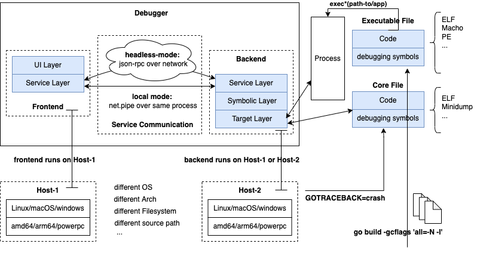

## 前端UI层设计



联想下调试器的整体架构设计，前后端分离式架构中，前端部分主要包括两部分：

- UI层为用户提供调试相关的界面交互逻辑；
- Service层完成与调试器后端实现的通信，完成对被调试进程的各种控制；

Service层的设计统一在《Service层设计》一节描述，本节只讨论UI层。本节及后面各节的配套实现是 godbgv2（更早的章节稿曾以 tinydbg 为例，两者只是命名与代码基线不同，架构分层一致），命令行程序名是 `godbg`。

### 图形化调试界面

图形化调试界面大致有三类做法：

- 把终端从文本模式切到图形模式，用 ncurses 一类库做可视化调试界面；
- 用图形库自行绘制界面，如 gdlv 基于 nuklear 实现；
- 在 IDE 里实现调试插件，如 VSCode 的调试插件用 JS/TS 绘制界面。

图形化界面的长处是一次能展示更多内容（源码、断点、变量、调用栈、goroutine 列表可以同屏），但UI层的设计也更细碎。它不在本书的详细讨论范围内，这里只作为可扩展方向罗列。

### 命令行调试界面

godbgv2 的最终形态是终端文本模式下的命令行调试器：读入用户输入的调试命令，转换成对应的调试动作，再把结果以文本形式打出来。主流调试器 gdb、lldb、dlv 都工作在这种模式下。

命令行的优劣势都摆在明面上：

- **优势**：跨平台表现一致，不依赖图形库；资源占用少；远程调试友好（SSH、容器里直接用）；容易脚本化。
- **劣势**：一次只能展示有限信息，视图要来回切；命令和参数靠记忆；输入比点按钮慢；复杂数据结构和调用关系不直观。

对一本讲原理的书来说，这些劣势可以接受：文本界面的每行输出都能对应到后端返回的一份数据，"前端只是数据的呈现层"这件事反而更容易讲清楚。

会话形态很朴素：`godbg exec/attach/debug` 启动调试后进入 `DebugSession`，提示符是 `godbg> `（`cmd/debug/shell.go` 的 `prefix` 常量），一行输入对应一次命令执行。`DebugSession` 持有会话命令树根 `root *cobra.Command`、行编辑器 `liner *liner.State`、上一条命令 `last`、待回放脚本 `initFile` 等状态，`Start()` 里跑读行循环。

### 调试命令支持

要支持的调试命令分两类，管理方式不同：

- **进程级命令**：怎么发起调试。顶层只有 6 个：`exec`、`attach`、`debug`、`core`、`connect`、`version`，各自在自己的文件里 `rootCmd.AddCommand(...)`。注意 `--headless`/`--listen` 是根命令上的 persistent flag（如 `godbg debug --headless --listen 127.0.0.1:0`），不是独立子命令；也没有 `test`、`dap`、`tracepoint` 这样的顶层命令。
- **会话级命令**：进入会话后怎么读写、控制被调试进程。一个命令一个文件，统一挂到 `debugRootCmd`；命令形态是 `Use`（含参数用法）、`Short`、`Aliases`、`Annotations`（分组）、`RunE`（实现）五件套。

会话命令的数量和实现状态不在本节展开：**命令全集、每条命令的实现状态、每条命令的讲解章节，统一以《核心调试命令》（9.2.00）为准**，本节再抄一份只会产生第二个真相源。只需要知道命令集合里既有可用命令（`break`、`continue`、`step`、`backtrace`、`list`、`print` 等），也有先占位、只打印 `TODO(chX.Y.Z)` 的桩（`next`、`frame`、`finish`、`ptypes`、`display`），`ptype` 这类"想要但还没排期"的能力同样在 9.2.00 里标注。

本节关心的是这些命令**怎么被组织起来**、用户**怎么把它们敲进去**。

### 调试命令管理

命令管理的难点不在"注册命令"，而在于：命令多、要分组展示、要支持别名、要在同一次会话里反复执行而不互相污染状态，还要让命令实现不依赖后端的具体类型。godbgv2 的做法是"继续用 cobra，再加一层很薄的约定"。

#### 会话命令的注册：init() + AddCommand

顶层命令树由 `cmd/root.go` 的 `rootCmd` 维护；会话命令树的根是 `debugRootCmd`（`cmd/debug/shell.go`，只声明 `Use: "help [command]"` 与 `Short: descShort`），它自己不干活，只负责挂命令。

33 个会话命令各自一个文件，都在 `init()` 里挂到 `debugRootCmd`。以 `break` 为例（`RunE` 的实现省略）：

```go
// cmd/debug/break.go
var breakCmd = &cobra.Command{
	Use:     "break [--name|-n name] <locspec> [if <condition>]",
	Short:   "添加断点",
	Aliases: []string{"b", "breakpoint"},
	Annotations: map[string]string{
		cmdGroupAnnotation: cmdGroupBreakpoints,
	},
	RunE: func(cmd *cobra.Command, args []string) error { /* ... */ },
}

func init() {
	debugRootCmd.AddCommand(breakCmd)

	breakCmd.Flags().StringP("name", "n", "", "断点名称")
}
```

每行输入由 `DebugSession.execute` 交给 cobra：`s.root.SetArgs(strings.Split(line, " "))` 之后调 `ExecuteC()`，由 cobra 完成"命令名或别名 → 子命令"的匹配、flag 解析，再分派到 `RunE`。也就是说，**别名匹配、flag 解析、子命令树、help 骨架全部由 cobra 提供**，会话层没有另写一套分发逻辑。

#### 命令注册表：def.go 的现状

`ch9.1.2` 引入了 `cmd/debug/def.go`，想把"命令声明"从 33 个文件里抽出来集中管理：

```go
// cmd/debug/def.go
type commandDef struct {
	use     string
	aliases []string
	short   string
	group   string
	runE    func(cmd *cobra.Command, args []string) error
}

var commandDefs = []commandDef{}

func Register(def commandDef) {
	commandDefs = append(commandDefs, def)
}
```

`installCommands(root *cobra.Command)` 把 `commandDefs` 按"分组 + 命令名"排序后逐个 `AddCommand`，`NewDebugSession` 里调用它。

**这里的状态必须说清楚**：`commandDefs` 目前是**空切片**，`installCommands` 实际什么也不挂载，33 个命令仍然走 `init()` + `AddCommand`；`def.go` 顶部那张"命令 ↔ 实现章节"的对照表（`exec/attach` 6.1–6.2、`break` 6.6/9.2.22、……、`call` 9.2.42）也只是注释。准确的说法是"注册表骨架已搭好，迁移还没做完"——`shell.go` 的注释写的是「ch9.2 起各命令逐步从 `init()` 迁移到 `Register` 注册表」。

所以不要把 godbgv2 描述成"用自研命令管理逻辑替代了 cobra"。它一直在用 cobra 管会话命令，`def.go` 只是加了一层声明式外壳，而且尚未启用。

那为什么不再往前走一步、彻底自研一套命令分发？设计时评估过三个动机，结论是代价大于收益：可配置别名并不是需求（cobra 的 `Aliases` 编译期固定就够了）；处理函数需要的额外上下文不必靠函数参数传递（后端入口提成包级 `Client` 即可）；嵌入 starlark、允许运行时注册新命令确实要求对子命令管理细节 100% 可控，但这超出了本书范围（9.3.100 只讨论思路）。

最终选择：命令树交给 cobra，只在"分组展示"和"flag 复位"两处补自己的逻辑。

#### 命令分组：annotation + helpMessageByGroups

cobra 不提供命令分组。godbgv2 用一个 annotation key 存分组，再由自定义 help 函数按分组渲染。分组常量在 `cmd/debug/shell.go`，帮助信息里的组标题就是去掉数字前缀后的名字（组内只列举例，完整命令清单见 9.2.00）：

| annotation 值 | help 里的组 | 组内命令举例 |
| --- | --- | --- |
| `1-breaks` | `[breaks]` | `break`、`breakpoints`、`clear`、`condition`、`toggle`、`trace`、`watch` |
| `2-source` | `[source]` | `list`、`disass` |
| `3-execute` | `[execute]` | `continue`、`step`、`stepout`、`next`、`call`、`finish` |
| `4-info` | `[info]` | `backtrace`、`print`、`pregs`、`pmem`、`thread`、`goroutine`、`funcs`、`set` |
| `5-other` | `[other]` | `exit`、`display`，以及 cobra 内置命令 |

分组名前的数字只用于排序：`helpMessageByGroups` 按分组名排序后，用 `strings.Split(groupName, cmdGroupDelimiter)[1]` 把 `1-breaks` 切成 `breaks` 当标题。没有写 annotation 的命令（cobra 内置的 `help` 等）按 `cmdGroupCobra`（值为 `"other"`）归组，最后并入 `[other]`。

渲染细节在 `helpMessageByGroups`：先按最长的"命令名, 别名"串算出列宽，再逐组输出 `[组名]` 与组内命令（组内按字符串排序）。命令名与别名并列展示，写法与 flag 的 `-h, --help` 一致，如 `breakpoints, bp, bs`、`list, ls, l`。`NewDebugSession` 通过 `debugRootCmd.SetHelpFunc(...)` 把 `Short`、`Use`、`FlagUsages()` 和这段分组列表拼成最终 help 输出；`cmd/debug/shell_test.go` 的 `TestHelpMessageByGroups` 断言了 `[breaks]`、`[source]`、`break, b`、`list, ls, l` 这些片段。

#### flag 复位：resetFlags

REPL 里所有命令共用同一棵命令树，pflag 在多次 `Parse` 之间**不会**把 flag 恢复默认值：上一行敲了 `disass -n 3`，下一行只敲 `disass`，`-n` 还是 3。这不是 cobra 的 bug，而是把一个"只解析一次"的框架用在了"反复解析"的场景里。

```go
func (s *DebugSession) execute(line string) error {
	s.root.SetArgs(strings.Split(line, " "))
	cmd, err := s.root.ExecuteC()
	if cmd != nil {
		resetFlags(cmd)
	}
	return err
}

func resetFlags(cmd *cobra.Command) {
	cmd.Flags().VisitAll(func(f *pflag.Flag) {
		if !f.Changed {
			return
		}
		_ = f.Value.Set(f.DefValue)
		f.Changed = false
	})
}
```

`execute` 在每次执行后统一复位：只处理 `Changed` 为真的 flag，顺手把 `Changed` 置回 false，下次判断依然有效。`ExecuteC` 内部的 `ParseFlags` 已经把继承的 persistent flag 合并进 `cmd.Flags()`，所以 `VisitAll` 能同时覆盖命令自己的 flag 和从父命令继承下来的 flag（包括根命令上的 `--init`、`--log` 等）。`TestExecuteResetsFlags` 用 `demo -n 3` 后接裸 `demo`，断言两次取到的值是 `3, 10`。

交互模式和 `--init` 批量回放都走 `execute`，两条路径的 flag 语义因此一致。

#### 后端注入：Client api.Client

会话命令里看不到任何后端类型，只有 `Client.XXX(...)` 这样的调用。`Client` 是 `cmd/debug/shell.go` 的包级变量（`var Client api.Client`），`cmd/session.go` 在进入会话前装配 `debug.Client = Client`。

`main.go` 把具体实现塞进 `cmd.Client`，`cmd/debug` 只认 `pkg/service/api` 的接口。这是 `docs/ARCH-RULES.md` 的铁律 4：`cmd/` 只允许 import `pkg/service/api`、`pkg/log` 等白名单包，禁止 import `pkg/target`、`pkg/proc`、`pkg/dwarf`、`pkg/service/debugger`、`pkg/service/rpc2`。

好处很直接：等 9.2.16 把调试器切到 headless RPC 时，`cmd/` 下的命令实现一行都不用改，只换 `Client` 指向的实现。也正因为如此，"处理函数需要额外上下文"这个动机不需要靠自定义命令框架来解决。

### 用户交互设计

与用户交互只有三件事：怎么读输入、怎么展示输出、非交互时怎么办。

#### 用户输入

读行循环在 `DebugSession.Start` 里，去掉 `Prompt` 的错误处理后核心就这几行：

```go
txt = strings.TrimSpace(txt)
if len(txt) != 0 {
	s.last = txt
	s.liner.AppendHistory(txt)
} else {
	txt = s.last
}
_ = s.execute(txt)
```

（`Prompt` 返回错误时直接 `panic(err)`，所以会话的正常出口是 `exit`，不是关掉 stdin。）

由此得到几个用户可见的行为：

- **空行重复上一条**：输入非空时记入 `last`，为空时用 `last` 顶上，连按回车就会反复执行上一条命令，`step`、`continue` 之后最实用；
- **方向键历史**：`liner.AppendHistory` 把每行记入 `liner.State` 的内存历史，单次会话内可以用上下方向键翻；
- **`help` 与 `help <cmd>`**：`help` 输出分组列表；`help break` 输出该命令的 `Short`、`Use` 与 `FlagUsages()`；
- **`exit` 结束会话**：`exit` 命令调用 `CurrentSession.Stop()`，`Start` 的循环检测到 `done` 关闭后返回，`AtExit` 注册的 `Cleanup` 会还原断点，并按调试发起方式 kill 或 detach 被调试进程。

别名（`b`、`bp`、`c` 等）由 cobra 的 `Aliases` 匹配，`execute` 不需要额外处理，代价是别名编译期固定、运行时不可配置。

进程级信号在 `main.go` 的 `processSignals` 里兜底：收到 `SIGTERM`/`SIGINT`/`SIGQUIT` 时先 `debug.Cleanup()` 再 `os.Exit(1)`（`os.Exit` 不会触发 `AtExit`，必须显式清理）。会话层本身没有针对 Ctrl+C 的分支。

#### 补全范围

`completer` 只有十几行，直接决定了补全的能力边界：

```go
func completer(line string) []string {
	cmds := []string{}
	for _, c := range debugRootCmd.Commands() {
		if strings.HasPrefix(c.Use, line) {
			cmds = append(cmds, strings.Split(c.Use, " ")[0])
		}
		for _, alias := range c.Aliases {
			if strings.HasPrefix(alias, line) {
				cmds = append(cmds, alias)
			}
		}
	}
	return cmds
}
```

它做的是"命令名与别名的前缀匹配"：行首输入 `br` 再按 Tab（`SetTabCompletionStyle(liner.TabPrints)`）能列出 `break`、`breakpoints`；但输入 `break ma` 不会有任何补全——liner 传进来的是整行，而 `c.Use` 不会以 `break ma` 开头。**函数名、变量名、locspec 这类参数级补全没有实现**，参数只能自己敲全。

#### 调试器输出

- **命令结果**：各命令在 `RunE` 里直接 `fmt.Printf`/`fmt.Println` 到 stdout，需要对齐的表格（如 `pmem`）自己用 `text/tabwriter`。前端没有统一的输出层。
- **日志**：后端包一律不打印（架构铁律 1），调试信息经 `pkg/log` 输出，默认级别 `LevelError`、默认写 stderr；`--log` 打开 debug 级别，`--log-output <file>` 重定向到文件（`cmd/root.go` 的 `PersistentPreRun` 里装配）。

这里要澄清一个容易写错的地方：godbgv2 **没有**"UI 输出统一走 `pkg/terminal`"的实现。`pkg/terminal` 目前只有 `print.go` 里的 23 行（`TabWriter`、`Printf`、`Errorf`），全仓没有任何 Go 包 import 它，`pmem.go` 这类命令是直接调 `tabwriter.NewWriter` 的。它是为后续输出能力预留的一层，`doc.go` 里写的"分页、语法高亮、会话转录"是目标而不是现状（分别规划在 9.3.102、9.3.103、9.3.109）。

#### 交互能力边界

把上面几段合起来，godbgv2 的交互能力大致如下：

| 能力 | 现状 | 说明 |
| --- | --- | --- |
| 命令名、别名 Tab 补全 | ✅ | `completer`，前缀匹配，仅行首有效 |
| 单会话命令历史（上下方向键） | ✅ | liner 内存历史 |
| 回车重复上一条 | ✅ | `last` 字段 |
| `help` 按分组展示 / `help <cmd>` | ✅ | annotation + `helpMessageByGroups` |
| 参数级补全（函数名、变量名、locspec） | ❌ | 补全器只认命令名 |
| 跨会话历史持久化 | ❌ | 无 history 文件、无偏好配置（9.3.107） |
| 分页 / 语法高亮 / transcript | ❌ | `pkg/terminal` 未接线；规划 9.3.102/103/109 |
| 目标进程 IO 重定向 | ❌ | 规划 9.3.106 |
| `--allow-non-terminal-interactive` | ❌ | 无此选项，非交互走 `--init` |
| 运行时自定义别名 / starlark 命令 | ❌ | 别名编译期固定；扩展思路见 9.3.100 |

#### 非交互模式：--init 回放

`--init <file>` 是根命令上的 persistent flag（`cmd/root.go`），`startDebugSession` 读到后调用 `SetInitFile`，`Start` 于是不建 liner，直接 `replay(file)` 逐行回放再返回。典型用法是 `godbg exec ./main --init /path/to/script.txt`（被调试程序自己的参数要写在 `--` 之后，否则会被当成 godbg 的选项）。

`replay` 的规则不多，但够用：

- 行首 `#` 是注释；
- 行首 `!`、`=` 以及 `@spawn`/`@delay`/`@set` 这类宿主指令由冒烟测试脚本 `scripts/smoke.sh` 处理，会话回放时跳过；
- `@capture <var> <re>` 由回放器自己处理：从上一行命令的输出里用正则取第一个捕获组存进 `$<var>`，后续行执行前做 `$<var>` 替换——线程 id 这种只存在于本次会话输出里的值，靠它在上下两条命令之间传递；
- 回放到 `exit` 会提前结束。

`--init` 是已有的脚本化能力：`testdata/script/` 下的 smoke 脚本就靠它跑端到端测试。批量模式不创建 liner 还有一个实际原因——`liner.Close` 会对 stdin 做 `tcsetattr`，在 `timeout` 启动的后台进程组里会触发 `SIGTTOU` 把整个测试挂死，`shell.go` 里有大段注释记录了这个坑。但它不是通用 `source` 命令：会话里没有 `source`，也不能在会话中途再加载脚本文件。

#### 为什么要关心输入输出重定向

被调试进程可能要从 stdin 读输入、往 stdout/stderr 写输出，调试器自己也要用这三个流，于是就抢同一组文件描述符：用户在键盘上敲的这一行，是给调试器还是给被调试进程？屏幕上出现的一行，是调试器打的还是 tracee 打的？

dlv 用 `-r stdin:/path -r stdout:/path` 这类选项把它们拆开，godbgv2 目前**没有实现**（规划在 9.3.106）。从设计上看，这个能力属于"启动调试"一侧而不是会话一侧——重定向必须在进程启动时就定好，所以它最终会落在 `exec`/`debug` 的启动选项上，而不是会话命令。

### 本节小结

本节只讲前端 UI 层的两件事：命令怎么管、交互怎么做。

- **命令管理**：顶层命令与会话命令都用 cobra，会话命令由 `init()` 挂到 `debugRootCmd`；`def.go` 的 `commandDef`/`Register`/`installCommands` 是计划中的注册表骨架，`commandDefs` 目前为空，尚未启用；分组靠 `Annotations` + `helpMessageByGroups`；`resetFlags` 解决 REPL 复用命令树导致的 flag 残留；命令实现只依赖包级 `Client api.Client`，不 import 后端包。
- **用户交互**：liner 提供行编辑、单会话历史、命令名与别名补全，空行重复上一条，`help` 按分组展示；参数级补全、跨会话历史、分页、语法高亮、transcript、IO 重定向都还没有（各有规划小节）；`--init` 提供脚本化回放，但不是通用 `source`。
- **命令全集与逐条实现状态以 9.2.00 为准**，本节不重复列表，避免两处口径漂移。

后面讲具体命令的实现时沿用这里的约定：一个命令一个文件，`RunE` 里只和 `Client` 打交道，需要分组就加 annotation。
