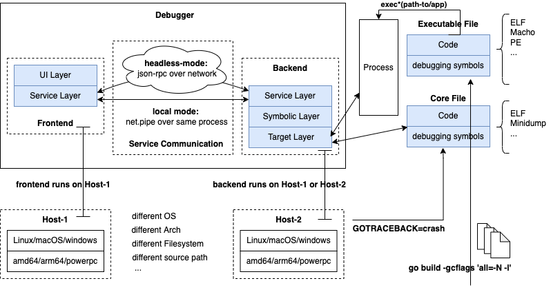

## Service层设计



调试器采用前后端分离式架构：前端负责命令解析、结果展示和会话交互，后端负责启动与跟踪进程、断点、内存、寄存器这些真正的调试动作。Service 层夹在两者之间，它要回答三个问题：前端能调用哪些能力，这些调用用什么协议传输，本地调试和远程调试能不能共用一套实现。

godbgv2 的选择是：先定一份纯值类型的契约 `api.Client`，再让本地调试和远程调试都通过 Go 标准库的 `net/rpc` 来调用它。远程走 TCP，本地走 `net.Pipe`；除了 `net.Conn` 从哪里来，服务端、客户端、编码方式和错误处理都是同一套。

- 远程调试：`godbg connect <addr>` 作为客户端，通过 TCP 连接 headless 服务端；服务端由带 `--headless --listen <addr>` 的 godbg 会话命令启动。前后端可以不在同一台机器上，也可以分属不同进程。
- 本地调试：`godbg exec/attach/debug` 在同一个进程里装配一对服务端和客户端，中间用 `net.Pipe` 连接。没有网络，但调用链和远程调试完全一致。

由此引出 Service 层的三个设计决定，也是本节的主线：

1. **协议统一用 `net/rpc` + gob**。前后端都是 Go 程序，契约本身就是 Go 接口和结构体，不需要 gRPC、protobuf、IDL 和代码生成；标准库的 `net/rpc` 足够小，默认 gob 编码能直接处理结构体、切片、映射和指针。
2. **本地调试也装配成 C/S**。不是为了绕远路，而是为了让 `cmd/` 的调试逻辑只通过 `api.Client` 访问后端，不依赖 `debugger.Debugger`、`pkg/proc`、`pkg/target` 这些后端实现。本地和远程的差异被压缩到 `main` 的几行装配代码里。
3. **契约收敛为 41 个方法的 `api.Client`**。方法只搬数据、只传值、只返回快照，不打印、不回调、不返回 channel。契约是前端与后端唯一的耦合点。

> 作为历史参考，早期的 tinydbg 是另一条实现路线（从 delve 裁剪而来）；本书的示例、命令和代码统一以 godbgv2 为准，不再展开它的细节。

下面先看远程通信，再看本地通信，最后逐组过一遍这份 41 方法的契约。

### 远程通信：net/rpc over TCP

RPC 是 C/S 架构里最常见的通信抽象：客户端像调用本地方法一样调用服务端方法，序列化、编解码、网络收发这些细节都藏在桩代码里。调试器前端需要的正是这种形态——`continue` 对应后端一次继续执行，`break` 对应后端一次创建断点，命令层不需要直接面对 socket 和字节流。

为什么不用 gRPC？gRPC 功能完整，但要引入 protobuf、IDL、代码生成和一套运行时。godbgv2 的前后端都是 Go 程序，契约本身就是 Go 接口和 `api` 包里的结构体，没有跨语言需求。标准库 `net/rpc` 把方法名、请求、应答、错误这四件事映射到一次调用上，默认 gob 编码又能直接处理结构体、切片、映射和指针，正好够用，也正好让读者看清一次 RPC 调用到底发生了什么。`pkg/service/rpc2/doc.go` 把这层定位为“基于标准库 `net/rpc` 的调试器 RPC 传输层”：客户端实现 `api.Client`，服务端包装 `debugger.Debugger`，`cmd/` 只依赖契约。

`net/rpc` 对服务端方法有硬性约定：

- 服务类型的方法必须导出，方法签名必须是 `func (t *T) Method(args *In, reply *Out) error`；
- `In`、`Out` 必须是导出类型或内建类型，字段必须能被 gob 编码；
- 一次调用一个请求、一个应答，客户端 `Call` 同步等待结果；
- 服务注册名和方法名拼成完整的方法名，例如 `Debugger.Continue`。

一句话概括：请求/响应就是 `*In`/`*Out` 两个结构体指针。这里的 `In`/`Out` 是角色名：请求参数放 `In`，应答写进 `Out`。godbgv2 没有定义一个叫 `In` 或 `Out` 的万能结构体，而是给每个契约方法配了一对具体类型，例如 `LaunchArgs`/`LaunchReply`、`ContinueArgs`/`ContinueReply`。字段名和类型本身就是文档，gob 也不需要额外的标签或 IDL。

gob 还有一个限制：只编码导出字段，接口值需要提前注册具体类型。godbgv2 的请求/应答类型（`rpc2` 里的 `XxxArgs`/`XxxReply`）都是具体结构体，字段全部导出；它们携带的 `api` 值类型也都是具体类型，正好落在 gob 的舒适区；如果哪天某个 reply 里塞了 `interface{}`，就要额外注册类型，否则运行时报错。这也是契约坚持“只传值类型”的原因之一。

`pkg/service/rpc2/server.go` 的前半部分就是这张映射表。每个 `api.Client` 方法对应一对 `XxxArgs`/`XxxReply`，`serverImpl` 持有 `*debugger.Debugger`，RPC 方法只做三件事：拆参数、调门面、把返回值写进 reply。真正的调试逻辑不在 RPC 层：门面 `debugger.Debugger` 把 `api` 值类型翻译成 `pkg/proc` 的调用，RPC 层不直接碰目标进程。下面把其中几段拼在一起看（类型声明、注册和方法实现都来自同一个文件）：

```go
// net/rpc 的约定：服务端方法形式为 func(args *T, reply *R) error，
// 请求与响应均为可 gob 编码的结构体。

type ContinueArgs struct{}

type ContinueReply struct{ Stop *api.StopInfo }

type serverImpl struct {
	dbg *debugger.Debugger
}

func NewServer(dbg *debugger.Debugger) *rpc.Server {
	s := rpc.NewServer()
	if err := s.RegisterName("Debugger", &serverImpl{dbg: dbg}); err != nil {
		panic(err)
	}
	return s
}

func (s *serverImpl) Continue(args *ContinueArgs, reply *ContinueReply) error {
	stop, err := s.dbg.Continue()
	reply.Stop = stop
	return err
}
```

注意 `RegisterName("Debugger", ...)` 这一行。`rpc.Server.Register` 默认用具体类型名注册，方法会变成 `serverImpl.Continue`，把实现类的名字泄露到协议里；显式注册成 `Debugger` 之后，对外的 RPC 命名空间就是稳定的 `Debugger.*`，将来把 `serverImpl` 改名、拆包，线协议都不受影响。

客户端的对应实现是一层很薄的包装。`rpc2.Client` 只持有一个 `*rpc.Client`，每个方法把契约参数装进 `XxxArgs`，调用 `Call`，再把 `XxxReply` 拆回契约返回值：

```go
func (c *Client) Continue() (*api.StopInfo, error) {
	var reply ContinueReply
	err := c.c.Call("Debugger.Continue", &ContinueArgs{}, &reply)
	return reply.Stop, err
}
```

从类型上看，每次调用的请求是 `*XxxArgs`、响应是 `*XxxReply`：`Continue` 的请求是 `*ContinueArgs`（空结构体），响应是 `*ContinueReply`。`net/rpc` 在服务端把 gob 解码后的请求填到 `args` 指向的结构，把 `reply` 指向的结构编码回客户端；客户端则反过来，把 `&ContinueArgs{}` 交给 `Call` 作为请求，把 `&reply` 交给 `Call` 作为应答容器。`In`/`Out` 只是这套指针结构体在调用两端的角色。

以 `godbg> continue` 为例，一次继续执行会这样走：命令层调用 `Client.ThreadsStoppedAtBreakpoint()` 找到停在断点处的线程，按需 `ReadRegs`/`WriteRegs`/`RestoreInstruction`/`Step` 越过断点，最后调用 `Client.Continue()` 等下一个停止。这些调用都走同一条链路——`cmd/debug/continue.go` → `rpc2.Client` → gob/TCP → `serverImpl` → `debugger.Debugger` → `pkg/proc`/`pkg/target`。命令层只看见 `api.Client` 的方法，看不见 ptrace，也看不见 socket。一次调用中 gob 编解码、`Request`/`Response`、`Seq` 匹配的逐层细节在 9.2.01 节展开，本节只定设计边界。

#### 错误跨 RPC 的同一性

`net/rpc` 不会把服务端的 error 值原样传回来：响应里只有错误字符串，客户端拿到的是 `rpc.ServerError`。对大多数错误这没问题，但 `api.ErrBreakpointNotExisted` 是哨兵错误，`cmd/debug/step.go` 和 `cmd/debug/continue.go` 里直接把返回值与 `api.ErrBreakpointNotExisted` 判等。RPC 模式下一比就失败，因为两端已经不是同一个 error 值了。

`translateErr` 负责把哨兵还原：

```go
func translateErr(err error) error {
	if err != nil && err.Error() == api.ErrBreakpointNotExisted.Error() {
		return api.ErrBreakpointNotExisted
	}
	return err
}
```

凡是可能把 `ErrBreakpointNotExisted` 透出来的方法，客户端侧都会过一道 `translateErr`，例如 `ClearBreakpoint`、`RestoreInstruction`、`SetVariable`、`ToggleBreakpoint`、`SetBreakpointCondition`；`ListSource` 的错误也统一走这个函数。这个细节说明：契约不只是方法签名，还包括错误的同一性。以后新增哨兵错误，不能只加一个 `errors.New`，还要在 RPC 客户端补上对应的消息比对，否则命令层的判等会静默失效。换句话说，`ErrBreakpointNotExisted.Error()` 的文本也是线协议的一部分，不能随意改动。

#### 远程两端的装配

客户端装配只有两步，`pkg/service/wire.go` 里的 `WireRemote` 就是全部：

```go
func WireRemote(addr string) (api.Client, error) {
	cli, err := rpc.Dial("tcp", addr)
	if err != nil {
		return nil, err
	}
	return rpc2.NewClientFrom(cli), nil
}
```

服务端装配在 `main.go`。headless 模式下，`cmd/` 不直接创建 listener，也不 import `rpc2` 和 `debugger`（架构铁律第 4 条），而是调用 main 注入的函数变量 `cmd.ServeHeadless`：

```go
cmd.ServeHeadless = func(listenAddr string) error {
	ln, err := net.Listen("tcp", listenAddr)
	if err != nil {
		return err
	}
	fmt.Printf("godbg headless server listening on %s\n", ln.Addr())
	rpc2.NewServer(dbg).Accept(ln)
	return nil
}
```

`--headless` 不是一条新子命令，而是根命令的持久 flag：`exec`/`attach`/`debug` 建立好目标进程后，会话层检测到它，就调用 `cmd.ServeHeadless` 而不是进入 REPL。`rpc2.NewServer(dbg)` 创建并注册 `Debugger` 服务，`.Accept(ln)` 是阻塞的：它循环接受连接，每个连接交给内部的服务 goroutine 处理。`--listen` 的默认值是 `127.0.0.1:0`，即只监听回环地址、端口由系统分配；要让其他机器连进来，必须显式指定可达的地址，同时意识到这条链路没有 TLS 和鉴权。

远程这条链路的能力边界要提前说清楚：

- **只支持 TCP**：`WireRemote` 固定 `rpc.Dial("tcp", addr)`，`ServeHeadless` 固定 `net.Listen("tcp", ...)`；没有 Unix domain socket、没有 TLS、没有鉴权。
- **没有多客户端会话**：服务端只有一份 `debugger.Debugger`，所有连接共享同一个被调试进程；`net/rpc` 的 `Accept` 循环虽然能为多个连接各起一个服务 goroutine，但 godbgv2 按单客户端使用，没有连接级会话、租约、并发保护或访问控制。
- **没有 DAP**：`godbg connect` 是唯一的远程客户端，VSCode 等 IDE 的 DAP 接入不在当前实现里。

这些是当前实现的边界。把边界写进设计，后面才不会误以为接口签名允许的行为都已经实现。

### 本地通信：net.Pipe 上的同一个服务端

本地调试为什么也要走 RPC？从进程角度看，完全可以让 `cmd/` 直接调用 `debugger.Debugger`，少一次编码解码。但从架构角度看，那样会让前端重新依赖后端的具体类型，等到 9.2.16 节引入 headless RPC、把本地也切到 RPC 时又要把调用链改一遍。godbgv2 的选择是：本地也装配一对服务端和客户端，只把 TCP 换成 `net.Pipe`。这样 `cmd/` 永远只看见 `api.Client`，本地和远程的差异被压缩到 `main` 的几行装配代码里。

`net.Pipe()` 返回一对 `net.Conn`，读写直接在内存里配对，不经过网络协议栈，也不经过 socket。它的问题是没有 listener：服务端的典型写法是先 `net.Listen` 再 `Accept`，而 `net.Pipe` 已经把两端都给你了，没有“等待连接”这一步。`listenerPipe` 就是为补上这个缺口写的，它实现 `net.Listener` 的最小面，让服务端仍然可以用 `Accept` 的方式拿到连接。

与 TCP 不同，`net.Pipe` 没有内核缓冲，一次写要等对端读。这个同步语义会让“写”阻塞，但 `net/rpc` 本来就是请求-应答模型，gob 编解码和请求循环照常工作，本地调试不需要为管道写特殊逻辑。

```go
type listenerPipe struct {
	ch   chan net.Conn
	once chan struct{}
}

func (l *listenerPipe) Accept() (net.Conn, error) {
	select {
	case c := <-l.ch:
		return c, nil
	case <-l.once:
		return nil, net.ErrClosed
	}
}

func (l *listenerPipe) Close() error {
	select {
	case <-l.once:
	default:
		close(l.once)
	}
	return nil
}

func (l *listenerPipe) Addr() net.Addr { return pipeAddr{} }

type pipeAddr struct{}

func (pipeAddr) Network() string { return "pipe" }
func (pipeAddr) String() string  { return "pipe" }

func NewListenerPipe() (net.Listener, net.Conn, error) {
	srv, cli := net.Pipe()
	l := &listenerPipe{
		ch:   make(chan net.Conn, 1),
		once: make(chan struct{}),
	}
	l.ch <- srv
	return l, cli, nil
}
```

几个关键细节：

1. `ch` 必须带缓冲（容量 1）。`NewListenerPipe` 在返回前执行 `l.ch <- srv`；如果 channel 无缓冲，这里就阻塞了，listener 永远构造不完。容量 1 让预置动作立即完成，`Accept` 随后取走。
2. `Accept` 用 `select` 同时等 `ch` 和 `once`。正常路径从 `ch` 拿到预置连接；预置连接被取走之后，`Close` 关闭 `once`，后续 `Accept` 返回 `net.ErrClosed`，符合 `net.Listener` 的约定。
3. `Close` 用 `select` 加 `default` 保证幂等：重复关闭不会 panic。
4. `Addr` 返回 `pipeAddr{}`，`Network`/`String` 都是 `"pipe"`。进程内管道没有真实地址，但 `net.Listener` 接口要求有 `Addr`；这个占位类型让接口完整，也方便日志里一眼看出是本地管道。
5. 这个 listener 只服务一次装配：连接是预置的，同一 listener 上不会反复建立新连接；`Accept` 取走唯一连接后再调用就会一直等，直到 `Close`。本地调试本来也只有一个调试会话，够用。

`WireLocal` 把服务端和客户端都装好：

```go
func WireLocal(dbg *debugger.Debugger) (api.Client, error) {
	ln, cli, err := NewListenerPipe()
	if err != nil {
		return nil, err
	}

	server := rpc2.NewServer(dbg)
	go server.Accept(ln)

	return rpc2.NewClientFrom(rpc.NewClient(cli)), nil
}
```

`NewListenerPipe` 给出 listener 和客户端连接；`rpc2.NewServer(dbg)` 注册 `Debugger` 服务；`go server.Accept(ln)` 在后台跑 accept 循环；`rpc.NewClient(cli)` 把管道的客户端端包成 `*rpc.Client`；最后 `rpc2.NewClientFrom` 返回 `api.Client`。`server.Accept` 是阻塞的，所以必须放在 goroutine 里，否则 `WireLocal` 永远不返回。`rpc.Server.Accept` 内部对每个 accept 到的连接调用 `ServeConn`；`listenerPipe` 只预置了一个连接，所以服务端只会服务这一条。

`main()` 里的装配是无条件的：

```go
dbg := debugger.New()
client, err := service.WireLocal(dbg)
if err != nil {
	fmt.Fprintf(os.Stderr, "wire local: %v\n", err)
	os.Exit(1)
}
cmd.Client = client
```

也就是说，`godbg version`、`godbg help` 也会创建管道、启动服务端 goroutine；只有执行具体调试命令（`Launch`、`Attach` 或会话内命令）时才会发 RPC。这个取舍值得说明：多一个 goroutine 和一对管道连接的成本可以忽略，换来的是 `cmd.Client` 在任何子命令下都有确定的值，`cmd/` 不需要判断“现在是本地还是远程”“会话有没有开始”。架构边界落在依赖关系上，而不是进程边界上。

本地模式是货真价实的 RPC：gob 编码、`Debugger.Launch` 这样的方法名、Args/Reply 结构体、错误字符串还原，一样不少。`pkg/service/rpc2/rpc_test.go` 里的 `TestRPCRoundtrip` 就用 `net.Pipe` 加 `ServeConn` 把 `Launch`、`State`、`Kill` 走了一遍 RPC。换句话说，本地调试能暴露的 RPC 问题，和远程调试是同一类问题，不要把它当成“直接函数调用”。

把两条装配路径并排看，差异只在传输和 listener：

| 维度 | 远程调试 | 本地调试 |
|---|---|---|
| 客户端 | `rpc2.Client` | `rpc2.Client`（同一个类型） |
| 连接建立 | `rpc.Dial("tcp", addr)` | `rpc.NewClient(cli)`，`cli` 来自 `net.Pipe` |
| listener | `net.Listen("tcp", ...)` | `listenerPipe` |
| 服务端 | `rpc2.NewServer(dbg)` | `rpc2.NewServer(dbg)`（同一个） |
| 契约 | `api.Client` | `api.Client`（同一份） |

### RPC 契约：api.Client 的 41 个方法

契约放在 `pkg/service/api`：`client.go` 定义 `Client` 接口、`Kind` 和哨兵错误，`types.go` 定义其余值类型。这个包不 import `debugger`、`rpc2`、`proc`、`target`，只依赖标准库。前端（`cmd/`）依赖它，后端（`debugger.Debugger`）实现它，RPC 层（`rpc2`）在两边各实现和包装一次。接口开头的注释把设计原则写死了，这不是装饰：

```go
// 契约设计三原则：
//  1. 只搬数据不打印——所有方法返回数据快照，格式化由 UI 层完成；
//  2. 只传值/可序列化结构——便于 ch9.2.16 起经 RPC 传输；
//  3. 请求-响应快照语义——不做流式/迭代器。
```

逐条展开：

1. **只搬数据不打印**。后端不 `fmt.Printf`。比如 `ListSource` 返回 `*ListSourceResult{File, PC, Line, StartLine, Lines, Current}`，`Lines` 是原始源码行，`Current` 只回答“目标行是不是当前停止位置”；`=>` 箭头、行号宽度、排版都由前端决定。`Continue` 返回 `*StopInfo{PID, Reason}`，停止原因是一句字符串，打印格式不归后端管。这条原则让同一份后端能同时服务 CLI、远程客户端和测试。
2. **只传值/可序列化**。方法参数和返回值里没有 `chan`、`func`、`io.Reader`，也没有 `*target.Thread` 这类指向运行时状态的对象。需要跨 RPC 的东西一律先转成 `api` 值类型：`Registers` 把 ptrace 寄存器结构摊平成字段，`Breakpoint` 是逻辑断点的快照，`Frame` 只保留 PC、函数名、文件、行号。`map[int]uint64`（`ThreadsStoppedAtBreakpoint`）和 `[]byte`（内存读写）gob 都能直接编码。
3. **快照语义**。一次调用返回一份完整结果，不做流式、不做迭代器、不返回 channel。`Continue` 会阻塞到目标停止，然后返回一个 `*StopInfo`；`Goroutines` 返回当前全部 goroutine 的切片；`Backtrace` 返回当前栈帧切片。前端不需要维护订阅关系，也不存在忘了关 channel 导致的 goroutine 泄漏。代价是 `Continue` 这类调用要等到目标停下来才返回——对单客户端调试器来说，这正好是想要的行为。

`types.go` 里的类型不多，按用途可以分成几族：

- 会话：`Kind`（`KindDebug`/`KindExec`/`KindAttach`）、`State{PID, Kind}`、`LaunchOptions{DisableASLR}`；
- 寄存器：`Registers`（amd64 通用寄存器、段寄存器、`OrigRax`，带 `PC()`/`SetPC()`）；
- 停止：`StopInfo{PID, Reason}`；
- 符号与源码：`Function`、`Frame`、`Variable`、`ListSourceResult`；
- 断点：`Breakpoint`、`Tracepoint`、`Watchpoint`；
- 并发：`Goroutine`、`Thread`；
- 反汇编：`AsmInstruction`；
- 调试期调用：`CallResult`。

```go
type State struct {
	PID  int  // 被调试进程 pid
	Kind Kind // 调试发起类型
}

type StopInfo struct {
	PID    int    // 停止的线程/进程 id
	Reason string // 停止原因（如 stopped: trace/breakpoint trap）
}
```

这里没有把所有状态塞进一个大对象：`State` 只回答 pid 和调试发起方式；停止原因归 `StopInfo`，线程和栈帧的位置归 `Thread`、`Frame`。需要什么就返回什么，RPC 消息也跟着变小。这里也没有 `EvalScope` 这样的显式求值作用域：调试上下文由后端维护（选中线程 > 选中 goroutine > 当前事件线程），前端只传 `tid`、`sel` 或 `loc` 这样的简单参数，不需要在每个请求里重复描述“在哪个线程/goroutine 里求值”。

按接口里的分组，41 个方法如下。RPC 方法名统一是 `Debugger.<方法名>`；`RPC 消息` 一列只写 `rpc2` 里的 Args/Reply 类型。每个方法在 `rpc2/client.go` 里都有一个同名包装，在 `rpc2/server.go` 里都有一个 `serverImpl` 方法。

| 分组 | 方法 | 参数 → 返回 | RPC 消息 |
|---|---|---|---|
| **会话管理（5）** | | | |
| | `Launch` | `(kind Kind, cmd string, args []string, opts *LaunchOptions)` → `(int, error)` | `LaunchArgs` / `LaunchReply` |
| | `Attach` | `(pid int)` → `([]int, error)` | `AttachArgs` / `AttachReply` |
| | `Detach` | `()` → `(error)` | `DetachArgs` / `DetachReply` |
| | `State` | `()` → `(*State, error)` | `StateArgs` / `StateReply` |
| | `Kill` | `()` → `(error)` | `KillArgs` / `KillReply` |
| **线程与寄存器（5）** | | | |
| | `CurrentThread` | `()` → `(int, error)` | `CurrentThreadArgs` / `CurrentThreadReply` |
| | `Threads` | `()` → `([]Thread, error)` | `ThreadsArgs` / `ThreadsReply` |
| | `SwitchThread` | `(tid int)` → `(*Thread, error)` | `SwitchThreadArgs` / `SwitchThreadReply` |
| | `ReadRegs` | `(tid int)` → `(*Registers, error)` | `ReadRegsArgs` / `ReadRegsReply` |
| | `WriteRegs` | `(tid int, regs *Registers)` → `(error)` | `WriteRegsArgs` / `WriteRegsReply` |
| **内存（2）** | | | |
| | `ReadMemory` | `(addr uint64, size int)` → `([]byte, error)` | `ReadMemoryArgs` / `ReadMemoryReply` |
| | `WriteMemory` | `(addr uint64, data []byte)` → `(error)` | `WriteMemoryArgs` / `WriteMemoryReply` |
| **反汇编（3）** | | | |
| | `CurrentPC` | `()` → `(uint64, error)` | `CurrentPCArgs` / `CurrentPCReply` |
| | `Disassemble` | `(addr, max uint64, syntax string)` → `([]AsmInstruction, error)` | `DisassembleArgs` / `DisassembleReply` |
| | `DisassembleWithBreakpointCleared` | `(addr, max uint64, syntax string)` → `([]AsmInstruction, error)` | `DisassembleClearedArgs` / `DisassembleClearedReply` |
| **断点（12）** | | | |
| | `AddBreakpoint` | `(addr uint64)` → `(*Breakpoint, error)` | `AddBreakpointArgs` / `AddBreakpointReply` |
| | `CreateBreakpoint` | `(loc, cond, name string)` → `([]Breakpoint, error)` | `CreateBreakpointArgs` / `CreateBreakpointReply` |
| | `ListBreakpoints` | `()` → `([]Breakpoint, error)` | `ListBreakpointsArgs` / `ListBreakpointsReply` |
| | `ClearBreakpoint` | `(id uint64)` → `(*Breakpoint, error)` | `ClearBreakpointArgs` / `ClearBreakpointReply` |
| | `ClearAll` | `()` → `(error)` | `ClearAllArgs` / `ClearAllReply` |
| | `SetBreakpointCondition` | `(id uint64, cond string)` → `(error)` | `SetBreakpointConditionArgs` / `SetBreakpointConditionReply` |
| | `EvalCondition` | `(expr string)` → `(bool, error)` | `EvalConditionArgs` / `EvalConditionReply` |
| | `ToggleBreakpoint` | `(id uint64)` → `(error)` | `ToggleBreakpointArgs` / `ToggleBreakpointReply` |
| | `Trace` | `(pattern string)` → `([]Tracepoint, error)` | `TraceArgs` / `TraceReply` |
| | `Watch` | `(addr uint64, mode string)` → `(*Watchpoint, error)` | `WatchArgs` / `WatchReply` |
| | `RestoreInstruction` | `(addr uint64)` → `(error)` | `RestoreInstructionArgs` / `RestoreInstructionReply` |
| | `ThreadsStoppedAtBreakpoint` | `()` → `(map[int]uint64, error)` | `ThreadsStoppedArgs` / `ThreadsStoppedReply` |
| **执行控制（7）** | | | |
| | `Step` | `(tid int)` → `(error)` | `StepArgs` / `StepReply` |
| | `Continue` | `()` → `(*StopInfo, error)` | `ContinueArgs` / `ContinueReply` |
| | `StepOut` | `()` → `(*StopInfo, error)` | `StepOutArgs` / `ContinueReply` |
| | `Goroutines` | `()` → `([]Goroutine, error)` | `GoroutinesArgs` / `GoroutinesReply` |
| | `CurrentGoroutine` | `()` → `(*Goroutine, error)` | `CurrentGoroutineArgs` / `CurrentGoroutineReply` |
| | `SwitchGoroutine` | `(sel string)` → `(*Goroutine, error)` | `SwitchGoroutineArgs` / `CurrentGoroutineReply` |
| | `Call` | `(name string, args []int64)` → `(*CallResult, error)` | `CallArgs` / `CallReply` |
| **符号层（7）** | | | |
| | `ListFunctions` | `()` → `([]Function, error)` | `ListFunctionsArgs` / `ListFunctionsReply` |
| | `FindFunction` | `(name string)` → `(*Function, error)` | `FindFunctionArgs` / `FindFunctionReply` |
| | `PCToLine` | `(pc uint64)` → `(string, int, error)` | `PCToLineArgs` / `PCToLineReply` |
| | `PrintVariable` | `(name string)` → `(*Variable, error)` | `PrintVariableArgs` / `PrintVariableReply` |
| | `Backtrace` | `()` → `([]Frame, error)` | `BacktraceArgs` / `BacktraceReply` |
| | `ListSource` | `(loc string)` → `(*ListSourceResult, error)` | `ListSourceArgs` / `ListSourceReply` |
| | `SetVariable` | `(expr string, value uint64)` → `(error)` | `SetVariableArgs` / `SetVariableReply` |

表的读法：`In`/`Out` 不是两个叫 `In`、`Out` 的类型，而是“请求/应答”的角色。比如 `Launch` 的 In 是 `LaunchArgs{Kind, Cmd, Args, Opts}`，Out 是 `LaunchReply{Pid}`；`Continue` 的 In 是空的 `ContinueArgs`，Out 是 `ContinueReply{Stop}`。少数方法复用消息类型：`DisassembleWithBreakpointCleared` 用 `DisassembleClearedArgs`/`DisassembleClearedReply`（`DisassembleArgs`/`DisassembleReply` 的别名），`StepOut` 复用 `ContinueReply`，`SwitchGoroutine` 复用 `CurrentGoroutineReply`。这些复用是因为返回的数据形状相同，不表示方法语义相同；方法名仍然各自独立，前端看到的是 41 个不同语义的调用。

再强调一次数字：`api.Client` 是 41 个方法。不是 40，也不是 delve `service.Client` 的 76。delve 的接口覆盖反向执行、录制重放、checkpoint、动态库、多客户端等能力，delve 另有 DAP 服务；godbgv2 采用净室方式自研（见 `docs/CLEANROOM.md`），不引入 delve 依赖，只保留一台教学调试器真正实现得完、讲得清的能力。反向执行、录制重放、checkpoint、core dump、DAP、多客户端这些能力，godbgv2 当前都不做，对应的方法自然也不在契约里。方法少不是缺陷，是范围控制：每多一个方法，后端、RPC 消息、客户端包装、测试都要多一份。

接口满足关系不靠文档保证，靠编译器。`debugger.Debugger` 末尾有一行 `var _ api.Client = (*Debugger)(nil)`，`rpc2.Client` 末尾也有一行 `var _ api.Client = (*Client)(nil)`。这行代码没有运行时开销，编译期就会检查方法集：少一个方法、参数类型不对、返回值不对，都会直接编译失败。`contract_test.go` 里还有一份同样的断言：

```go
// TestDebuggerImplementsClient 验证进程内门面实现了完整契约（ch9.1.3）。
// 第9.2.16节引入 RPC 后，此断言同样适用于 RPC 客户端实现。
func TestDebuggerImplementsClient(t *testing.T) {
	var _ api.Client = (*Debugger)(nil)
}
```

为什么测试里还要再写一遍？因为生产代码里的断言可能被人顺手删掉，测试里这份把契约检查绑进 `go test`：接口一改、实现没跟上，`go test ./pkg/service/debugger` 首先就编译不过。对 RPC 客户端来说，`rpc2/client.go` 的包级断言等价于“41 个方法一个都不能少”；新增契约方法时，先改 `api.Client`，再让编译错误把 `debugger.Debugger` 和 `rpc2.Client` 两处都点出来。

这层检查对 9.2.16 节的切换很关键：`cmd/` 只持有 `api.Client`，只要 `rpc2.Client` 在编译期满足接口，本地和远程的切换就不需要改命令层。接口是唯一的耦合点，编译器替我们守着它。

最后把能力边界集中列一下，避免读者把“契约里有的方法”误读成“协议层什么都支持”：

- **传输只有 TCP**：远程固定 `rpc.Dial("tcp", addr)` 和 `net.Listen("tcp", ...)`，没有 Unix domain socket、TLS、鉴权；默认 `127.0.0.1:0`，暴露到公网需要自己承担风险。
- **没有多客户端**：服务端一份 `debugger.Debugger`，所有连接共享同一个被调试进程；没有连接级会话、租约、并发保护，`connect` 按单客户端使用。
- **没有 DAP**：`godbg connect` 是唯一的远程客户端，IDE 的 DAP 接入不在当前实现里。
- **没有 streaming/迭代器**：接口不返回 channel，不注册回调，所有结果都是一次性快照；`Continue` 是阻塞调用，不是事件流。
- **方法数是 41**：以 `pkg/service/api/client.go` 为准；`rpc2` 的消息对、`serverImpl` 的方法、`rpc2.Client` 的包装都应与之一一对应。

### 本节小结

本节把 Service 层的设计收束成三件事：

1. **协议**：Go 标准库 `net/rpc` 加 gob，服务注册名 `Debugger`，请求/应答是每方法对应的 `XxxArgs`/`XxxReply`（少量复用）；`In`/`Out` 只是角色，具体类型由契约方法决定。
2. **传输**：远程 `WireRemote` 走 TCP，本地 `WireLocal` 走 `net.Pipe`；`listenerPipe` 用预置连接把管道伪装成 listener，两边共用同一套服务端和客户端实现。
3. **契约**：`api.Client` 的 41 个方法，按会话、线程寄存器、内存、反汇编、断点、执行控制、符号层分组，遵守只搬数据、只传值、快照语义三条原则，并用编译期断言锁住实现。

回头再看开头那句话：前后端分离的边界不在进程，而在依赖。本地调试和远程调试可以共用同一份 `rpc2` 代码、同一份 `api.Client` 契约，差异只剩下 `main` 里选择哪条 `net.Conn`。9.2.16 节会沿着这条线把 headless/connect 的装配流程展开；9.2 的后续小节则按这份契约逐个实现调试命令。Service 层定的是“能调什么、怎么传、传到哪”，具体每个方法背后怎么操作 ptrace、怎么读 DWARF，是后面章节的事。
