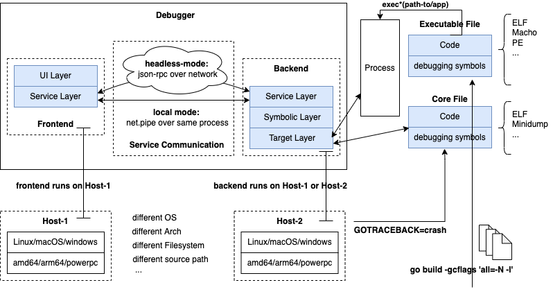
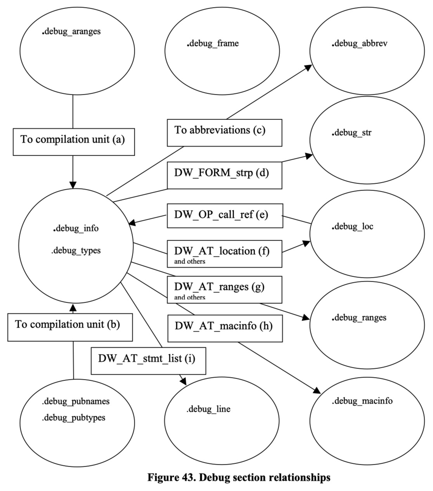

## 后端符号层设计



本节我们来介绍下调试器后端的符号层设计，这里的符号层指的就是利用 DWARF 调试信息建立起来的「指令地址 ↔ 源码概念」转换层：给定一个 PC，能说出它属于哪个函数、对应哪一行源码；给定一个变量名，能找到它在当前 PC 处的地址和类型；给定一个栈帧，能算出它的调用者。第 8 章介绍了 DWARF 调试信息标准、Go 工具链如何生成 DWARF，以及怎么用标准库和 delve 做对照读取，8.9 还提供了一批通过 DWARF 获取变量、类型、行号表信息的示例，大家对 DWARF 是什么、怎么用应该已经有概念了。这一节不再重复格式细节，只回答一个问题：符号层该拆成哪些模块，模块之间怎么分工。

把符号层要回答的问题列出来，大致是这七条：

1. 地址 → 源码位置：`BinaryInfo.PCToLine` 最终落到 `LineTable.LineForPC`；
2. 源码位置 → 地址：`LineToPC`，`break main.go:10`、`list` 之后执行到某一行都要用；
3. 地址 → 函数：`FuncForPC`，把全部 `DW_TAG_subprogram` 按入口地址排序后二分；
4. 名字/描述 → 地址：`main.main`、`main.go:10`、`*0x401000`、`+2`、`/^runtime\./` 这些输入先由 `pkg/locspec` 解析，再由 `Target.FindLocation` 落成地址；
5. 变量名 → 地址/类型/值：DIE → `DW_AT_location` → 位置表达式求值 → 按类型读内存；
6. 地址 → 栈帧 → 返回地址：`.debug_frame` 的 CFA 规则加上 Go 调用约定；
7. Go 运行时结构的字段布局：`runtime.firstmoduledata`、`runtime.g` 的字段偏移同样从 DWARF 读，不硬编码。

这七件事有一个共同点：DWARF 只给出静态描述，真正的地址和值要结合运行时状态（寄存器、内存）才能算出来。所以符号层天然分成两半——一半把 section 字节解析成结构化数据，与进程无关；另一半拿着寄存器值和内存读取器去解释这些结构，必须依附于一个正在调试的进程。

godbgv2 按这个分界拆成三个包：`pkg/dwarf`、`pkg/proc`、`pkg/locspec`。`pkg/dwarf` 只吃 section 字节，产出 `LineTable`/`FrameTable`/`Loclist`/`Type`，并提供 `DW_OP` 栈机；`pkg/proc` 在其上建立面向调试会话的符号视图（`Function`/`Variable`），负责 ELF 加载、结果缓存、寄存器与内存上下文；`pkg/locspec` 只解析位置描述字符串，不碰 DWARF。

> 这里要交代清楚复用与自研的边界：DIE 流与属性原始值的解码复用标准库 `debug/dwarf`，ELF 节读取复用 `debug/elf`；类型模型、位置表达式、行号表、调用栈帧、位置列表这些语义层是自研的。这条边界写在 `pkg/dwarf/doc.go` 里，也是 `docs/CLEANROOM.md` 的约定——设计上参考 delve 的做法，代码里不含 delve 的派生实现。

调试信息标准本身还在演进：Go 1.25 起工具链默认生成 DWARFv5，DWARFv6 的草案也已经成形。本书仍以 Go 1.24 + DWARFv4 为口径，因为 v4 的格式最稳定，也最贴近 Go 编译器实际产出的形态；v5 只做了行号表上的延伸（`pkg/dwarf/line.go` 的 `parseV5Tables` 能解析 v5 的目录表与文件表），其余部分遇到 v5 才有的形式会返回明确错误，而不是悄悄算错。

> Go 1.25 release note：The compiler and linker in Go 1.25 now generate debug information using DWARF version 5; the newer DWARF version reduces the space required for debugging information in Go binaries.

### DWARFv4 sections

DWARFv4 在 ELF 中对应的 debug sections 是符号层的数据地图。为方便本章设计符号层时对照，这里再列一次；更完整的 section 引用关系见 8.5.7。

| Section         | Description                                                           |
| --------------- | --------------------------------------------------------------------- |
| .debug_abbrev   | 存储.debug_info中使用的缩写信息                                       |
| .debug_aranges | 存储一个加速访问的查询表，通过内存地址查询对应编译单元信息            |
| .debug_frame    | 存储调用栈帧信息                                                      |
| .debug_info     | 存储核心DWARF数据，包含了描述变量、代码等的DIEs                       |
| .debug_line     | 存储行号表程序 (程序指令由行号表状态机执行，执行后构建出完整的行号表) |
| .debug_loc      | 存储location描述信息                                                  |
| .debug_macinfo  | 存储宏相关描述信息                                                    |
| .debug_pubnames | 存储一个加速访问的查询表，通过名称查询全局对象和函数                  |
| .debug_pubtypes | 存储一个加速访问的查询表，通过名称查询全局类型                        |
| .debug_ranges   | 存储DIEs中引用的address ranges                                        |
| .debug_str      | 存储.debug_info中引用的字符串表，也是通过偏移量来引用                 |
| .debug_types    | 存储描述数据类型相关的DIEs                                            |

这些 debug sections 之间的引用关系如下图所示（详情 see：DWARFv4 Appendix B）。



godbgv2 真正会去读的节只有六个：`.debug_info`（DIE 树，函数、变量、类型都在里面，经标准库解码）、`.debug_line`（行号表）、`.debug_frame`（CFI）、`.debug_loc`（位置列表）、`.debug_ranges`（编译单元的地址区间）、`.debug_str`（被 `.debug_info` 间接引用，标准库透明处理）。

其余几个要么 Go 链接器根本不生成，要么本书用不到：`.debug_aranges` 的解析器是写了的（`pkg/dwarf/section.go` 的 `ParseAranges`），但 Go 链接器不产出该节，只能算备着的能力；`.debug_pubnames`/`.debug_pubtypes`/`.debug_macinfo`/`.debug_types` 都没有实现。节被压缩时（`SHF_COMPRESSED` 标志或 `.zdebug_*` 命名），`BinaryInfo.LineTable` 会先调 `DecompressSection` 解压再解析，这两种压缩格式的差异见 8.5.6。

想直接看这些节里到底有什么，可以用 aarzilli 的 [aarzilli/diexplorer](https://github.com/aarzilli/diexplorer) 或我写的 [hitzhangjie/dwarfviewer](https://github.com/hitzhangjie/dwarfviewer) 浏览，比对着本节后面的解析代码看，理解会快很多。

### DWARFv4读写查询

先给出模块全貌，再挑几条关键链路走读。三个包的分工就是上一节说的那条分界线：`pkg/dwarf` 是纯函数式的解析器（输入节字节、输出结构体），`pkg/proc` 是带状态的符号视图（缓存 + 进程上下文），`pkg/locspec` 是纯字符串解析。

#### pkg/dwarf：把 section 字节解析成结构化数据

这个包不依赖 ELF、不依赖进程，输入是节字节和地址宽度。11 个文件的分工如下：

| 文件         | 职责                                                          | 主要导出                                                                                                                       |
| ------------ | ------------------------------------------------------------- | ------------------------------------------------------------------------------------------------------------------------------ |
| `doc.go`     | 包说明与标准出处（v4 §2.5/§2.6/§6.2/§6.4/§7.3/§7.2x）          | —                                                                                                                              |
| `reader.go`  | DIE 树遍历：编译单元、函数、变量、类型、内联子程序              | `Reader`、`NewReader`、`CompileUnits`、`Subprograms`、`FindFunction`、`FindVariable`、`FindGlobalVariable`、`FindGlobalVariableInPC`、`FindType`、`InlinedSubroutines`、`EntryRange` |
| `section.go` | 加速访问节与节解压                                            | `ParseAranges`、`DecompressSHFCompressed`、`DecompressZDebug`、`DecompressSection`、`RangeEntry`                                |
| `line.go`    | 行号表状态机（含 v5 目录表/文件表）                            | `ParseLine`、`LineTable`、`LineForPC`、`LineToPC`、`Rows`、`LineEntry`                                                          |
| `frame.go`   | CIE/FDE 与 CFA 规则                                           | `ParseFrame`、`FrameTable`、`FDEForPC`、`CFAForPC`、`CfaRule`、`FDE`                                                            |
| `loclist.go` | `.debug_loc` 位置列表（含基址选择项）                          | `ParseLoclist`、`Loclist`、`EntryFor`、`Entries`、`LoclistEntry`                                                                |
| `op.go`      | `DW_OP` 位置表达式栈机                                        | `OpContext{Regs, Mem, CFA, Pieces}`、`Piece`、`Eval`                                                                            |
| `type.go`    | 教学类型模型                                                  | `Type`、`BasicType`、`PointerType`、`StructType`、`StructField`、`ArrayType`、`Reader.TypeFromDIE`、`Reader.TypeOfEntry`         |
| `ranges.go`  | `.debug_ranges` 地址区间                                      | `ParseRangesAt`、`RangesEntry`、`Contains`                                                                                      |
| `leb128.go`  | ULEB128/SLEB128 编解码                                        | `AppendULEB128`、`AppendSLEB128`（解码为包内 `readULEB`/`readSLEB`）                                                            |
| `opcodes.go` | `DW_OP` 名称表，只用于错误信息和调试输出                       | `opcodeName`                                                                                                                    |

`reader.go` 是这一层的入口。它建立在 `debug/dwarf.Data` 之上：`NewReader(d)` 只是把数据存起来，真正的遍历用标准库 `Reader` 的 `Seek`/`Next`/`SkipChildren` 在 DIE 树里走，按 Tag 加 `DW_AT_name` 找 `DW_TAG_subprogram`/`DW_TAG_variable`/类型 DIE。要注意它返回的还是 `*dwarf.Entry`，没有变成 `Function`/`Variable`——从 DIE 到符号视图的翻译在 `pkg/proc` 里做，这样 `pkg/dwarf` 就不需要知道「调试会话」的存在。

行号表是这一层第一个双向结构。`.debug_line` 里放的不是一张现成的表，而是一段小程序：先读行号程序头（目录表、文件表、状态机初值），再逐条执行操作码，每遇到 copy 类操作码就把当前状态机寄存器吐出一行。`line.go` 把这两步实现成 `parseHeader` 和 `run`，状态机寄存器（`address`/`file`/`line`/`column`/`is_stmt`/`end_sequence` 等）都落在 `lineProgram` 上；多个编译单元的行号程序解析完后按地址排序，查询就退化成一次顺序查找：

```go
// LineForPC 返回地址 pc 对应的源码位置（取 <= pc 的最近一行）
func (lt *LineTable) LineForPC(pc uint64) (file string, line int, err error) {
	for i := len(lt.rows) - 1; i >= 0; i-- {
		if lt.rows[i].Address <= pc {
			return lt.rows[i].File, lt.rows[i].Line, nil
		}
	}
	return "", 0, fmt.Errorf("no line entry for pc %#x", pc)
}

// LineToPC 返回文件 file 行号 line 对应的首个地址（ch9.2.20）。
// 文件匹配采用后缀匹配（行号表中的路径可能带编译目录前缀）。
func (lt *LineTable) LineToPC(file string, line int) (uint64, error) {
	for _, row := range lt.rows {
		if row.Line == line && strings.HasSuffix(row.File, file) {
			return row.Address, nil
		}
	}
	return 0, fmt.Errorf("no address for %s:%d", file, line)
}
```

`frame.go` 处理 `.debug_frame`：CIE 给出公共信息（code/data 对齐因子、返回地址寄存器）和初始规则，FDE 给出一个函数的地址范围与逐指令的规则变化。两者都是同一套 `DW_CFA_*` 指令流，所以用一个 `cfiState` 状态机先跑 CIE 的初始指令、再跑 FDE 的指令流，把「地址 → CFA 规则」的变化记成一行行 `cfaRow`，查询时取 `<= pc` 的最近一条。CIE/FDE 的格式细节在 8.5.3 已经讲过，这里只强调一点：**`pkg/dwarf` 算出来的只是「规则」，把规则里的基址寄存器换成实际值才得到 CFA，这一步是 `pkg/proc` 的事**，下面 `cfaForPC` 那段代码就是这两步的衔接处。

`loclist.go` 处理位置列表。同一个变量在函数的不同地址区间里可能落在不同寄存器或栈位上（优化后很常见），编译器于是把它的 `DW_AT_location` 写成 loclistptr，指向 `.debug_loc` 里一串「区间 + 表达式」，`EntryFor(pc)` 按当前 PC 选一条。`ParseLoclist` 还处理了基址选择项（起始地址全 1 的记录）：Go 链接器用这种方式把后续记录中的 8 字节绝对地址压缩成相对基址的偏移。位置数据本身的概念见 8.4.2。

`type.go` 是教学类型模型，`Type` 接口只有两个方法：

```go
// Type 教学用的 DWARF 类型模型（ch8.4.1 起逐步扩展）。
//
// 依据 DWARF v4 §2.5 类型描述：从 DIE 树解析类型，而非复用
// 标准库 dwarf.Type——这是理解 DWARF 类型系统的基础。
type Type interface {
	// String 返回类型的可读表示
	String() string
	// Size 返回类型占用的字节数
	Size() int64
}
```

具体实现有四个：`BasicType`、`PointerType`、`StructType`、`ArrayType`；`DW_TAG_typedef` 不单独建模，直接解析成被引用的类型。解析时要从 DIE 里的 `DW_AT_type` 偏移再 `Seek` 回去取目标 DIE，Go 运行时的类型图存在环（结构体字段的指针最终指回自身），所以 `typeFromDIE` 带了一条路径级的环检测。

`op.go` 是位置表达式的栈机。它把「表达式」和「运行时上下文」分开：表达式是 `DW_AT_location` 里的那串字节，上下文是这个结构体：

```go
type OpContext struct {
	Regs   map[uint64]uint64                 // DWARF 寄存器编号 → 值
	Mem    func(addr uint64) ([]byte, error) // 目标进程内存读取
	CFA    uint64                            // 当前栈帧的 CFA（DW_OP_call_frame_cfa）
	Pieces []Piece                           // 复合位置的片段（DW_OP_piece）
}
```

`Eval(expr []byte) (uint64, error)` 在其中执行表达式并返回栈顶结果；`DW_OP_piece` 这类描述复合位置的操作码不产生单值，而是把片段记进 `Pieces`。教学版支持的指令集在 `op.go` 开头的注释里列全了：字面量、`DW_OP_reg*`/`breg*`/`regx`/`bregx`、`fbreg`、`call_frame_cfa`、`addr`、`deref`、算术/逻辑/比较、`stack_value`；其余操作码返回 `unsupported DW_OP 0x..` 的明确错误，`opcodes.go` 的 `opcodeName` 就是为这条错误信息准备的名字表。

剩下三个文件是配角但缺不得：`leb128.go` 是 DWARF 所有变长整数的底座（属性值、行号程序操作数、CFI 操作数都在用），`ranges.go` 给编译单元的覆盖判定提供地址区间（`DW_AT_ranges` 指向 `.debug_ranges`），`section.go` 除了前面提到的解压，还负责 `.debug_aranges`。

#### pkg/proc：符号视图、缓存与运行时上下文

`pkg/proc` 是符号层面向调试会话的那一半。它把 `pkg/dwarf` 的结构翻译成「函数、变量、栈帧、goroutine」这些调试器概念，并负责把寄存器、内存、CFA 这些运行时状态喂给解析层。

| 文件            | 职责                                                                  | 主要 API                                                                                                     |
| --------------- | --------------------------------------------------------------------- | ------------------------------------------------------------------------------------------------------------ |
| `bininfo.go`    | 打开 ELF、确定静态基址、暴露 DWARF 数据，并缓存行号表/帧表/函数表      | `BinaryInfo`、`NewBinaryInfo`、`DWARF`、`LineTable`、`FrameTable`、`Section`、`StaticBase`、`VaddrToOffset`    |
| `funcs.go`      | 函数表：全部 subprogram → `Function`，并补上声明位置                  | `Function`、`Functions`、`FuncForPC`、`FindFunction`、`PCToLine`                                              |
| `variables.go`  | 变量定位与取值：DIE → 类型 + 位置 → 地址 → 读内存渲染                 | `EvalVariable`、`EvalVariableAddr`、`cfaForPC`、`dwarfRegisters`、`fillVariableValue`                          |
| `eval.go`       | Go 表达式子集求值（Pratt 解析 + 解释执行），条件断点复用               | `Eval`、`Value`、`EvalLookup`、`MemReader`、`EvalCondition`                                                   |
| `location.go`   | locspec → 地址；按位置下断点                                          | `Target.FindLocation`、`CreateBreakpointByLoc`                                                                |
| `moduledata.go` | 解析 `runtime.firstmoduledata`：`text`/`etext`/`types`/`etypes`        | `ModuleData`、`Target.ModuleData`                                                                             |
| `backtrace.go`  | 按 CFI 逐帧回溯，`bt` 与 `stepout` 的基础                              | `Frame`、`Backtrace`、`ReturnAddress`、`effectivePC`                                                          |
| `goroutines.go` | 从 `runtime.allgs` 枚举 goroutine，字段偏移全部来自 DWARF              | `Goroutine`、`Goroutines`、`CurrentGoroutine`、`SelectGoroutine`、`goroutineLayout`、`Registers`               |
| `target.go`     | 符号层门面：`Target{dbp, bi}`，把符号视图暴露给 service 层             | `Target`、`NewTarget`、`ListFunctions`、`FindFunction`、`FuncForPC`                                            |
| `types.go`      | `Variable` 结构（名称/类型/地址/值/渲染串）                            | `Variable`、`BinaryInfo.FindVariable`、`BinaryInfo.FindType`                                                  |
| `source.go`     | 行号表反向查询与源码行读取                                            | `LineToPC`、`SourceLines`、`LineTable`                                                                        |

`bininfo.go` 是整个符号层的事实入口，也是最该讲清的一段：它把「打开一次 ELF」和「解析一次 DWARF」的成本摊到整个调试会话上。

```go
// BinaryInfo 二进制文件的符号信息（ch7.2 起逐步扩展）
type BinaryInfo struct {
	Path string // 二进制文件路径

	f *elf.File // ELF 文件

	staticBase uint64 // 静态基址（ET_EXEC 为 0，ET_DYN 为假定基址）

	// frameOnce/frameTable 缓存 .debug_frame 的解析结果
	// （ch9.2.33 变量求值、ch9.2.34 栈回溯每帧都需要 CFA 规则）
	frameOnce  sync.Once
	frameTable *godbgdwarf.FrameTable
	frameErr   error

	// funcsOnce/funcs 缓存全部函数（DWARF DW_TAG_subprogram，
	// 按入口地址升序；FuncForPC 每次回溯都需要查询）
	funcsOnce sync.Once
	funcs     []Function
	funcsErr  error

	// lineOnce/lineTable 缓存 .debug_line 的解析结果
	// （PCToLine/LineToPC 都需要行号表）
	lineOnce  sync.Once
	lineTable *godbgdwarf.LineTable
	lineErr   error
}
```

三组 `sync.Once` 分别守住帧表、函数表、行号表：`FuncForPC` 每回溯一帧都要查函数，`LineForPC` 每停一次都要查行号，如果每次都重新解析 `.debug_info`，调试会话会慢到没法用。函数表缓存时顺手按入口地址排序，`FuncForPC` 就可以二分；排序后还要处理「同名函数存在多个 DIE」和「函数间填充区不属于任何函数」这两个细节，所以命中后不是直接返回，而是从二分位置往前逐个核对 `[Entry, End)` 区间。另外 `NewBinaryInfo` 会按 ELF 类型确定基址（`ET_EXEC` 为 0，`ET_DYN` 先给一个假定的静态基址），PIE 程序真正的加载基址由第 7 章的 auxv 流程确定。

`target.go` 则是把两半拼起来的地方：`Target{dbp *target.DebuggedProcess, bi *BinaryInfo}`，`NewTarget` 从 `/proc/<pid>/exe` 找到二进制再建 `BinaryInfo`。目标层的执行控制、断点、线程这些内容属于 9.1.5，这里只用到它的「读寄存器/读内存」两项能力。

`eval.go` 是 `print` 与条件断点的公共地板：`Eval(expr, lookup, mem)` 先用 Pratt 解析器把表达式变成 AST，再在调用方注入的 `EvalLookup`/`MemReader` 回调上解释执行——标识符怎么变成值、内存怎么读都不写死，所以同一套求值器既能服务 `print x.y[2]`，也能服务断点条件 `i == 10`（`EvalCondition` 只多做一步「结果必须是布尔类型」的检查）。

`variables.go` 里有一段代码最能说明分层的价值，就是前面提到的 `cfaForPC`——上半段是 `pkg/dwarf` 的规则查询，下半段是 `pkg/proc` 的寄存器代入：

```go
// cfaForPC 计算地址 pc 处的 CFA（ch8.5.3 的 .debug_frame 解析）。
// CfaRule 给出基准寄存器与偏移（或表达式形式），代入当前线程的
// 寄存器值即得运行时 CFA。
func (t *Target) cfaForPC(pc uint64, regs *syscall.PtraceRegs) (uint64, error) {
	ft, err := t.bi.FrameTable()
	if err != nil {
		return 0, err
	}
	rule, err := ft.CFAForPC(pc)
	if err != nil {
		return 0, err
	}

	dregs := dwarfRegisters(regs)
	if rule.IsExpr {
		ctx := &godbgdwarf.OpContext{Regs: dregs, Mem: t.readTargetMemory}
		return ctx.Eval(rule.Expr)
	}
	base, ok := dregs[rule.Reg]
	if !ok {
		return 0, fmt.Errorf("CFA base register %d unavailable", rule.Reg)
	}
	return base + uint64(rule.Offset), nil
}
```

其中 `dwarfRegisters(regs *syscall.PtraceRegs) map[uint64]uint64` 就是「DWARF 寄存器编号 → 值」的映射：x86_64 约定 `rax=0`、`rdx=1`、`rcx=2`、`rbx=3`、`rsi=4`、`rdi=5`、`rbp=6`、`rsp=7`、`r8`-`r15` 为 8-15、`rip=16`。delve 为这件事单独维护了一个寄存器编号包，godbgv2 只用一个函数就够了——因为本书只支持 linux/amd64，寄存器集合是固定的。

`moduledata.go` 和 `goroutines.go` 展示了符号层的另一种用法：不查调试信息里的函数和变量，而是查 Go 运行时自己的数据结构。`ModuleData()` 先找到全局变量 `runtime.firstmoduledata`、求值它的 `DW_AT_location` 拿到地址，再从 `runtime.moduledata` 的类型定义里按名字取出 `text`/`etext`/`types`/`etypes` 的字段偏移，最后按偏移读内存；`goroutineLayout()` 走同一条路——`runtime.allgs` 是切片，其元素在 DWARF 里包了两层指针，剥掉两层得到 `runtime.g`，再按字段名取 `goid`/`atomicstatus`/`startpc`/`sched` 以及 `gobuf` 里 `sp`/`pc`/`bp` 的偏移，`allGoroutines` 再按这些偏移把每个 `g` 读出来。这样写的好处很直接：Go 版本升级、字段重排、结构体布局变化都不需要改代码，更不需要维护一张「各版本字段偏移表」。

#### 栈回溯：CFI 规则的消费方

`.debug_frame` 有两个消费方，一个是变量求值里的 `DW_OP_call_frame_cfa`，另一个是 `bt`。Go 的调用约定没有帧指针，回溯只能靠两件事：CFA 规则，以及「返回地址固定压在 `CFA-8`」这个约定。`Backtrace` 的循环因此很短：

```go
	pc := regs.PC()
	rsp := regs.Rsp

	frames := []*Frame{}
	for i := 0; i < maxDepth; i++ {
		fn, err := t.bi.FuncForPC(pc)
		if err != nil {
			break
		}

		// CFI 查询用 effectivePC（断点命中时按断点地址查询，
		// 见 effectivePC，ch9.2.39 排查结论）；帧显示保留真实 pc
		cfa, err := t.cfaForPCRSP(t.effectivePC(pc), rsp)
		if err != nil {
			break
		}
		frames = append(frames, &Frame{PC: pc, Fn: fn, CFA: cfa})

		// 调用者的返回地址保存在 CFA-8（go 调用约定）
		ra, err := t.readUint(cfa - 8)
		if err != nil || ra == 0 {
			break
		}
		pc, rsp = ra, cfa
	}
```

这段代码里有两个容易踩的坑，注释里都写了：一是断点命中时线程停在 `int3` 上、断点处的指令还没执行，寄存器状态对应的是「断点地址」，而 CFI 里的行是按指令执行后的状态描述的，所以查 CFI 要用 `effectivePC` 把 `pc` 修正成 `pc-1`，否则 CFA 会偏 8 字节、把主调帧栈顶的数据误当成返回地址；二是回溯上一帧时只有 `rsp` 可信，其他寄存器值未知，`cfaForPCRSP` 只填 `Rsp` 去算 CFA——这依赖 Go 函数 CFA 一律为 rsp 相对，换成 C 程序（帧指针、任意基准寄存器）就不成立了。循环的终止条件也压在这个约定上：返回地址为 0（栈底 `runtime.goexit` 的哨兵）、`pc` 不在任何函数范围内，或达到 `maxDepth`。

#### pkg/locspec：位置描述解析

`pkg/locspec` 是三个包里唯一没有 DWARF 依赖的，输入一行字符串，输出 `LocSpec{Raw, FuncName, File, Line, Addr, Offset, Pattern}`。支持五种形式：函数名（`main.main`、`loop.(*T).Run`）、`file:line`、`*addr` 绝对地址、`+N`/`-N` 相对当前行、`/regexp/` 匹配函数名。解析本身没什么难度，难点在于它把「用户想停在哪」和「调试器怎么找到那个地方」这两件事解耦了：`Parse` 只判断语法，真正的地址换算交给 `Target.FindLocation`——函数名走 `FindFunction`，`file:line` 走 `LineToPC`，正则遍历函数表，`+N`/`-N` 则先用当前 PC 反查行号再跳行。位置描述的语法与用法在 9.2.19 展开。

#### 一条完整链路：从变量名到内存里的值

把上面的模块串起来，`print v` 的完整路径是：

1. `EvalVariable(name)` → `EvalVariableAddr(name)`，拿到寄存器上下文（选中的 goroutine 若处于挂起态，寄存器由其 `g.sched` 合成），并用 `effectivePC` 把断点命中时的 `pc` 修正为 `pc-1`；
2. `FuncForPC(pc)` 定位函数，再 `FindVariable(fn.Name, name)` 查局部变量；查不到就转全局变量：带包前缀的（`runtime.allgs`）用 `FindGlobalVariable`，不带前缀的用 `FindGlobalVariableInPC` 限定到当前 PC 所属编译单元；
3. `TypeOfEntry` 解析类型，得到 `Type`；
4. 读 `DW_AT_location`：`[]byte` 是 exprloc（内联表达式），`int64` 是 loclistptr（先 `ParseLoclist` 解析 `.debug_loc`，再 `EntryFor(pc)` 选一条）；
5. `cfaForPC` 算出当前帧 CFA；Go 函数的 `DW_AT_frame_base` 通常是 `DW_OP_call_frame_cfa`，求值后填进 `Regs[0x7fffffff]` 这个哑槽位，供 `DW_OP_fbreg` 使用；
6. `OpContext{Regs, Mem, CFA}.Eval(expr)` 得到变量地址；
7. `fillVariableValue` 按类型读内存并渲染：`BasicType` 按 `Encoding` 决定是否有符号，结构体按 `DW_AT_data_member_location` 偏移递归，Go 的 `string` 与切片在 DWARF 里就是结构体，按各自的头布局单独处理。

这条链路上每一步的输入都来自上一步，任何一环返回错误，`print` 就给出明确原因——这些错误信息（`variable %q not found`、`no location at pc`、`unsupported DW_OP`）本身就是调试器对外的诊断能力。

> 本节早期版本是照着 delve 的包划分来讲的，还配了 7 张 delve 的类图（DWARF 生成、CFI、行号表、位置列表、类型、位置表达式、DIE 读取各一张）。那些图描述的是 delve 的分层，不是 godbgv2 的代码结构，正文不再引用，读者以上面的模块表为准即可。godbgv2 的前身 tinydbg 是从 delve 裁剪出来的符号级调试器，这一节如今全部换成自研实现的模块，也正是为了不再让读者把 delve 的结构误当成我们的结构。

#### 教学子集与能力边界

符号层的实现是「够用」而非「完整」的，边界必须写清楚，否则读者会以为没写到的部分只是没来得及写：

- **类型模型**：只有 `BasicType`/`PointerType`/`StructType`/`ArrayType` 四个具体类型，`typedef` 解析后不保留别名。`union`/`enum`/`map`/`chan`/`func`/`interface`/位域都没有建模，遇到会返回 `unsupported type tag`。Go 的 `string`、切片、`map` 在 DWARF 里其实是结构体，所以前两者能靠结构体模型「蹭」出来，`map`/`chan`/`interface` 就只能报不支持。
- **`DW_OP` 栈机**：只实现前面 `op.go` 注释里列的那些指令，且寄存器形式的位置（表达式只有 `DW_OP_reg*`）目前只记进 `Pieces`、不产生地址，`Eval` 会返回「表达式无结果」——完整形态的寄存器变量取值要等 `SetVariable`/表达式这条链路继续完善。
- **位置列表**：只支持 v4 的 `.debug_loc`（含基址选择项），DWARFv5 的 `.debug_loclists` 没有实现。
- **CFI**：只记录 CFA 规则，各寄存器的恢复规则（`DW_CFA_offset` 的操作数）读出来即丢弃，`DW_CFA_remember_state`/`restore_state` 也没落地。所以回溯依赖 Go 的调用约定兜底——CFA 都是 rsp 相对、返回地址在 `CFA-8`，这也是 `Backtrace` 里那个循环能跑起来的前提。
- **行号表**：v4 全量 + v5 目录表/文件表；`emitRow` 只输出 `is_stmt` 为真的行，非语句行会被丢弃，因此个别地址可能查不到行号。
- **DWARF 生成**：不做。delve 有一个专门的包用来生成 DWARF、支持把运行中的进程 dump 成 core 文件，godbgv2 没有这个需求（能力矩阵里 `dump` 一项标的是不做）。
- **其他**：分离 DWARF（`.gnu_debuglink`/`.dwp`）与 debuginfod 没做，`.debug_types`、DWARFv5 的分节字符串（`.debug_str_offsets` 等）没有，`.eh_frame` 也不读；平台只支持 linux/amd64 + ELF + Go，架构上留了扩展点，但实现是一份单平台实现。

这些裁剪项与理由，第 8 章的 8.7、8.8 已经从「标准库能做什么、delve 为什么自研」的角度论证过，godbgv2 仓库的 `docs/FEATURE-MATRIX.md` 第 7 节「符号与 DWARF」则逐项给了对照表和代码位置，两边可以对照着读。

### 本节小结

本节介绍了符号层的职责边界：地址与源码位置、函数、变量、类型、行号表、CFI、位置表达式，以及把它们串起来的那条「DIE → 位置描述 → 寄存器/内存 → 值」的链路；也介绍了 godbgv2 按「解析」与「解释」划出的三个包——`pkg/dwarf` 负责把 section 字节变成结构化数据，`pkg/proc` 负责缓存、进程上下文和符号视图，`pkg/locspec` 负责位置描述。`BinaryInfo` 是这一层的入口与缓存，`Target` 则把它和目标层拼在一起交给 service 层。

和 delve 相比，godbgv2 的实现是教学子集：类型模型、`DW_OP`、CFI、位置列表都只覆盖本书用得到的那一部分，其余能力要么明确报错，要么直接把裁剪理由写进能力矩阵。这样做的好处是每个模块都可以在几千行内读懂、跑通、改得动，读者不至于一上来就淹没在完备实现的细节里。第 9.1.5 节接着讲符号层依赖的另一半——目标层，以及 `Target` 是如何把两者组合起来的。
