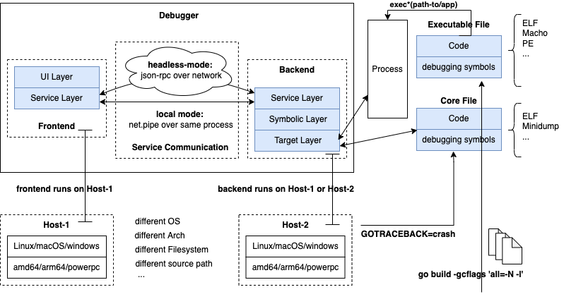
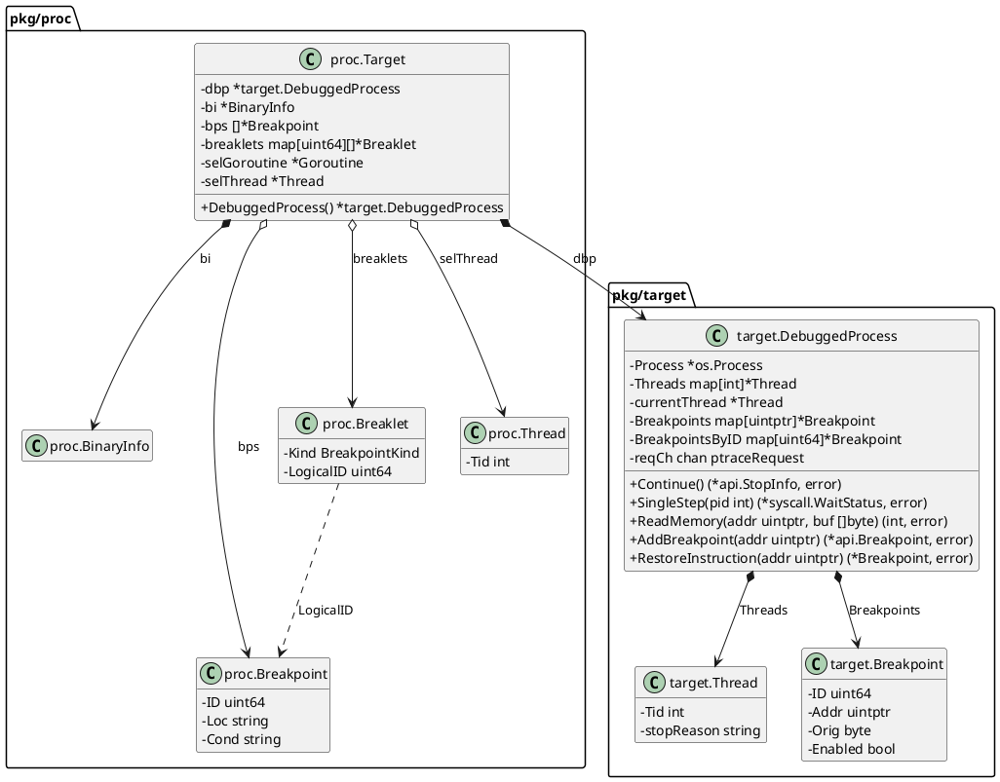

## 后端目标层设计



后端目标层（target layer）在四层架构最底部，直接与被调试进程（tracee）打交道：把"让进程跑起来/停下来""读一段内存""改一个寄存器""在某地址打一个 `int3`"落实为系统调用，其余一概不管。`godbgv2` 把这一层放在 `pkg/target`，`pkg/target/doc.go` 把定位写成 native 后端（linux/amd64 的 ptrace 后端）：它是当前唯一实现，不是某套可插拔后端里的一个。符号级调试目标 `proc.Target` 把 `*target.DebuggedProcess` 与符号层 `*BinaryInfo` 组合起来（9.1.4），前端只经 `pkg/service/api` 契约访问后端。

> ps：本书早期稿件曾以 tinydbg 为示例，自本节起统一以 godbgv2 为准。

### 1. 执行控制

执行控制方法都挂在 `*target.DebuggedProcess` 上：`NewDebuggedProcess`/`AttachTargetProcess`、`Continue`、`SingleStep`、`Detach`/`Kill`，以及断点与监视点的增删。它的字段就是这一层的全部状态：

```go
// pkg/target/process.go:17-33（节选）
type DebuggedProcess struct {
	Process *os.Process // 进程信息
	Kind    Kind        // 发起调试的类型

	Threads       map[int]*Thread // 已跟踪的线程列表，k=tid
	currentThread *Thread         // 最近一次停止的线程

	Breakpoints     map[uintptr]*Breakpoint // k=addr
	BreakpointsByID map[uint64]*Breakpoint  // k=id

	once   *sync.Once
	reqCh  chan ptraceRequest
	doneCh chan int
}
```

`once`/`reqCh`/`doneCh` 就是 ptrace 引擎：`ExecPtrace` 首次调用时起一个 `runtime.LockOSThread` 协程，此后所有 ptrace 请求经 `reqCh` 串行投递给这个固定线程。原因见 `ptrace_linux.go:26-31`：ptrace 要求 tracer 与 tracee 绑定，而 goroutine 与 OS 线程没有绑定关系，请求分散会拿到 `EPERM`。

**启动与接入。** `NewDebuggedProcess` 用 `exec.Cmd` + `SysProcAttr{Ptrace: true}`（等价于 `PTRACE_TRACEME`）拉起目标并等待 exec 的 `SIGTRAP`，再设置 `PTRACE_O_TRACECLONE|TRACEFORK|TRACEVFORK|TRACEEXEC` 跟踪新线程、新进程与 exec 事件；环境里追加 `GODEBUG=asyncpreemptoff=1`，避免异步抢占信号干扰单步。`AttachTargetProcess` 走 `PTRACE_ATTACH` 并循环等待真正的 `SIGSTOP`（首次 `wait` 可能先收到 post-exec `SIGTRAP`，用 `PTRACE_CONT(signal=0)` 丢弃），随后读 `/proc/<pid>/comm`、`cmdline` 填充 `Command`/`Args`，再按 `/proc/<pid>/task/*` 逐个 attach 其余线程。

**all-stop。** `Continue` 不是"恢复一个线程"，而是恢复 `p.Threads` 里的全部线程（`PtraceCont(tid, 0)`，容忍 `ESRCH`），再用 `waitAny` 等任意一个停下。等待循环先滤掉三类"不算停止"的事件：`PTRACE_EVENT_CLONE`（读新 tid、入线程表、恢复克隆者）、`PTRACE_EVENT_EXEC`（放行）、调试器自己投递的信号（经 `PTRACE_GETSIGINFO` 读 `si_pid`/`si_code` 判别）。真正的停止事件出现后，`suspendOtherThreads(wpid)` 挂起其余线程，才返回 `*api.StopInfo`。

**线程挂起。** 挂起不用 `PTRACE_SINGLESTEP`，而是向每个线程投递 `SIGSTOP`：

```go
// pkg/target/suspend.go:24-26（节选）
if err := syscall.Tgkill(p.Process.Pid, tid, syscall.SIGSTOP); err != nil && err != syscall.ESRCH {
	return fmt.Errorf("tgkill thread %d err: %v", tid, err)
}
```

两个坑就在 `suspend.go` 的注释里：阻塞在 futex 里的线程，单步陷阱可能迟迟不触发，会把挂起流程拖住；线程若已停止，组停止不再产生新事件，阻塞 `wait4` 会永久挂起，所以只做非阻塞轮询、消费不到就返回。

**单步。** `SingleStep(pid)` 只有 `PTRACE_SINGLESTEP` + `wait4` 两步，是**指令级**的；源码级 `next`/`step` 需要"下一条语句在哪""要不要跨函数调用"这些符号层知识，不在这里（9.2.28/9.2.29）。

**断点补丁。** 软件断点先把断点地址处的指令首字节读进 `Orig`，再把该字节改成 `0xCC`：

```go
// pkg/target/breakpoint.go:68-80（节选）
orig := [1]byte{}
n, err = syscall.PtracePeekText(pid, addr, orig[:])
if err != nil || n != 1 {
	return fmt.Errorf("peek text, pid: %d, %d bytes, error: %v", pid, n, err)
}
breakpoint = newBreakPoint(addr, orig[0], "-")
p.Breakpoints[addr] = breakpoint
p.BreakpointsByID[breakpoint.ID] = breakpoint
n, err = syscall.PtracePokeText(pid, addr, []byte{0xCC})
```

`Breakpoints` 按地址查重、`BreakpointsByID` 按编号查找。清除断点时顺序很关键：先回退 PC（`regs.SetPC(regs.PC() - 1)` 后 `WriteRegister`），再 `RestoreInstruction`。`int3` 执行后 PC 指向断点地址 +1，不回退就会跳过断点处那条指令；回退必须早于还原——还原会从两张索引摘除断点，之后就找不到"哪些线程停在断点上"了（`ClearBreakpoint` 的注释特意标了这一点）。`Continue` 本身不做 PC 回退，修正发生在下一条执行控制命令的开头。硬件监视点走的是另一条路：调试寄存器 DR0-DR3（经 `PTRACE_PEEKUSER`/`POKEUSER` 访问 `u_debugreg`，x86_64 偏移 848），DR7 定读写类型与长度，DR6 记录命中槽位并在命中后清零，且设置/清除都要遍历全部线程（`hwbreakpoint.go`）。

### 2. 数据访问

- **内存**：`ReadMemory(addr uintptr, buf []byte) (int, error)` / `WriteMemory(addr uintptr, value []byte) error`，缓冲区由调用方分配，本层只返回实际字节数；内部是 `PtracePeekText`/`PtracePokeData`（`memory.go`）。
- **寄存器**：`ReadRegister(pid int) (*syscall.PtraceRegs, error)` / `WriteRegister(pid int, regs *syscall.PtraceRegs) error`，直接透传内核的 `user_regs_struct`；`fs_base` 不在 `PTRACE_GETREGS` 范围，`FSBase` 另走 `PTRACE_PEEKUSER` 偏移 168。
- **线程**：线程表是 `map[int]*Thread`，`addThread` 负责 attach 并等待停止，`updateThreadList` 按 `/proc/<pid>/task/*` 补齐，`CurrentThreadTid` 返回最近停止的线程。`target.Thread` 只有 `Tid`/`Process`/`stopReason`，**不缓存寄存器**，每次读都是实时 ptrace 请求。
- **栈与反汇编**：目标层没有"调用栈"概念，只有内存与寄存器，调用栈由符号层用 `.debug_frame` 的 CFI 逐帧算出（`proc.Backtrace`，9.2.34）；`Disassemble` 读内存后交给 `x86asm` 解码，返回 `api.AsmInstruction{Addr, Bytes, Text}`，是不含符号语义的便利方法。

### 3. 原始数据处理

目标层返回的都是未经解释的二进制或数值：内存是 `[]byte`，寄存器是 `*syscall.PtraceRegs`，断点保存的是原始指令首字节 `Orig byte`。它不知道也不该知道这些字节是变量、指令还是字符串。物理断点只记录 `ID`/`Addr`/`Pos`/`Orig`/`Enabled`；这个地址对应哪个函数、哪一行、属于哪个变量、命中时该不该停，全由符号层回答。反汇编同理：`Bytes` 是原始编码，`Text` 只是助记符。

原始数据的"完整建模"在跨层转换处才暴露：服务层用 `target.RegsFromPtrace`/`RegsToPtrace` 把 `*syscall.PtraceRegs` 与契约类型 `api.Registers` 互转，后者必须把段寄存器、段基址一个不落地写回——`registers_amd64.go:43-47` 说明原因：`PTRACE_SETREGS` 会完整写入 `user_regs_struct`，清零字段会让内核返回 `EIO`。

### 4. 与符号层的协作

两层是**组合**关系：`proc.Target` 持有目标层与符号层实例，在两者之上提供符号级能力。

```go
// pkg/proc/target.go:11-20
type Target struct {
	dbp *target.DebuggedProcess // 目标层（native 后端）
	bi  *BinaryInfo             // 符号层

	bps       []*Breakpoint              // 逻辑断点
	breaklets map[uint64][]*Breaklet     // 物理断点地址→重叠单元

	selGoroutine *Goroutine // 选中的 goroutine（nil 表示未选中）
	selThread    *Thread    // 选中的线程（nil 表示未选中）
}
```

`NewTarget` 只接手 `dbp` 并从 `/proc/<pid>/exe` 解析 `BinaryInfo`；此后两层靠两个访问器打通：`DebuggedProcess()` 让上层下钻执行控制，`BinaryInfo()` 让上层查符号。

这种协作不是"符号层把所有目标层方法包一层"。`debugger.Debugger` 里大量调用直接下钻，例如 `Continue` 就是 `d.t.DebuggedProcess().Continue()`；`StepOut`、`Call` 这类需要符号知识的操作才编排在 `proc` 层（9.2.39/9.2.42）。**分工标准是"这一步需不需要 DWARF 知识"**，而不是"是不是执行控制"。

**逻辑断点与物理断点**是两层协作最重要的接口：

| | `target.Breakpoint`（物理） | `proc.Breakpoint`（逻辑） |
|---|---|---|
| 位置 | `pkg/target/breakpoint.go` | `pkg/proc/breakpoints.go` |
| 内容 | `ID`、`Addr`、`Pos`、`Orig`、`Enabled` | `ID`、`Name`、`Loc`、`Addr`、`File`、`Line`、`Cond`、`Kind`、`HitCount`、`Enabled` |
| 索引 | `map[uintptr]` + `map[uint64]` 双索引 | 编号与 locspec 原文 |
| 生命周期 | 打补丁/还原，越过断点后可反复重建 | 长期保留，直到 `clear` |
| 重叠 | 一个地址只有一个 | 一个地址可挂多个 `Breaklet` |

`CreateBreakpoint` 先在符号层解析 locspec、查重，再调 `dbp.AddBreakpoint` 打补丁；同一地址已有物理断点时，步进类断点只追加一个 `Breaklet`（记录 `Kind` 与归属的 `LogicalID`）复用补丁，用户断点则复用既有逻辑断点（`canOverlap`，9.2.21）。`ToggleBreakpoint` 关闭时还原物理断点、开启时重建，逻辑记录始终保留（9.2.24）。

**线程与选择。** 符号层 `proc.Thread` 只有 `Tid` 与 `dbp`，`Registers()` 是一次实时的 `dbp.ReadRegister(tid)`；它的价值在于承载选择状态。`Target.Registers()` 的优先级是 `selThread`（真实寄存器）→ `selGoroutine`（挂起时用 `g.sched` 合成）→ 当前事件线程（`goroutines.go:300-321`）。

**PC 的事实由目标层给出，解释由符号层负责。** 断点命中时 PC 指向断点地址 +1，两层各处理一次：符号层查 CFI 时用 `effectivePC` 拉回 `PC-1`（`backtrace.go:75-80`），否则栈回溯会错位 8 字节；执行控制前要真正写回 PC，并完成"回退→还原→单步→恢复"四步（`passOverCurrentBreakpoint`，`backtrace.go:148-178`）。**符号层负责"什么时候做、对哪个地址做"，目标层负责"怎么做"**。

### 5. 平台适配

目前的平台适配只有一条路：linux/amd64 的 ptrace。这不是"抽象好了、只实现一种"，而是直接按唯一平台写成的具体实现：

- 文件名即平台声明：`ptrace_linux.go`、`registers_amd64.go`；`archName()` 返回固定的 `"x86_64"`（`DisableASLR` 时拼 `setarch -R`）。
- 数据结构是平台布局：寄存器复用 `syscall.PtraceRegs`（amd64 的 `user_regs_struct`），调试寄存器偏移 848、`fs_base` 偏移 168 都是 x86_64 的 `struct user` 布局。
- `Kind` 不是平台抽象：`DEBUG`/`EXEC`/`ATTACH` 区分"怎么接入目标"，与操作系统、架构无关。
- 平台不支持时给出可读错误：WSL2 内核不支持 `PTRACE_POKEUSER` 写 `u_debugreg`，`SetWatchpoint` 把 `EIO` 翻译成 "hardware watchpoint not supported by kernel"。

把目标层设计成"支持 Linux/Windows/macOS、x86/ARM"的多后端抽象，在本项目里是**设计愿景，不是现状**。要接 gdb/lldb/rr，先得抽一层 backend 接口（至少覆盖进程/线程/寄存器/内存/执行控制/断点/监视点），把 `target.DebuggedProcess` 降为其中一个实现，`proc.Target.dbp` 字段与 `proc.Target.DebuggedProcess()` 的返回类型也要改成接口——这是跨 9.1.4、9.2.x 的重构，godbgv2 没有做。原因有二：只有一种后端时接口只是"一个实现 + 一层间接"，而 `pkg/service/api` 契约已把前端与后端隔开；rr 这类后端要的是记录/重放与反向执行语义，不是换掉 `Continue`/`SingleStep` 就能接上，接口形状得等真实需求出现才定得准。所以更准确的说法是：**目标层是"为单一平台写实、边界清晰的一层"，不是"可插拔后端框架"**；真要扩展，第一步是抽接口，第二步才是接第二种后端。

### 类图设计

目标层没有 `Target`/`Process`/`Registers`/`MemoryReader` 这类接口——`pkg/target` 全是具体类型，`proc.Target` 直接组合 `*target.DebuggedProcess`。按实际类型与字段画组件关系：



读图要点：

1. **组合/聚合**：`proc.Target` 组合 `target.DebuggedProcess` 与 `BinaryInfo`，聚合（`o--`）逻辑断点、`Breaklet` 与选中线程——后三者可为空或替换，生命周期不由 `Target` 决定。
2. **目标层自持状态**：线程表 `Threads` 与物理断点双索引都在 `DebuggedProcess` 上，`Thread`、`Breakpoint` 是它的组成部分。
3. **两层各有一份 `Thread`/`Breakpoint`**：`proc.Thread` 是符号层视图，`proc.Breakpoint` 是逻辑断点，与 `target.*` 不是同一类型，靠 `Tid`、`LogicalID` 关联。
4. **没有接口、没有 backend 抽象**：内存/寄存器能力是 `DebuggedProcess` 的方法，`api.Registers` 只在服务边界出现，`dbp` 是具体类型字段。

### 本节小结

- 目标层 = ptrace 引擎 + 原始数据：`target.DebuggedProcess` 持有 `*os.Process`、固定 tracer 线程、线程表与物理断点表，负责接入、继续、单步、挂起、内存/寄存器读写与断点补丁。
- all-stop 是本层核心语义：`Continue` 恢复全部线程、等任一停止、过滤内部事件，再用 `SIGSTOP` 挂起其余线程；挂起既不能用单步陷阱，也不能阻塞等待。
- 原始数据止步于本层：内存是 `[]byte`、寄存器是 `*syscall.PtraceRegs`、断点只存 `Orig byte`；语义解释一律交给符号层。
- 两层分工的标准是"是否需要 DWARF 知识"：逻辑断点/`Breaklet`/线程选择在符号层，具体执行动作在目标层；`StepOut`、`Call` 这类需要符号信息的编排留在 `proc`。
- 平台适配目前只有 linux/amd64，`Kind` 区分接入方式而非平台；"支持 gdb/lldb/rr"要先抽 backend 接口，godbgv2 尚未做。
